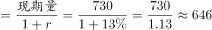
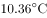
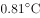
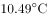
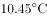
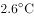
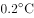
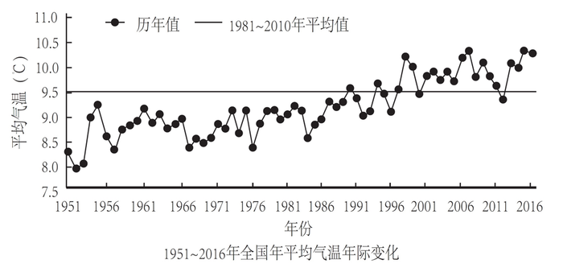

# 基期量计算（已知现期量与同比偏多百分比逆推）

考点：[[20-考点/资料分析/增长/基期量计算（已知现期量与同比偏多百分比逆推）|增长 / 基期量计算（已知现期量与同比偏多百分比逆推）]]
材料：[[15-材料/资料分析/195310 2016年全国气候概况：全国平均气温|195310 2016年全国气候概况：全国平均气温]]

**问法模型**：题干直接问上一期（2015年）的水平量 → 基期计算模型：基期量=现期量÷(1+与该期相比的增长率)，并用选项回代与图表直读双重验证

## 推理链
1. 第1步：题干问'2015年全国平均降水量'，材料现期为2016年（730.0毫米），时间错位判定为基期计算问题
2. 第2步：定位文字第二段：2016年全国平均降水量730.0毫米，'比2015年偏多13%'（原卷数值，现文本空缺，可由正确项反推：646.0×1.13≈729.98≈730.0）；而'较常年629.9毫米偏多'是另一比较基准，不能用于求2015年
3. 第3步：套用基期量公式：2015年降水量=现期量÷(1+偏多百分比)=730.0÷(1+13%)=730.0÷1.13
4. 第4步：截位直除：730.0÷1.13≈646.0毫米（验证：646.0×1.13=729.98≈730.0，等式自洽）
5. 第5步：与选项对照：A项730.0是2016年现期值、C项629.9是常年值（图2水平参考线约630mm）、D项612.6对应约偏多19%且低于图2中2015年柱高，均排除
6. 第6步：图2直读核对：2015年柱约640~650mm且高于常年参考线，与646.0毫米吻合，锁定B

**最快解法**：⚡ 选项代入验证+图2直读：先看图2，2015年柱约640~650mm且高于约630mm的常年参考线，秒排A(730.0为2016年柱)、C(629.9恰为参考线水平)、D(612.6柱高明显更低)；再回代验证646.0×1.13≈729.98≈730.0成立，选B（或直接截位直除730.0÷1.13≈646）

## 易错点
- ⚠ 现期/基期混淆：A项730.0毫米正是材料现期（2016年）数值，题干问2015年，不转换时间直接抄现期数即错选A
- ⚠ 比较基准混淆：C项629.9毫米是'常年值'（1981~2010年平均），'较常年偏多'与'比2015年偏多'是两个不同基准，求2015年只能用后者；勿把图2水平参考线当成某一年数据
- ⚠ 算法方向错+数据空缺：基期逆推应做除法730.0÷1.13，误用乘法730.0×(1−13%)≈635.1即错；原文本'偏多'后百分比空缺，需按选项反推13%或用图2核对（纵轴自400mm非0起点，目测柱差被放大，须对照刻度）

## 母题抽象
> 🧩 当题干出现'基期年份+某总量'且材料给出现期量和'比该年偏多/增长x%'时，用基期量=现期量÷(1+x%)逆推，并以'基期×(1+x%)≈现期'回代、图表直读双重锁定选项

**同类特征**：2015年（基期年份）、全国平均降水量、730.0毫米（现期量）、比2015年偏多、629.9毫米（常年值干扰项）、基期量逆推

## 相关题
（暂无）

---

### 题干
2015年全国平均降水量为：

### 选项
- A. 730.0毫米
- B. 646.0毫米　✅
- C. 629.9毫米
- D. 612.6毫米

### 官方解析

根据题干“2015年全国平均降水量为……”，结合文字材料时间为2016年，可判定本题为基期计算问题。定位文字第二段材料可知：“2016年，全国平均降水量730.0毫米……比2015年偏多。”故2015年全国平均降水量毫米。

故正确答案为B。

### 给定材料

根据以下资料，回答下列小题。

        2016年，全国平均气温，较常年平均气温偏高，为1951年以来第三高，仅次于2015年（）和2007年（）。2016年四季气温均偏高，其中夏季气温为历史最高；除1月偏低、11月接近常年同期外，其余各月均偏高，其中12月偏高，为历史同期最高。全国31个省（区、市）中，仅黑龙江平均气温较常年偏低，其他省（区、市）气温均偏高，其中青海、甘肃、河南和贵州4省均为1951年以来的历史最高。

        2016年，全国年降水量范围为3.5毫米（新疆托克逊）～3494.4毫米（安徽黄山），全国平均降水量730.0毫米，较常年（629.9毫米）偏多，比2015年偏多，为1951年以来最多。2月和8月降水偏少，3月接近常年同期，其余各月均偏多，其中1月偏多，10月偏多，均为历史同期最多。

> [!warning] 疑点（官方解析可能有误，待人工复核）
> 官方答案B无误；但所给文本'比2015年偏多'后的百分比及官方解析算式均显示为空缺，本题计算依赖原卷数值'偏多13%'（由B项反推得646.0×1.13≈730.0，并与图2中2015年柱约640~650mm吻合），属材料转录缺漏而非解析口径错误
