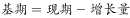
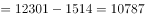

# 基期量计算（现期−增长量还原基期）

考点：[[20-考点/资料分析/增长/基期量计算（现期−增长量还原基期）|增长 / 基期量计算（现期−增长量还原基期）]]
材料：[[15-材料/资料分析/195255 2016年全国文化演艺事业发展情况的|195255 2016年全国文化演艺事业发展情况的]]

**问法模型**：题干问'2015年末……数量是'而材料给出2016年末现期量及'比上年末增加'的增长量 → 用基期=现期−增长量直接相减还原

## 推理链
1. 第1步：题干要求'2015年末'全国艺术表演团体数量，材料统计口径为2016年（年末时点值），故2015年末为基期
2. 第2步：定位材料第二段：2016年末全国共有艺术表演团体12301个，比上年末增加1514个
3. 第3步：增量以'增加1514个'直接给出，无需增速，基期量=现期量−增长量=12301−1514
4. 第4步：计算12301−1514=10787个，与选项对照，A项10787个恰好吻合，故选A

**最快解法**：⚡ 直接减法+尾数法：12301−1514，尾数1减4需借位得7，快速锁定尾数为7的A项10787，排除B（现期值）、C（12301+1514=14237，方向加反）、D（22031，疑与文化部门所属2031个混淆）

## 易错点
- ⚠ 方向搞反：误算成12301+1514=14237而错选C，'比上年末增加'意味着上年=现期−增量
- ⚠ 套错公式：见'基期'就想用现期/(1+增长率)，但本材料增速留空且增长量已直接给出，应直接相减
- ⚠ 时点口径混淆：团体数12301个是'2016年末'时点值而非全年时期值，勿与演出场次、收入等全年数据混杂

## 母题抽象
> 🧩 当题干出现'上年末/上年同期……是多少'且材料以'现期量+比上期增加X'呈现时，直接用现期−增量还原基期，并警惕选项中'现期+增量'的反向陷阱与尾数快速验证

**同类特征**：'2015年末'基期时点提问、材料给出'比上年末增加1514个'、机构数量为年末时点值、纯文字型材料需定位段落、基期量计算、选项含现期值与反向计算干扰项

## 相关题
- [[10-真题/资料分析/增长/12019697 基期量计算（现期累计值−当期新增值）|12019697]]（广东 2026，相关度1）
- [[10-真题/资料分析/增长/2033794 基期量计算|2033794]]（江苏 2016，相关度1）
- [[10-真题/资料分析/增长/2166218 基期量计算（同比下降型）|2166218]]（深圳市考 2018，相关度1）
- [[10-真题/资料分析/增长/2187798 基期量计算（现期÷(1+同比增速)）＋单位换算（亿元→万亿元）|2187798]]（天津 2018，相关度1）
- [[10-真题/资料分析/增长/2188293 基期量计算（已知现期值与同比增速）|2188293]]（江西 2018，相关度1）

---

### 题干
2015年末，全国拥有艺术表演团体的数量是：

### 选项
- A. 10787个　✅
- B. 12301个
- C. 14237个
- D. 22031个

### 官方解析

根据题干“2015年末······的数量是”，结合材料时间是2016年末，可判定本题为基期计算问题。定位材料第二段可得：“2016年末全国艺术表演团体12301个，比上年末增加1514个”。故2015年末全国拥有艺术表演团体的数量是：个。

故正确答案为A。

### 给定材料

<b>根据以下资料，回答下列小题。</b>

        2016年，全年原创首演剧目1423个，扶持了100名京剧、地方戏表演艺术家向200名青年演员传授经典折子戏。第十一届中国艺术节共汇聚67台参评参演剧目和1000余件美术作品，观众达40万人次。国家艺术基金2016年共有966个项目获得立项资助，较2015年增长了，资助资金总额7.3亿元。

        2016年末全国共有艺术表演团体12301个，比上年末增加1514个，从业人员33.27万人，增加3.08万人。其中各级文化部门所属的艺术表演团体2031个，占；从业人员11.52万人，占。

        全年全国艺术表演团体共演出230.60万场，比上年增长，其中赴农村演出151.60万场，增长；国内观众11.81亿人次，增长，其中农村观众6.21亿人次，比上年增长；总收入311.23亿元，比上年增长，其中演出收入130.86亿元，增长。

        全年全国各级文化部门所属艺术表演团体共组织政府采购公益演出13.90万场，观众1.17亿人次。利用流动舞台车演出11.31万场次，观众10381万人次。中央直属院团全年开展公益性演出1335场，其中赴老少边穷地区演出241场，面向老红军、留守儿童等演出132场。

        年末全国共有艺术表演场馆2285个，观众坐席数168.93万个。全年馆内艺术演出19.09万场次，增长；艺术演出观众3098万人次，增长。其中各级文化部门所属艺术表演场馆1265个，全年共举行艺术演出6.81万场次，增长，艺术演出观众2589万人次，增长。

        年末全国国有美术馆462个，比上年末增加44个，从业人员4597人，增加502人。全国共举办展览6146次，比上年增长，参观人次3237万，增长。

