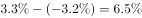

# 增速的百分点变化（负转正求增速差）

考点：[[20-考点/资料分析/增长/增速的百分点变化（负转正求增速差）|增长 / 增速的百分点变化（负转正求增速差）]]
材料：[[15-材料/资料分析/195085 某省2017年第一季度农林牧渔业总产|195085 某省2017年第一季度农林牧渔业总产]]

**问法模型**：题干以'生猪出栏增速比上年同期加快多少'设问→用增速差模型：加快幅度=2017年一季度增速−2016年一季度增速，由下降转为增长（负转正）时等于|上年降幅|+今年增幅，单位为个百分点

## 推理链
1. 第1步：定位材料第四段畜牧业部分，提取条件：生猪'出栏增速由上年同期的下降转为增长'，即2016年一季度出栏增速为负值、2017年一季度出栏增速为正值（两期具体百分数在本版本材料中以图片呈现、未能显示）
2. 第2步：所用规则：增速比上年同期加快的百分点数=2017年增速−2016年增速；上年增速为负时，等于|上年降幅|+今年增幅，即两数绝对值相加而非相减
3. 第3步：代入计算：设2017年出栏增速为+a%、2016年出栏增速为−b%，则加快幅度=(a+b)个百分点；本版本具体数值缺失、不得凭空补数，按官方解析将原值代入相加即得结果
4. 第4步：与选项对照：四个选项均为'加快××个百分点'的同构形式，按官方解析计算出的加快幅度对应C项，故正确答案为C

**最快解法**：⚡ 公式法+符号速判：见到'由下降转为增长'立即反应'加快幅度=|上年降幅|+今年增幅'（必大于今年增幅本身），将第四段给出的两个百分数直接相加，对照选项即选C；若误把上年降幅当正数相减（a−b）会落入错误选项

## 易错点
- ⚠ 负转正符号坑：'下降转为增长'意味着上年增速为负，加快幅度=|上年降幅|+今年增幅，若把上年增速当正数直接相减会算小、选到错误选项，干扰项正是按此设置
- ⚠ 指标口径坑：材料中'存栏'与'出栏'是两个不同指标（存栏=期末在栏头数，出栏=期间屠宰上市数），本题问的是'出栏'增速，勿误用存栏的负转正数据
- ⚠ 单位与版本坑：所求为增速之差，单位是'个百分点'而非'%'；本版本材料中增速百分数均为图片缺失状态，切勿凭印象补数，应依托'负转正幅度=两绝对值之和'的模型对照选项结构作答

## 母题抽象
> 🧩 当题干出现'某指标增速由上年同期的下降转为增长'并问'比上年同期加快多少个百分点'时，用增速差公式：加快幅度=今年增速−上年增速=|上年降幅|+今年增幅，同时核对问的是'出栏'还是'存栏'等相近指标

**同类特征**：生猪出栏增速、由上年同期的下降转为增长、比上年同期加快、个百分点、负转正求增速差、畜牧业第四段定位

## 相关题
- [[10-真题/资料分析/增长/10718183 名义增速与实际增速之差（百分点计算）|10718183]]（深圳市考 2024，相关度1）
- [[10-真题/资料分析/比重/16070258 现期比重差值（两个部分占比相减）|16070258]]（重庆 2026，相关度1）
- [[10-真题/资料分析/比重/1752600 两期比重变化（比重差，百分点表述）|1752600]]（北京 2016，相关度1）
- [[10-真题/资料分析/比重/1789664 比重差值计算（百分点搭桥）|1789664]]（江苏 2016，相关度1）
- [[10-真题/资料分析/比重/2042846 两期比重差（比重差值计算）|2042846]]（江苏 2017，相关度1）

---

### 题干
2017年第一季度，该省生猪出栏增速比上年同期：

### 选项
- A. 
加快

- B. 
加快

- C. 
加快
　✅
- D. 
加快

### 官方解析

定位材料第四段：“出栏增速由上年同期的下降转为增长”，可得，2017年第一季度该省生猪出栏增速为，2016年第一季度该省生猪出栏增速为。故2017年第一季度，该省生猪出栏增速比上年同期加快。

故正确答案为C。

### 给定材料

<b>根据以下资料，回答以下问题。</b>

        2017年第一季度，某省农林牧渔业增加值361.78亿元，比上年同期增长，高于上年同期0.2个百分点。具体情况如下：

        该省种植业增加值119.21亿元，比上年同期增长。其中蔬菜种植面积358.80万亩，比上年同期增加18.23万亩，蔬菜产量471.42万吨，增长；茶叶种植面积679.53万亩，比上年同期增加19.79万亩，茶叶产量2.30万吨，增长。

        该省林业增加值34.84亿元，比上年同期增长。

        该省畜牧业增加值176.64亿元，比上年同期增长，增速比上年同期加快2.1个百分点。其中生猪存栏增速由上年同期的下降转为增长，出栏增速由上年同期的下降转为增长；猪牛羊禽肉产量67.80万吨，比上年同期增长；禽蛋产量5.33万吨，增长；牛奶产量1.40万吨，增长。

        该省渔业增加值9.22亿元，比上年同期增长。全省水产品产量7.68万吨，比上年同期增长，其中，养殖水产品产量7.3万吨，增长。

        该省农林牧渔服务业增加值21.87亿元，比上年同期增长。

> [!warning] 疑点（官方解析可能有误，待人工复核）
> 本版本材料与官方解析中出栏两期增速的具体百分数均以公式图片呈现、未能显示（解析中'增速为，……增速为，……加快'处数值空缺），无法代入复算出加快幅度的具体数值；此属题面数据缺失而非解析逻辑错误，官方答案C作为唯一事实接受，其'负转正、加快幅度为两期增速绝对值之和'的口径与本模型一致

<!-- CODEX-ANSWER-REVIEW:BEGIN -->
### 本次独立复核

**复核状态：** `resolved`（答案与解析已核定）

**计分答案：** C（可计分）

**复核解析：**

图中生猪出栏量同比增速由上年同期的−3.2%变为本期的3.3%，增速提高3.3%−(−3.2%)=6.5个百分点，选C。

**相关信息：**

负增长转正时，增速差为正增长率加下降幅度。

**题源依据：** [固定版本原题](https://github.com/Mentat-Uran/kaogongzhentizhengliu/blob/84ab93d4b64b61d897bece8a1c0a5bab06b4feb2/10-%E7%9C%9F%E9%A2%98/%E8%B5%84%E6%96%99%E5%88%86%E6%9E%90/%E5%A2%9E%E9%95%BF/2187795%20%E5%A2%9E%E9%80%9F%E7%9A%84%E7%99%BE%E5%88%86%E7%82%B9%E5%8F%98%E5%8C%96%EF%BC%88%E8%B4%9F%E8%BD%AC%E6%AD%A3%E6%B1%82%E5%A2%9E%E9%80%9F%E5%B7%AE%EF%BC%89.md)；固定内容 commit `84ab93d4b64b61d897bece8a1c0a5bab06b4feb2`，Markdown blob `f16d67e950ba2f21d10fa2066761a9ad77d86e1d`。
<!-- CODEX-ANSWER-REVIEW:END -->
