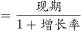
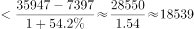

# 基期差值（基期和差）计算

考点：[[20-考点/资料分析/增长/基期差值（基期和差）计算|增长 / 基期差值（基期和差）计算]]
材料：[[15-材料/资料分析/195084 2016年我国邮电业务发展情况：邮政|195084 2016年我国邮电业务发展情况：邮政]]

**问法模型**：题干问'2015年（基期）A比B多多少'→ 现期为2016年，采用基期差值模型：A/(1+gA) − B/(1+gB)，再取与结果最接近的选项。

## 推理链
1. 第1步：题干求2015年（基期）电信与邮政收入之差，定位文字段：2016年电信业务收入35947亿元、邮政业务收入7397亿元（本版本材料中两处增速数值均留白）。
2. 第2步：判定为基期差值问题，公式：2015年电信=35947/(1+g电信)，2015年邮政=7397/(1+g邮政)，所求=两者作差。
3. 第3步：可先核验口径并算现期差作参照：35947−7397=28550亿元，基期差应略小于现期差；按官方解析代入原卷增速计算，结果略小于18539亿元。
4. 第4步：与选项对照：14235、16235、18235、20235中，18235与18539相差约300，为最接近项，故选C。

**最快解法**：⚡ 基期公式法+截位估算：先算现期差35947−7397=28550亿元锁定量级，再按'基期=现期/(1+g)'分别折减作差，官方解析结果略小于18539，四选项中仅18235与其最接近，直接锁定C，无需精算。

## 易错点
- ⚠ 基期/现期混淆：题干问2015年，勿直接用2016年现期差28550亿元作答（无对应选项，须按增速折减到基期）。
- ⚠ 增速空缺陷阱：给定材料中电信、邮政增速数值留白，不得臆补数值强行计算，须知原卷此处有具体增速、官方解析结果依赖原卷数据。
- ⚠ 三级包含口径：电信35947与邮政7397为并列项（两者之和=邮电总量43344），快递收入3974⊂邮政7397，勿误用快递收入或邮电总量43344代入公式。
- ⚠ '最接近'选项策略：计算值约18539并非选项原值，勿因18235不完全等于计算值而排除C错选D。

## 母题抽象
> 🧩 当题干出现'基期年份A比B多/少多少'且材料给出两者现期值与增速时，用基期差值模型A/(1+gA)−B/(1+gB)作差，先算现期差定方向，再取与结果最接近的选项。

**同类特征**：基期年份（2015年）+差值比较（比…多）、现期值已知、增速为折减必需、基期=现期/(1+增长率)、选项亿元量级、间隔约2000、答案取与计算值最接近项

## 相关题
- [[10-真题/资料分析/增长/2742055 基期差值（基期和差）计算|2742055]]（江苏 2021，相关度2）
- [[10-真题/资料分析/增长/2172304 基期量计算（已知现期量与同比增长率求上年值）|2172304]]（江苏 2018，相关度1）

---

### 题干
2015年我国电信业务收入比邮政业务收入多：

### 选项
- A. 14235亿元
- B. 16235亿元
- C. 18235亿元　✅
- D. 20235亿元

### 官方解析

由题干“2015年…比…多”，结合材料时间为2016年，判定此题为基期和差问题。定位文字材料可知，“2016年…我国电信业务收入35947亿元，增长”，“2016年…邮政业务收入7397亿元，增长”。根据基期计算公式，基期，可得2015年我国电信业务收入比邮政业务收入多：，因此所求略小于18539，只有C项最为接近。

故正确答案为C。

### 给定材料

        2016年，我国全年完成邮电业务收入总量43344亿元，比上年增长。其中，邮政业务收入7397亿元，增长；电信业务收入35947亿元，增长。邮政业全年完成邮政函件业务36.2亿件，包裹业务0.3亿件，快递业务量312.8亿件；快递业务收入3974亿元。电信业全年新增移动电话交换机容量7318万户，达到218384万户。2016年末全国电话用户总数152856万户（电话包括固定电话和移动电话两种），其中移动电话用户132193万户。移动电话普及率上升至96.2部/百人。固定互联网宽带接入用户29721万户，比上年增加3774万户，其中固定互联网光纤宽带接入用户22766万户，比上年增加7941万户；移动宽带用户94075万户，增加23464万户。移动互联网接入流量93.6亿G，比上年增长。互联网上网人数7.31亿人，增加4299万人，其中手机上网人数6.95亿人，增加7550万人。互联网普及率达到，其中农村地区互联网普及率达到。软件和信息技术服务业完成软件业务收入48511亿元，比上年增长。 

> [!warning] 疑点（官方解析可能有误，待人工复核）
> 本版本材料中电信、邮政业务收入的增速数值均留白空缺（原文'增长 '后无数值），仅凭所给材料无法唯一算出基期差；官方解析'所求略小于18539'依赖原卷完整增速数据，此处仅记录材料完整性/口径问题，正确答案仍以官方C为准。
