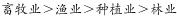
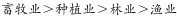
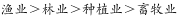
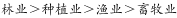

# 增长率比较（多主体增速排序）

考点：[[20-考点/资料分析/增长/增长率比较（多主体增速排序）|增长 / 增长率比较（多主体增速排序）]]
材料：[[15-材料/资料分析/195085 某省2017年第一季度农林牧渔业总产|195085 某省2017年第一季度农林牧渔业总产]]

**问法模型**：题干要求对2017年第一季度各产业增加值同比增速'从快到慢'排序 → 回文定位各分项'比上年同期增长X%'的百分数，按从大到小排列后与选项比对，属零计算查数题

## 推理链
1. 第1步：题干要求比较2017年第一季度各产业增加值同比增速，回文定位四个分项的增速表述——种植业增加值119.21亿元（第2段）、林业34.84亿元（第3段）、畜牧业176.64亿元（第4段）、渔业9.22亿元（第5段）
2. 第2步：规则：'从快到慢'即按同比增速从大到小排列；增速快慢与增加值绝对量大小（176.64>119.21>34.84>9.22）无必然对应关系，也与畜牧业'增速比上年同期加快2.1个百分点'这一变化量无关
3. 第3步：提取四个分项各自的同比增速百分数（本版本材料正文中这些数值全部空缺，按官方解析口径四项增速为各具体数值）
4. 第4步：将四个增速数值从大到小排列，得到从快到慢的顺序
5. 第5步：与A/B/C/D四个选项所给排序逐一比对，官方判定与材料一致的排序为D项，故正确答案为D

**最快解法**：⚡ 直查直排法（零计算）：在第2~5段各定位一处'增加值……比上年同期增长__%'，把四个百分数从大到小抄成一串，直接对照选项即得D；本题唯一动作是'查数+排序'，任何计算都是多余

## 易错点
- ⚠ 把'增加值绝对量大小'误当'增速快慢'：若按176.64>119.21>34.84>9.22的基数排序会掉入干扰项，增速与基数大小无必然关系
- ⚠ 把畜牧业的'增速比上年同期加快2.1个百分点'误读为畜牧业增速是2.1%——那是增速的变化量（百分点），不是增速本身
- ⚠ 本版本材料各分项增速数值全部缺失，切勿凭直觉、基数大小或'2.1个百分点'等残缺信息凭空补数排序；且排序对象按官方口径为种植、林业、畜牧、渔业四项，服务业不参与

## 母题抽象
> 🧩 当题干出现'多个主体某指标增速从快到慢/从慢到快排序'特征时，无需任何计算，直接回文提取各主体'增长X%'的百分数按大小排列，与选项比对即可锁定答案

**同类特征**：增加值同比增速、从快到慢、排序、种植/林业/畜牧/渔业多主体并列、纯读数比较、无需计算

## 相关题
- [[10-真题/资料分析/其他/5623 直接查找比较（涨幅最大项）|5623]]（福建 2008，相关度1）
- [[10-真题/资料分析/其他/2139506 表格定位读数与最值比较（直接查数）|2139506]]（天津 2017，相关度1）
- [[10-真题/资料分析/增长/2256382 同比增长率直接比较（表内读数比较）|2256382]]（江西 2018，相关度1）
- [[10-真题/资料分析/其他/2374716 表格直接读数比较（最大值识别）|2374716]]（广东 2019，相关度1）
- [[10-真题/资料分析/其他/2374811 简单查找比较（表格直接读数比大小）|2374811]]（广东 2019，相关度1）

---

### 题干
2017年第一季度，下列产业增加值同比增速从快到慢排序正确的是：

### 选项
- A. 

- B. 

- C. 

- D. 

　✅

### 官方解析

定位材料可知，2017年第一季度种植业、林业、畜牧业和渔业增加值同比增速分别为、、和，则同比增速从快到慢的排序为。

故正确答案为D。

### 给定材料

<b>根据以下资料，回答以下问题。</b>

        2017年第一季度，某省农林牧渔业增加值361.78亿元，比上年同期增长，高于上年同期0.2个百分点。具体情况如下：

        该省种植业增加值119.21亿元，比上年同期增长。其中蔬菜种植面积358.80万亩，比上年同期增加18.23万亩，蔬菜产量471.42万吨，增长；茶叶种植面积679.53万亩，比上年同期增加19.79万亩，茶叶产量2.30万吨，增长。

        该省林业增加值34.84亿元，比上年同期增长。

        该省畜牧业增加值176.64亿元，比上年同期增长，增速比上年同期加快2.1个百分点。其中生猪存栏增速由上年同期的下降转为增长，出栏增速由上年同期的下降转为增长；猪牛羊禽肉产量67.80万吨，比上年同期增长；禽蛋产量5.33万吨，增长；牛奶产量1.40万吨，增长。

        该省渔业增加值9.22亿元，比上年同期增长。全省水产品产量7.68万吨，比上年同期增长，其中，养殖水产品产量7.3万吨，增长。

        该省农林牧渔服务业增加值21.87亿元，比上年同期增长。

> [!warning] 疑点（官方解析可能有误，待人工复核）
> 本版本材料正文中种植业、林业、畜牧业、渔业（及服务业）增加值同比增速的具体百分数全部缺失（疑为原文公式/图片未渲染），四个选项亦为图片无法读取排序内容；官方解析中对应数值同样空缺，仅给出'排序为D'的结论。故无法基于给定文本独立复现排序过程，仅按官方答案D记录，不得凭空补数

<!-- CODEX-ANSWER-REVIEW:BEGIN -->
### 本次独立复核

**复核状态：** `resolved`（答案与解析已核定）

**计分答案：** D（可计分）

**复核解析：**

公式图给出种植业8.2%、林业8.3%、畜牧业4.2%、渔业4.5%的增加值增速。由高到低为林业、种植业、渔业、畜牧业，对应D。

**相关信息：**

服务业不属于题目所列四项。

**题源依据：** [固定版本原题](https://github.com/Mentat-Uran/kaogongzhentizhengliu/blob/84ab93d4b64b61d897bece8a1c0a5bab06b4feb2/10-%E7%9C%9F%E9%A2%98/%E8%B5%84%E6%96%99%E5%88%86%E6%9E%90/%E5%A2%9E%E9%95%BF/2187809%20%E5%A2%9E%E9%95%BF%E7%8E%87%E6%AF%94%E8%BE%83%EF%BC%88%E5%A4%9A%E4%B8%BB%E4%BD%93%E5%A2%9E%E9%80%9F%E6%8E%92%E5%BA%8F%EF%BC%89.md)；固定内容 commit `84ab93d4b64b61d897bece8a1c0a5bab06b4feb2`，Markdown blob `ed613a5f57c67d6c4dbafb04901448181781743d`。
<!-- CODEX-ANSWER-REVIEW:END -->
