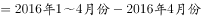
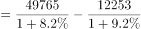
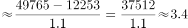

# 基期量差值（基期和差）计算

考点：[[20-考点/资料分析/增长/基期量差值（基期和差）计算|增长 / 基期量差值（基期和差）计算]]
材料：[[15-材料/资料分析/195086 2017年4月当月及1~4月累计全国|195086 2017年4月当月及1~4月累计全国]]

**问法模型**：题干求上年（2016年）1~3月这一材料未直接给出的时段的量 → 用基期和差模型：基期(1~3月)=现期(1~4月)/(1+r₁)−现期(4月)/(1+r₂)，再换算单位。

## 推理链
1. 第1步：题干求2016年1~3月限额以上单位消费品零售额；表格给出2017年1~4月为49765亿元、同比+8.2%，2017年4月为12253亿元、同比+9.2%（两列增速不同，需分别对应）。
2. 第2步：由时段关系'1~3月=1~4月−4月'，基期同样满足：2016年1~3月=49765/(1+8.2%)−12253/(1+9.2%)。
3. 第3步：截位直除，49765/1.082≈45993（约4.6万亿），12253/1.092≈11221（约1.12万亿）。
4. 第4步：作差得45993−11221≈34772亿元。
5. 第5步：单位换算：34772亿元≈3.48万亿元（亿元→万亿元缩小4个量级）。
6. 第6步：与选项对照，3.48万亿元与B项3.5最接近，故选B。

**最快解法**：⚡ 截位直除+基期和差：49765/1.082≈46000，12253/1.092≈11200，差≈34800亿元≈3.5万亿元，直接锁定B；也可先估量级——1~4月基期约4.6万亿，再减去约1.1万亿即约3.5万亿。

## 易错点
- ⚠ 量级陷阱：题干要求以'万亿元'作答而材料为'亿元'，34772亿元≈3.48万亿元，忘换算会把数字直接与选项比对而错选。
- ⚠ 时段陷阱：不能直接拿1~4月的基期量49765/1.082≈4.6万亿元当答案，必须再减去4月基期量，否则会误选C(4.0)或偏大选项。
- ⚠ 列错位陷阱：4月列与1~4月列并排且增速不同（9.2%对8.2%），若拿12253除以1.082或49765除以1.092即读错列，全题出错。

## 母题抽象
> 🧩 当题干所求时段（如某年1~3月）材料未直接给出，但可由已给的两个时段（1~4月与4月）相减得到时，用基期和差模型——各现期量分别除以各自(1+增速)后再相减，并核对单位量级（亿元↔万亿元）。

**同类特征**：求上年同期（基期）绝对量、所求时段=材料两时段相减（1~4月减4月）、两个不同增速（8.2%与9.2%）并存、限额以上单位消费品零售额、亿元换算万亿元、约多少万亿（量级设问）

## 相关题
- [[10-真题/资料分析/其他/1758920 期间总量加总（五年规划求和+单位量级判断）|1758920]]（上海 2016，相关度1）
- [[10-真题/资料分析/比重/2051382 基期比重计算|2051382]]（天津 2017，相关度1）
- [[10-真题/资料分析/其他/5430291 多期累计加总求差+单位换算（亿元→万亿元）|5430291]]（浙江 2023，相关度1）

---

### 题干
2016年1～3月份，限额以上单位消费品零售额的绝对量约为多少万亿元？

### 选项
- A. 3.0
- B. 3.5　✅
- C. 4.0
- D. 4.5

### 官方解析

根据题干所求“2016年1～3月份，限额以上单位消费品零售额的绝对量”，结合材料数据时间为2017年1～4月和4月，可判定本题为基期和差问题。定位表格材料可得，2017年1～4月限额以上单位消费品零售额为49765亿元，增速为；2017年4月限额以上单位消费品零售额为12253亿元，增速为。故2016年1～3月份限额以上单位消费品零售额的绝对量万亿，与B项接近。

故正确答案为B。

### 给定材料

        2017年1～4月份，全国社会消费品网上零售额19180亿元，同比增长。其中，实物商品网上零售额14617亿元，增长。在实物商品网上零售额中，吃、穿和用类商品零售额分别增长，和。

