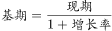
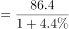
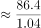
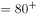

# 基期量计算

考点：[[20-考点/资料分析/增长/基期量计算|增长 / 基期量计算]]
材料：[[15-材料/资料分析/195088 J省2016年规模以上工业取水与用水|195088 J省2016年规模以上工业取水与用水]]

**问法模型**：题干问'2015年……取水量约为多少'而材料现期为2016年 → 基期量计算模型：基期量=现期量÷(1+同比增速)，直除后对照选项。

## 推理链
1. 第1步：题干求2015年取水量，材料现期为2016年：J省规模以上工业总取水量86.4亿立方米，文字表述'比上年增长'，但增速数值在本版本文字中显示为空缺（需回原图核对，不得凭空补数）。
2. 第2步：基期量公式：基期量=现期量÷(1+增长率)；由'比上年增长'可知为正增长，故2015年取水量必小于86.4亿立方米，可先排除大于现期的选项A(90)。
3. 第3步：代入直除：86.4÷(1+g)≈83，即g≈86.4/83−1≈4.1%，说明原文增速为4%左右的低个位数（按官方答案口径反推校验）。
4. 第4步：与选项对照：B(83)与直除结果吻合；C(74)对应增速约16.8%、D(65)对应增速约32.9%，均远超实际增速量级，故选B。

**最快解法**：⚡ 公式法+截位直除：基期量=86.4÷(1+g)；先用'正增长⇒基期<86.4'秒杀排除A(90)，再用原文增速（低个位数）直除得约83锁定B；考场若遇本版本增速空缺，须回原图读取实际增速后再除，不可凭空补数。

## 易错点
- ⚠ 三个总量口径混淆：材料并存取水量86.4、用新水量28.3、重复用水量168.4亿立方米，本题只能用'取水量86.4'作现期量，误用图1口径(28.3)或重复用水口径(168.4)必错。
- ⚠ 基期现期方向搞反：求2015年应'除以(1+g)'，误乘(1+g)得86.4×1.04≈90，恰好落入A选项陷阱。
- ⚠ 数据空缺与方向陷阱：本版本文字中增速数值空缺，若忽略'比上年增长'的方向性（正增长⇒基期<现期）或凭空补数，无法锁定B；且增速仅约4%，决定了答案在83附近而非74或65。

## 母题抽象
> 🧩 当题干出现'上年（基期）某量为多少'且材料给出现期量与同比增速时，用'基期量=现期量÷(1+增速)'截位直除，并先用'正增长⇒基期<现期'排除大于现期量的选项再定值。

**同类特征**：时间倒推一年（问2015年、材料现期2016年）、约为多少亿立方米、基期量计算、总取水量86.4、同比增速、选项间距大、可先排除后直除

## 相关题
- [[10-真题/资料分析/增长/2033794 基期量计算|2033794]]（江苏 2016，相关度3）
- [[10-真题/资料分析/增长/4651470 基期量计算|4651470]]（江苏 2022，相关度3）
- [[10-真题/资料分析/增长/2050974 基期量计算|2050974]]（江西 2017，相关度3）
- [[10-真题/资料分析/增长/2394030 基期量计算|2394030]]（青海 2019，相关度3）
- [[10-真题/资料分析/增长/20303 基期量计算|20303]]（贵州 2010，相关度2）

---

### 题干
J省2015年规模以上工业取水量约为多少亿立方米？

### 选项
- A. 90
- B. 83　✅
- C. 74
- D. 65

### 官方解析

根据题干“2015年······为多少亿立方米”，结合材料时间为2016年，可判定本题为基期计算问题。定位文字材料第一段可知，2016年J省规模以上工业取水量为86.4亿立方米，增长率为。由可得，J省2015年规模以上工业取水量亿立方米。

故正确答案为B。

### 给定材料

        2016年，J省规模以上工业取水量为86.4亿立方米，比上年增长。其中，直接采自江、河、淡水湖、水库等的地表淡水68.1亿立方米，比上年增长，所占比重比上年下降0.4个百分点；自来水取水量15.9亿立方米，同比增长。 

        2016年，规模以上工业重复用水量168.4亿立方米，比上年增长；重复用水利用率，比上年提高0.1个百分点。其中，石油加工、黑色金属冶炼及压延加工、电力和化学原料等4个行业的重复用水总量占规模以上工业的，重复用水利用率分别为、、和。全年用新水量超过2亿立方米的5个行业用新水量合计19.1亿立方米，占总用新水量的，比重比上年下降0.9个百分点。

> [!warning] 疑点（官方解析可能有误，待人工复核）
> 本版本材料文字与官方解析中，2016年总取水量'比上年增长'的增速数值均显示为空缺（解析中公式亦被略去），按现有文本无法直接复算；由官方答案B(83)反推增速≈86.4/83−1≈4.1%（低个位数增长），与答案方向一致、不影响答案唯一性，但标准计算须回原图核对实际增速数值后方可完成。

<!-- CODEX-ANSWER-REVIEW:BEGIN -->
### 本次独立复核

**复核状态：** `resolved`（答案与解析已核定）

**计分答案：** B（可计分）

**复核解析：**

2016年总取水量86.4亿立方米，同比增长4.4%。2015年取水量=86.4÷1.044≈82.76亿立方米，按选项取约83亿立方米，选B。

**相关信息：**

资料分析—同比增长型基期量=现期量÷(1+增长率)。

**题源依据：** [固定版本原题](https://github.com/Mentat-Uran/kaogongzhentizhengliu/blob/84ab93d4b64b61d897bece8a1c0a5bab06b4feb2/10-%E7%9C%9F%E9%A2%98/%E8%B5%84%E6%96%99%E5%88%86%E6%9E%90/%E5%A2%9E%E9%95%BF/2187862%20%E5%9F%BA%E6%9C%9F%E9%87%8F%E8%AE%A1%E7%AE%97.md)；固定内容 commit `84ab93d4b64b61d897bece8a1c0a5bab06b4feb2`，Markdown blob `0986b5699198b4c830ef3fe9d230496e92da412b`。
<!-- CODEX-ANSWER-REVIEW:END -->
