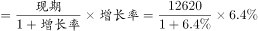
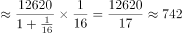

# 增长量计算（已知现期量与同比增速）

考点：[[20-考点/资料分析/增长/增长量计算（已知现期量与同比增速）|增长 / 增长量计算（已知现期量与同比增速）]]
材料：[[15-材料/资料分析/195125 2017年我国电信业务收入规模（总量|195125 2017年我国电信业务收入规模（总量]]

**问法模型**：题干问'2017年……同比增加了大约（）亿元'→ 采用增长量计算模型：增长量=现期量×r/(1+r)，增速r需从统计图中'电信业务收入'序列读取

## 推理链
1. 第1步：题干关键词'同比增加了大约（）亿元'判定为增长量计算，现期量=2017年电信业务收入12620亿元（文字材料）
2. 第2步：文字材料中2017年增速以公式图片缺失，转由统计图'2013-2017年我国电信业务及分支业务收入的年度同比增速'读取：2017年电信业务收入同比增速=6.4%，并与'增速同比提高1个百分点'及图中2016年该指标5.4%相互印证
3. 第3步：套用增长量公式：增长量=12620×6.4%/(1+6.4%)=12620×6.4/106.4
4. 第4步：速算：12620×0.064=807.68，再÷1.064≈759亿元（或百化分：6.4%=1/15.625，增长量≈12620/16.625≈759）
5. 第5步：与选项对照：759与B项最接近；A≈681对应误用图中5.7%等其他分支增速，C=808对应漏除(1+r)的陷阱值12620×6.4%，故选B

**最快解法**：⚡ 百化分+截位直除：将6.4%百化分为1/15.625，增长量=现期/(n+1)=12620/16.6≈760，锁定B；或直除12620×64÷10640≈759

## 易错点
- ⚠ 漏除(1+r)：直接算12620×6.4%≈808，恰好落入C项陷阱，增长量必须用r/(1+r)口径
- ⚠ 增速读错序列：图中26.7%是移动数据及互联网业务收入增速、9.5%是固定数据及互联网、5.7%等其他为分支业务增速，总量'电信业务收入'2017年增速为6.4%，误用分支增速（如5.7%得681对应A）即错
- ⚠ 文字材料中增速为公式图片不可读，严禁臆造增速值，必须回到统计图读取并注意亿元量级；勿与'拉动增长1.4个百分点''贡献率'口径混淆

## 母题抽象
> 🧩 当题干出现'现期量为A、同比增长r（增速在图中）求同比增加多少'时，用增长量公式A×r/(1+r)，将r百化分为1/n后按A/(n+1)速算，并警惕选项中'现期×r'的陷阱值

**同类特征**：同比增加了大约（）亿元、增长量计算、现期量12620亿元+同比增速、增速需从年度同比增速统计图读取、增长量=现期×r/(1+r)

## 相关题
- [[10-真题/资料分析/增长/2262596 增长量计算（已知现期量与同比增速）|2262596]]（选调 2016，相关度3）
- [[10-真题/资料分析/增长/2049864 增长量计算（已知现期量与同比增速）|2049864]]（湖南 2017，相关度3）
- [[10-真题/资料分析/增长/16593081 增长量计算（已知现期量与同比增速）|16593081]]（甘肃 2024，相关度3）
- [[10-真题/资料分析/增长/2054178 增长量计算（已知现期量与同比增速）|2054178]]（陕西 2017，相关度3）
- [[10-真题/资料分析/增长/7159 增长量计算|7159]]（北京 2009，相关度1）

---

### 题干
2017年我国电信业务收入同比增加了大约（  ）亿元。

### 选项
- A. 681
- B. 759　✅
- C. 808
- D. 818

### 官方解析

根据题干“2017年······同比增加了大约······亿元”，可判定本题为增长量计算问题。定位文字材料：“2017年我国电信业务收入12620亿元，比上年增长”，故2017年我国电信业务收入同比增长量亿元，与B项最接近。

故正确答案为B。

### 给定材料

<b>二、根据以下资料，回答</b><b>71--75题。</b>

        2017年，我国电信业务收入12620亿元，比上年增长，增速同比提高1个百分点。其中，2017年全年固定通信业务收入完成3549亿元，比上年增长，在电信业务收入中占比为。2017年，在固定通信业务中固定数据及互联网业务收入达到1971亿元，比上年增长，拉动电信业务收入增长1.4个百分点，对全行业业务收入增长贡献率达。2017年全年移动通信业务实现收入9071亿元，比上年增长，在电信业务收入中占比为。2017年，在移动通信业务中移动数据及互联网业务收入5489亿元，比上年增长，对收入增长贡献率达。

