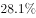
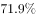
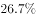
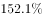

# 拉动增长率（拉动……增长……个百分点）计算

考点：[[20-考点/资料分析/增长/拉动增长率（拉动……增长……个百分点）计算|增长 / 拉动增长率（拉动……增长……个百分点）计算]]
材料：[[15-材料/资料分析/195125 2017年我国电信业务收入规模（总量|195125 2017年我国电信业务收入规模（总量]]

**问法模型**：题干问'部分业务收入拉动电信业务收入增长约多少个百分点'→采用拉动增长率模型：拉动百分点=部分增长量÷整体基期量×100%。

## 推理链
1. 第1步：提取数据——移动数据及互联网业务收入现期5489亿元、同比增速26.7%（官方解析明确，统计图2017年灰柱亦为26.7%）；电信业务收入现期12620亿元，总增速从统计图2017年行读得6.4%（与2016年5.4%相比恰好提高1个百分点，与文字'增速同比提高1个百分点'互证）。
2. 第2步：明确口径——拉动百分点=部分增长量÷整体基期量×100%，分母是总量的基期值，既不是总量现期值，也不是总增量（后者是贡献率口径）。
3. 第3步：求部分增长量=5489×26.7%÷(1+26.7%)≈5489×0.211≈1157亿元。
4. 第4步：求整体基期量=12620÷(1+6.4%)≈12620÷1.064≈11861亿元。
5. 第5步：拉动百分点=1157÷11861×100%≈9.75%，四个选项中与C项9.7最接近（D项10.7明显偏大），故选C。

**最快解法**：⚡ 公式法+百化分估算：增量=现期×r/(1+r)，26.7/126.7≈21.1%，5489×21.1%≈1157亿；基期=12620÷1.064≈11861亿（可近似为12620×0.94≈11860）；1157÷11861≈9.7个百分点，口算即可锁定C。

## 易错点
- ⚠ 口径混淆：'拉动增长…个百分点'分母是整体基期量（12620/1.064≈11861亿），若误用总量现期12620作分母得约12.4%，若误按贡献率口径除以总增量则全错——'拉动百分点'与'贡献率'两口径混用是本题最大陷阱。
- ⚠ 增长量错算：直接用5489×26.7%≈1466亿元当增长量，漏除(1+26.7%)，结果偏大易误选D（10.7）。
- ⚠ 数据来源陷阱：总增速6.4%在文字中为公式图片不可读，必须从统计图2017年行读取，并用'增速同比提高1个百分点'（5.4%+1%=6.4%）交叉验证，不能臆造增速或把26.7%误当总量增速。

## 母题抽象
> 🧩 当题干出现'A拉动B增长约多少个百分点'特征时，用拉动增长率模型：部分增量=部分现期×r/(1+r)，B基期量=B现期/(1+R)，两者相除×100%即为百分点数，最后与最接近选项对照验证。

**同类特征**：拉动……增长……个百分点、部分业务收入对总收入、部分现期量+部分同比增速、总量现期+总量同比增速、增速藏在公式图片/统计图中需读取、答案为个位数百分点

## 相关题
（暂无）

---

### 题干
2017年移动数据及互联网业务收入拉动电信业务收入增长约（    ）个百分点。

### 选项
- A. 7.2
- B. 8.2
- C. 9.7　✅
- D. 10.7

### 官方解析
根据题干“拉动······增长······个百分点”，可判定本题为拉动增长率问题。定位材料文字部分可得：移动数据及互联网业务收入5489亿元，比上年增长26.7%，可计算出移动数据及互联网业务收入增长量=；定位材料文字部分可得：我国电信业务收入12620亿元，比上年增长，可计算出电信业务收入基期量=，故移动数据及互联网业务收入拉动电信业务收入增长的百分点=，与C项最接近。
故正确答案为C。

### 给定材料

<b>二、根据以下资料，回答</b><b>71--75题。</b>

        2017年，我国电信业务收入12620亿元，比上年增长，增速同比提高1个百分点。其中，2017年全年固定通信业务收入完成3549亿元，比上年增长，在电信业务收入中占比为。2017年，在固定通信业务中固定数据及互联网业务收入达到1971亿元，比上年增长，拉动电信业务收入增长1.4个百分点，对全行业业务收入增长贡献率达。2017年全年移动通信业务实现收入9071亿元，比上年增长，在电信业务收入中占比为。2017年，在移动通信业务中移动数据及互联网业务收入5489亿元，比上年增长，对收入增长贡献率达。

