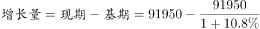
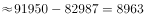

# 增长量计算（已知现期值与同比增长率求增长量）

考点：[[20-考点/资料分析/增长/增长量计算（已知现期值与同比增长率求增长量）|增长 / 增长量计算（已知现期值与同比增长率求增长量）]]
材料：[[15-材料/资料分析/195128 2017年全国规模以上文化及相关产业|195128 2017年全国规模以上文化及相关产业]]

**问法模型**：题干'2017年合计数（现期91950亿元）比2016年增加了大约多少亿元' → 采用增长量公式：增长量=现期×r/(1+r)=91950×10.8%/1.108

## 推理链
1. 第1步：定位统计表'合计'行的'1-12月'列，提取现期值：2017年全国规模以上文化及相关产业企业营业收入合计91950亿元，比上年增长10.8%
2. 第2步：题干问'比2016年增加了大约多少亿元'，判定为增长量计算，基期为2016年全年，与表中'比上年增长%'的同比口径一致，套公式：增长量=现期×r/(1+r)
3. 第3步：代入计算：91950×10.8%=9930.6，再除以(1+10.8%)：9930.6÷1.108≈8962.8≈8963亿元
4. 第4步：与选项对照：A项8936与B项8963数字对调，C项9836与D项9863对应漏除(1+r)的错解方向（91950×10.8%≈9930.6最接近D项9863）；精确结果8963与B项吻合，故选B

**最快解法**：⚡ 公式法+截位直除：增长量=91950×10.8%÷1.108；分子拆项速算：91950×0.108=9195+91950×0.008=9195+735.6=9930.6；再除1.108得≈8963，直选B。或用百化分：10.8%≈1/9.26，增长量≈91950/(9.26+1)=91950/10.26≈8964。因A、B仅差27，必须完成÷(1+r)的精算，不能停留在91950×10.8%≈9930

## 易错点
- ⚠ 把'现期×r'直接当增长量：91950×10.8%≈9930.6，会误选最接近的D项9863；增长量必须再除以(1+r)
- ⚠ 选项设置数字对调陷阱：A(8936)/B(8963)、C(9836)/D(9863)两两仅差几十，估算精度不足必错，需精算到个位
- ⚠ 增速口径取错：须用合计行'1-12月'列的10.8%（全年对2016年全年的同比），勿误用其他时段（如1-3月合计的11.0%）或行业行的增速；另注意合计行与10个行业行并列，勿错位取数

## 母题抽象
> 🧩 当题干出现'现期值为A、同比增长r%，求比上期增加了大约多少'的特征时，用增长量=A×r/(1+r)（r≈1/n时可速记为A/(n+1)），若选项差距很小则截位精算除法验证落点，切忌用A×r直接替代增长量

**同类特征**：比2016年增加了大约、合计数、单位亿元、表格给出同比增长%、选项数值两两接近、全年（1-12月）口径

## 相关题
- [[10-真题/资料分析/增长/2616100 基期量计算（同比减少型-负增长基期还原）|2616100]]（云南 2020，相关度1）
- [[10-真题/资料分析/增长/18643961 基期量计算（同比基期）|18643961]]（浙江 2026，相关度1）
- [[10-真题/资料分析/增长/2050974 基期量计算|2050974]]（江西 2017，相关度1）
- [[10-真题/资料分析/其他/2188307 进出口额读数排序与加总求和|2188307]]（江西 2018，相关度1）
- [[10-真题/资料分析/增长/2262591 基期量计算|2262591]]（选调 2016，相关度1）

---

### 题干
2017年全国规模以上文化及相关产业企业营业收入合计数比2016年增加了大约（  ）亿元。

### 选项
- A. 8936
- B. 8963　✅
- C. 9836
- D. 9863

### 官方解析

根据题干“······增加了大约（    ）亿元”，判定为增长量计算题型。定位统计表，可得：2017年全国规模以上文化及相关产业企业营业收入合计数为91950亿元，比上年增长。选项差距非常小，需要精确计算。根据公式，亿元。

故正确答案为B。

### 给定材料

根据以下资料，回答76—80题。

> [!warning] 疑点（官方解析可能有误，待人工复核）
> 官方解析文字中'比上年增长'后缺失增速数值（应为10.8%，据统计表合计行补全），按10.8%计算得8963亿元，与答案B一致，不影响结论
