# 累计值相减构造单季值+环比升降方向判断计数

考点：[[20-考点/资料分析/增长/累计值相减构造单季值+环比升降方向判断计数|增长 / 累计值相减构造单季值+环比升降方向判断计数]]
材料：[[15-材料/资料分析/195128 2017年全国规模以上文化及相关产业|195128 2017年全国规模以上文化及相关产业]]

**问法模型**：题干问'第三季度环比下降的产业个数'→用累计值相减还原Q3=1-9月-1-6月、Q2=1-6月-1-3月，逐行业比较Q3与Q2大小，数出Q3<Q2的个数

## 推理链
1. 第1步：材料只给累计值，环比须先还原当季值：Q3=1-9月-1-6月，Q2=1-6月-1-3月（切勿用1-12月列）
2. 第2步：规则：两季值均为正数，环比下降⟺Q3<Q2，无需算具体环比增速
3. 第3步：逐行业相减：新闻出版780=2301-1521<840=1521-681，降；广播电视424=1186-762<439=762-323，降；文化艺术114=283-169>93=169-76，升；文化信息2106=5503-3397>1891=3397-1506，升
4. 第4步：继续：文化创意2875=8046-5171<2884=5171-2287，降；休闲娱乐430=1070-640>364=640-276，升；工艺美术4253=12756-8503<4527=8503-3976，降
5. 第5步：辅助生产2491=7084-4593<2554=4593-2039，降；文化用品8930=25556-16626>8893=16626-7733，升；专用设备1342=3834-2492<1464=2492-1028，降
6. 第6步：下降的行业共6个（新闻出版发行、广播电视电影、文化创意和设计、工艺美术品、文化产品辅助生产、文化专用设备），对照选项选C

**最快解法**：⚡ 差值定性比较法：不算环比增速，只做两次减法比大小；速算重点盯差值接近的行业——文化创意2875 vs 2884（差9）、文化用品8930 vs 8893（差37）、广播电视424 vs 439（差15），其余行业两差值差距一目了然可秒判方向

## 易错点
- ⚠ 直接拿表上累计数比较或算环比：全表是1-3/1-6/1-9/1-12月累计值，必须先相减还原单季值，且Q3=1-9月-1-6月，时段错位（误减1-6月或用1-12月）全错
- ⚠ 把表头'比上年增长%'（同比）当环比用：如专用设备1-9月同比-2.2%是负增长，但Q3环比1342>1464为下降、Q2为1464>1028，升降须按单季差值判断，与同比负号无关
- ⚠ 大数减法进退位出错，且接近值易误判：文化创意差仅9、文化用品差仅37，粗心会判反方向
- ⚠ 误把'合计'行当产业计数：合计不是细分行业，且其Q3=67618-43874=23744、Q2=43874-19926=23948虽也下降，但不能计入10个产业中

## 母题抽象
> 🧩 当题干问'某季度环比升降（个数/最快/最慢）'而材料只给累计值时，先累计相减还原相邻两季当季值（当季=本累计-上一累计），再直接比较两季值大小定性升降，不必算环比增速，也绝不能误用同比增速列

**同类特征**：第三季度、环比下降、营业收入、累计值相减、当季值构造、产业个数计数

## 相关题
- [[10-真题/资料分析/平均数/3522362 基期平均数计算（基期总量-(1+r)÷家数）|3522362]]（青海 2021，相关度1）
- [[10-真题/资料分析/增长/2187526 增长量比较与增长率比较（相邻两年对比）|2187526]]（选调 2018，相关度1）
- [[10-真题/资料分析/其他/2388239 累计值求当月值（相邻累计差值简单计算）|2388239]]（河北 2019，相关度1）
- [[10-真题/资料分析/增长/3018821 增长量计算（已知现期与同比增速）|3018821]]（广东 2021，相关度1）

---

### 题干
2017年第三季度（  ）个产业的企业营业收入实现环比下降。

### 选项
- A. 4
- B. 5
- C. 6　✅
- D. 7

### 官方解析

定位统计表可得：2017年1-9月、1-6月、1-3月各产业的企业营业收入，那么第三季度的营业收入为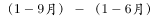，第二季度的营业收入为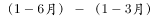，可得：

新闻出版发行服务的第三季度营业收入为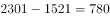亿元，第二季度营业收入为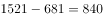亿元，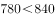，环比下降，满足；

广播电视电影服务的第三季度营业收入为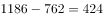亿元，第二季度营业收入为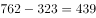亿元，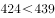，环比下降，满足；

文化艺术服务的第三季度营业收入为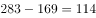亿元，第二季度营业收入为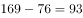亿元，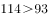，环比上升，不满足；

文化信息传输服务第三季度营业收入为亿元，第二季度营业收入为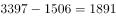亿元，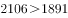，环比上升，不满足；

文化创意和设计服务第三季度营业收入为亿元，第二季度营业收入为亿元，，环比下降，满足；

文化休闲娱乐服务第三季度营业收入为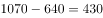亿元，第二季度营业收入为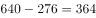亿元，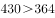，环比上升，不满足；

工艺美术品的生产第三季度营业收入为亿元，第二季度营业收入为亿元，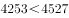，环比下降，满足；

文化产品生产的辅助生产第三季度营业收入为亿元，第二季度营业收入为亿元，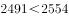，环比下降，满足；

文化用品的生产第三季度营业收入为亿元，第二季度营业收入为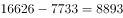亿元，，环比上升，不满足；

文化专用设备的生产第三季度营业收入为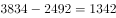亿元，第二季度营业收入为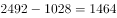亿元，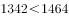，环比下降，满足。

满足条件的有6个。

故正确答案为C。

### 给定材料

根据以下资料，回答76—80题。

