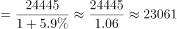
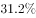
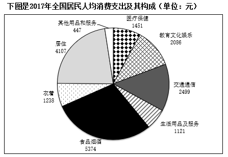

# 基期量计算（已知现期值与同比增速）

考点：[[20-考点/资料分析/增长/基期量计算（已知现期值与同比增速）|增长 / 基期量计算（已知现期值与同比增速）]]
材料：[[15-材料/资料分析/195132 2017年全国居民人均可支配收入与人|195132 2017年全国居民人均可支配收入与人]]

**问法模型**：题干问“2016年（时间前推一年）城镇居民人均消费支出是多少”，而材料给出2017年现期值24445元及同比增速 → 采用基期量=现期÷(1+名义增速)模型

## 推理链
1. 第1步：题干求2016年城镇居民人均消费支出，材料现期为2017年，定位文字“城镇居民人均消费支出24445元，增长g%”（文本中g为空格，由官方答案可反推g≈24445/23083−1≈5.9%，须以原卷数值为准）
2. 第2步：基期量公式：基期=现期÷(1+名义增速)=24445÷(1+g)，注意应使用名义增速而非扣除价格因素的实际增速
3. 第3步：代入计算：24445÷1.059≈23083元（验证：23083×1.059≈24445，吻合）
4. 第4步：排除干扰：A.23482对应增速仅约4.1%（为误用实际增速的陷阱结果），C.17383、D.10257与城镇现期24445的量级/口径明显不符
5. 第5步：与选项对照，B.23083最接近计算结果，故选B

**最快解法**：⚡ 基期公式法+截位直除：24445÷(1+5.9%)≈24445÷1.06≈23100，首两位“23”排除C(17383)、D(10257)；再以23083×1.059≈24445精算锁定B（A.23482对应增速仅约4.1%，与原卷5.9%不符，排除）

## 易错点
- ⚠ 名义与实际增速口径混淆：本题须用未扣价格因素的名义增速，误用“扣除价格因素实际增长”会算出约23300~23500，错选A.23482
- ⚠ 城乡/全国口径混淆：应使用城镇现期24445元，勿误用全国18323元或农村10955元作分子，C、D为量级干扰项
- ⚠ 增速数值在所给文本中留空（阅读陷阱）：必须回看原卷/图片读取增速，不可编造；同时勿把基期与现期方向弄反（2016是基期，应做除法而非乘法）

## 母题抽象
> 🧩 当题干出现“上年/基期某指标是多少”且材料给出现期值与同比增速时，用基期量=现期÷(1+增速)，先看量级、再用首两位直除排除干扰项，并警惕“实际增速”替代“名义增速”的陷阱选项

**同类特征**：问2016年（时间前推一年的基期）、城镇居民人均消费支出、材料已给现期值及同比增速、基期量计算、单位为元（人均口径）、选项量级为2万+千元级

## 相关题
- [[10-真题/资料分析/增长/12019697 基期量计算（现期累计值−当期新增值）|12019697]]（广东 2026，相关度1）
- [[10-真题/资料分析/增长/2033794 基期量计算|2033794]]（江苏 2016，相关度1）
- [[10-真题/资料分析/增长/2166218 基期量计算（同比下降型）|2166218]]（深圳市考 2018，相关度1）
- [[10-真题/资料分析/增长/2187625 基期量计算（现期−增长量还原基期）|2187625]]（选调 2018，相关度1）
- [[10-真题/资料分析/增长/2187798 基期量计算（现期÷(1+同比增速)）＋单位换算（亿元→万亿元）|2187798]]（天津 2018，相关度1）

---

### 题干
2016年城镇居民人均消费支出是多少元？

### 选项
- A. 23482
- B. 23083　✅
- C. 17383
- D. 10257

### 官方解析

根据题干“2016年城镇居民人均消费支出”，结合材料时间为2017年，可判定本题为基期计算问题。定位文字材料可得：“2017年城镇居民人均消费支出24445元，增长”。根据公式：，故2016年城镇居民人均消费支出元，与B项最接近。

故正确答案为B。

### 给定材料

        2017年全国居民人均可支配收入25974元，比上年增长，扣除价格因素，实际增长，2017年全国居民人均消费支出18323元，比上年增长，扣除价格因素，实际增长。按常住地分，城镇居民人均消费支出24445元，增长，扣除价格因素，实际增长；农村居民人均消费支出10955元，增长，扣除价格因素，实际增长。恩格尔系数为，比上年下降，其中城镇为，农村为。

> [!warning] 疑点（官方解析可能有误，待人工复核）
> 所给文字材料中“城镇居民人均消费支出增长”的百分比为空格，官方解析公式中该数值亦缺失；按官方答案23083反推名义增速≈24445÷23083−1≈5.9%，实际使用时须以原卷/图片中的增速数值为准，本笔记按此口径复核与B一致
