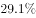

# 基期量计算之基期率逆推（现期率+下降百分点，恩格尔系数）

考点：[[20-考点/资料分析/增长/基期量计算之基期率逆推（现期率+下降百分点，恩格尔系数）|增长 / 基期量计算之基期率逆推（现期率+下降百分点，恩格尔系数）]]
材料：[[15-材料/资料分析/195132 2017年全国居民人均可支配收入与人|195132 2017年全国居民人均可支配收入与人]]

**问法模型**：题干问基期年份（2016年）某'率'（恩格尔系数）的数值 → 恩格尔系数是率，其'比上年下降'按百分点理解，基期率=现期率+下降百分点，切勿套用现期÷(1+增速)公式

## 推理链
1. 第1步：定位文字材料末句——2017年全国居民恩格尔系数为29.3%，比上年下降0.8个百分点（所给文本此处数值留空，降幅0.8个百分点以官方解析备注为准）
2. 第2步：辨析口径——恩格尔系数自身是率，不讨论'率的增长率'，材料中'比上年下降'应理解为下降0.8个百分点，而非下降0.8%
3. 第3步：用饼图交叉验证现期值：食品烟酒5374÷人均消费支出18323≈29.3%，确认2017年全国恩格尔系数为29.3%
4. 第4步：代入基期率公式：2016年恩格尔系数=29.3%+0.8%=30.1%
5. 第5步：与选项对照，D项即30.1%，与官方解析备注'2016年官方数据'一致，故选D

**最快解法**：⚡ 百分点逆推（公式法）：基期率=现期率+下降百分点，29.3%+0.8%=30.1%，口算一步锁定D；若文本数值缺失，先用饼图5374÷18323≈29.3%反推现期率再相加

## 易错点
- ⚠ 把'比上年下降0.8个百分点'误读为'下降0.8%'，错套现期÷(1−0.8%)或×0.992的率增长率公式——恩格尔系数是率，其变化按百分点计
- ⚠ 所给材料文字中恩格尔系数及降幅为空格，若不回看原卷确认（29.3%、0.8个百分点）而凭印象填数必错；数据缺失时可用饼图5374÷18323≈29.3%反推校验
- ⚠ 分母口径陷阱：恩格尔系数=食品烟酒支出÷人均消费支出（5374/18323），误用人均可支配收入25974作分母会得到约20.7%的错误口径

## 母题抽象
> 🧩 当题干出现'某率（恩格尔系数、失业率等）的基期值'且材料给出'现期率、比上年上升/下降'时，先辨明该变动是百分点而非增长率，再用基期率=现期率+下降百分点（或−上升百分点）直接逆推

**同类特征**：基期年份（2016年）、恩格尔系数（率）、比上年下降→按百分点理解、全国居民口径、文字材料直接定位、率求基期

## 相关题
（暂无）

---

### 题干
2016年全国居民的恩格尔系数为：

### 选项
- A. 

- B. 

- C. 

- D. 

　✅

### 官方解析
定位文字材料可得：“2017年全国居民······恩格尔系数为，比上年下降”，故2016年全国居民的恩格尔系数为。
故正确答案为D。
备注：
1.恩格尔系数自身是率，一般不会讨论“率”的增长率，所以材料中的“比上年下降”应当理解为“下降0.8个百分点”。
2.资料分析中涉及的数据都是统计局发布的真实数据，2016年我国居民的恩格尔系数的官方数据就是。

### 给定材料

        2017年全国居民人均可支配收入25974元，比上年增长，扣除价格因素，实际增长，2017年全国居民人均消费支出18323元，比上年增长，扣除价格因素，实际增长。按常住地分，城镇居民人均消费支出24445元，增长，扣除价格因素，实际增长；农村居民人均消费支出10955元，增长，扣除价格因素，实际增长。恩格尔系数为，比上年下降，其中城镇为，农村为。

