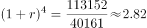
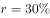
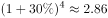

# 年均增长率计算（选项代入验证）

考点：[[20-考点/资料分析/增长/年均增长率计算（选项代入验证）|增长 / 年均增长率计算（选项代入验证）]]
材料：[[15-材料/资料分析/195136 2013—2017年年末我国固定互联|195136 2013—2017年年末我国固定互联]]

**问法模型**：题干出现'2013—2017年……年均增长率为'的问法 → 用(1+r)^n=现期/基期（n=年份差=4）列式，再将选项代入n次方与比值比对。

## 推理链
1. 第1步：从柱状图黑柱读取基期与现期数据：2013年年末移动宽带用户40161万户，2017年年末113152万户。
2. 第2步：2013为基期、2017为现期，增长年头n=2017-2013=4，套用年均增长率公式(1+r)^n=现期/基期。
3. 第3步：计算比值113152÷40161≈2.82，即(1+r)^4≈2.82，反解得r≈29.6%（1.296^4≈2.82）。
4. 第4步：优先取整数代入选项验证：如1.3^4=2.8561偏大、1.29^4≈2.769偏小，C项代入后(1+r)^4≈2.82，与计算值最接近，当选C。

**最快解法**：⚡ 选项代入法+4次方速算：先截位直除得113152/40161≈2.82；再对选项数值做4次方估算（利用1.3^4=2.856、1.29^4≈2.77两个锚点夹逼），落在2.82附近的选项即为答案C。

## 易错点
- ⚠ 年均增长率的n是年份差4而非5：2013为基期、2017为现期，间隔4个增长年头，误开5次方会明显低估r。
- ⚠ 材料各年数据均为'年末'期末存量，直接取期末数相除即可，勿误当新增/累计值、也勿用相邻年差值代入。
- ⚠ 2.82是(1+r)^4的比值而非r本身，勿把商直接当增长率；同时勿与'年增长速度最快的年份'这类逐年环比增速题混为一谈。

## 母题抽象
> 🧩 当题干出现'某时间段××的年均增长率为'且能读出基期、现期值时，用(1+r)^n=现期/基期（n=年份差），将选项逐一代入n次方，与比值最接近者即为答案。

**同类特征**：年均增长率、2013—2017年时间段、移动宽带用户数、基期2013/现期2017、n=年份差=4次方、选项代入验证

## 相关题
- [[10-真题/资料分析/增长/2187792 同比增长率比较（增速最快年份判断）|2187792]]（黑龙江 2018，相关度1）
- [[10-真题/资料分析/增长/12881993 年均增长率（区间型选项验证）|12881993]]（广东 2025，相关度1）
- [[10-真题/资料分析/增长/15121362 年均增速比较（年均增长率大小比较）|15121362]]（江苏 2024，相关度1）
- [[10-真题/资料分析/增长/4651694 年均增长率比较（年均增速大小排序）|4651694]]（江苏 2022，相关度1）
- [[10-真题/资料分析/增长/2145031 年均增长率计算（n=3，立方根型）|2145031]]（深圳市考 2017，相关度1）

---

### 题干
2013一2017年移动宽带用户数的年均增长率为：

### 选项
- A. 

- B. 

- C. 

　✅
- D. 

### 官方解析

根据题干“2013-2017年······年均增长率为”，可判定本题为年均增长率问题。由图形材料可知：2013年移动宽带用户数为40161，2017年移动宽带用户数为113152。代入公式：（n为年份差），即，优先选取整数代入，将C项代入，，与2.82非常接近，当选。

故正确答案为C。

### 给定材料

根据以下资料，回答116~120题。

