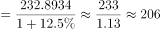

# 基期量计算（已知现期量与同比增长率求基期量）

考点：[[20-考点/资料分析/增长/基期量计算（已知现期量与同比增长率求基期量）|增长 / 基期量计算（已知现期量与同比增长率求基期量）]]
材料：[[15-材料/资料分析/195083 2017年5月我国境内银行业金融机构|195083 2017年5月我国境内银行业金融机构]]

**问法模型**：题干时间（2016年5月）早于材料时间（2017年5月）且只给同比增速 → 用'基期量=现期量÷(1+增速)'计算，并完成亿元→万亿元换算

## 推理链
1. 第1步：题干问2016年5月数值，材料现期为2017年5月且未直接给基期列，判定为基期计算问题
2. 第2步：从统计表第一行总计行提取：2017年5月银行业金融机构总资产2328934亿元、同比增速12.5%（注意是总计行，不是大型商业银行等分项）
3. 第3步：套用公式：基期量=现期量÷(1+增长率)=2328934÷1.125（亿元）
4. 第4步：百化分速算：12.5%=1/8，1+12.5%=9/8，除以9/8等价于乘8/9，2328934×8/9≈2070164亿元
5. 第5步：单位换算：2070164亿元÷10000≈207万亿元（材料为亿元，选项为万亿元）
6. 第6步：对照选项：≈207万亿元与C项一致；A.227、B.217、D.197均偏差超过一个量级单位，排除

**最快解法**：⚡ 百化分+单位换算：12.5%=1/8→基期=2328934×8/9，先心算232.9万亿元×8/9≈207.0万亿元，直接锁定C；无需精确直除2328934÷1.125

## 易错点
- ⚠ 单位量级陷阱：表中金额为亿元，选项为万亿元，必须÷10000换算，否则易在量级上错选
- ⚠ 基期现期混淆：2328934亿元是2017年5月现期值（约232.9万亿元），不能直接对应选项；也不可用'现期×(1−12.5%)'（得约203.7万亿元，偏离真值）
- ⚠ 行维度混淆：应读总计行'银行业金融机构'，误读成分项（如大型商业银行839329亿元）则全盘皆错

## 母题抽象
> 🧩 当题干出现'上一年/基期时间某指标约为多少'而材料只给现期值和同比增速时，用基期量=现期÷(1+r)，优先把增速百化分（12.5%=1/8）简算，最后按选项单位（万亿元=亿元÷10000）换算后对照选项

**同类特征**：时间前移求基期（2016年5月 vs 材料2017年5月）、问总计行'银行业金融机构'总资产、增速为12.5%（1/8型特殊分数）、选项单位'万亿元'与材料单位'亿元'不一致、问法含'约为'（允许估算）

## 相关题
- [[10-真题/资料分析/增长/19591643 基期量计算（已知现期量与同比增长率求基期量）|19591643]]（选调 2024，相关度2）

---

### 题干
2016年5月，银行业金融机构总资产金额约为：

### 选项
- A. 227万亿元
- B. 217万亿元
- C. 207万亿元　✅
- D. 197万亿元

### 官方解析

根据题干“2016年5月，银行业金融机构总资产金额约为”，结合材料时间是2017年5月，可判定本题为基期计算问题。定位统计表可得：2017年5月银行业金融机构总资产为，同比增速为。根据公式，基期万亿元，与C项最接近。

故正确答案为C。

### 给定材料

根据以下资料，回答以下问题。

注：

1.农村金融机构包括农村商业银行、农村合作银行、农村信用社和新型农村金融机构。

2.其他类金融机构包括政策性银行及国家开发银行、民营银行、外资银行、非银行金融机构、资产管理公司和邮政储蓄银行。

3.净资产额等于总资产额减去总负债额。

