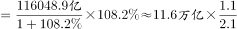

# 增长量计算（现期+增长率，附亿元→万亿元单位换算）

考点：[[20-考点/资料分析/增长/增长量计算（现期+增长率，附亿元→万亿元单位换算）|增长 / 增长量计算（现期+增长率，附亿元→万亿元单位换算）]]
材料：[[15-材料/资料分析/195224 这份材料讲的是2015年（对比201|195224 这份材料讲的是2015年（对比201]]

**问法模型**：题干出现'2015年比2010年增加约多少万亿元'→判定为增长量计算题，用'增长量=现期×r/(1+r)'并将亿元换算为万亿元后与选项对照

## 推理链
1. 第1步：定位材料第二段，2015年高技术制造业主营业务收入116048.9亿元，比2010年增长（原卷增长率约108%，文本版该数值留空，以原卷为准）
2. 第2步：单位换算，116048.9亿元÷10000=11.60489万亿元≈11.6万亿元，与设问单位'万亿元'统一
3. 第3步：所用公式为增长量=现期×r/(1+r)=现期−基期，其中基期=现期/(1+r)
4. 第4步：代入计算，增长量≈11.6×108/208≈11.6×0.52≈6.0万亿元（等价验证：基期≈11.6÷2.08≈5.6万亿元，11.6−5.6≈6.0万亿元）
5. 第5步：与选项对照，A5、B6、C7、D8，计算结果≈6万亿元，与B项最接近，故正确答案为B

**最快解法**：⚡ 百化分+截位直除：先把116048.9亿元换算为11.6万亿元，增长率r≈108%，增长量=现期×r/(1+r)=11.6×108/208，108/208≈0.52，11.6×0.52≈6.0万亿元；或先截位求基期11.6÷2.08≈5.6万亿元，再相减11.6−5.6≈6.0万亿元，秒选B

## 易错点
- ⚠ 单位量级陷阱：材料以'亿元'为主而设问用'万亿元'，必须先缩小10000倍（116048.9亿元≈11.6万亿元），漏换算或错数量级会直接选错
- ⚠ 口径陷阱：材料中'占全部制造业比重比2010年提高0.8个百分点'是百分数之差，不是增长率，绝不能代入基期/增长量公式
- ⚠ 数据缺失陷阱：文本版'比2010年增长＿%'留空，切勿随意编造增长率代入；本题r≈108%偏大，若误用50%左右会算得约3.9万亿元而错选A

## 母题抽象
> 🧩 当题干出现'现期（某年）比基期增加约多少X'且材料给出现期值+同比增长率时，用增长量=现期×r/(1+r)（百化分r≈1/n时可直接用现期/(n+1)），先统一单位量级再与选项对照

**同类特征**：比2010年增加、约多少万亿元、增长量计算、现期2015年、亿元→万亿元换算、纯文字材料定位

## 相关题
- [[10-真题/资料分析/增长/2448408 增长量计算（相邻两年合计数差值，含亿元→万亿元单位换算）|2448408]]（国考 2020，相关度2）
- [[10-真题/资料分析/其他/2776063 多分类数据加总与单位换算（亿元→万亿元）|2776063]]（浙江 2021，相关度2）
- [[10-真题/资料分析/增长/7159 增长量计算|7159]]（北京 2009，相关度1）
- [[10-真题/资料分析/增长/2571729 增长量计算——每增长1个百分点对应的增量（基期量×1%）|2571729]]（山东 2020，相关度1）
- [[10-真题/资料分析/增长/3018839 增长量计算（负增长情形：基期减少量）|3018839]]（广东 2021，相关度1）

---

### 题干
2015年，我国高技术制造业主营业务收入比2010年增加约多少万亿元？

### 选项
- A. 5
- B. 6　✅
- C. 7
- D. 8

### 官方解析

根据题干“······增加······万亿元”，可判定本题为增长量计算问题。定位文字第二段材料可知：“2015年我国高技术制造业实现主营业务收入116048.9亿元，比2010年增长。”与2010年相比，2015年我国高技术制造业主营业务收入的增长量，与B项最为接近。

故正确答案为B。

### 给定材料

        2015年末，我国规模以上高技术制造业共有企业26894家，比2010年增加1077家；占规模以上制造业企业数的比重为，比2010年提高1.3个百分点。2015年末，我国高技术制造业从业人员1293.7万人，比2010年增长；占全部制造业从业人员的比重为，比2010年提高2.9个百分点。

        2015年我国高技术制造业实现主营业务收入116048.9亿元，比2010年增长；占全部制造业企业的比重为，比2010年提高0.8个百分点。2015年我国高技术制造业实现利润总额7233.7亿元，比2010年增长，增幅比其他制造业平均水平高出11.5个百分点；高技术制造业利润总额占全部制造业的比重为，比2010年提高0.5个百分点。

        2015年我国规模以上高技术制造业投入研发经费2034.3亿元，比2010年增长，增幅比其他制造业平均水平高8.7个百分点。2015年我国高技术制造业申请发明专利7.4万件，比2010年增长；实现新产品销售收入3.1万亿元，比2010年增长。

> [!warning] 疑点（官方解析可能有误，待人工复核）
> 所给材料文本中'比2010年增长＿%'数值留空，官方解析亦未显示具体增长率；按官方答案B（6万亿元）反推，增长率应约为108%（116048.9÷(1+108%)≈5.6万亿元，增长量≈6.0万亿元，与B自洽），解题须以原卷完整数值代入，文本缺失不构成对答案本身的质疑
