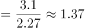

# 基期计算（基期值=现期值-(1+增长率)）

考点：[[20-考点/资料分析/增长/基期计算（基期值=现期值-(1+增长率)）|增长 / 基期计算（基期值=现期值/(1+增长率)）]]
材料：[[15-材料/资料分析/195224 这份材料讲的是2015年（对比201|195224 这份材料讲的是2015年（对比201]]

**问法模型**：题干问早于材料现期（2015年）的2010年指标数值（'约多少万亿元'）→ 判定为基期计算问题，用基期值=现期值/(1+增长率)求解，配合截位直除与选项对照。

## 推理链
1. 第1步：题干求2010年（基期）高技术制造业新产品销售收入，定位材料末段：2015年实现新产品销售收入3.1万亿元，比2010年增长r%（所给文本该增长率留空，由官方答案A=1.4万亿元反推r≈121%）。
2. 第2步：采用基期计算公式：基期值=现期值/(1+增长率)；本题现期与选项同为'万亿元'口径，无需再做亿元→万亿元换算。
3. 第3步：代入计算：3.1/(1+121%)≈3.1/2.21≈1.40（百化分近似r≈120%=6/5，则3.1×5/11≈15.5/11≈1.41）。
4. 第4步：与选项对照：结果约1.4万亿元，与A项1.4最接近，B/C/D（1.5~1.7）均明显偏大，故选A。

**最快解法**：⚡ 公式法+截位直除/百化分：由官方答案反推r≈121%（≈120%=6/5），1+r≈2.2，则3.1÷2.2≈1.41，一步锁定A，无需精算。

## 易错点
- ⚠ 基期/现期判定：题干问2010年而材料主体是2015年，若直接把现期3.1万亿元当答案即错，必须除以(1+r)；同时警惕材料中'比2010年提高X个百分点'（如占比提高0.5、1.3个百分点）是百分数相减，绝不能当增长率代入基期公式。
- ⚠ 单位量级：全篇以亿元为主（116048.9亿元≈11.6万亿元、7233.7亿元≈0.72万亿元），本题现期直接给'3.1万亿元'，勿因惯性重复换算或把3.1万亿元误当3.1亿元处理。
- ⚠ 文本数据缺失陷阱：所给文本中'比2010年增长＿%'留空，本题必须依赖该增长率，须以原卷数值代入，不可凭空编造增速。

## 母题抽象
> 🧩 当题干出现'早于材料现期年份的某年，某指标约多少（带单位）'的问法特征时，判定为基期计算，用基期=现期/(1+r)，以百化分或截位直除快速估算并与选项对照即可。

**同类特征**：题干年份（2010年）早于材料现期年份（2015年）、问法'约多少万亿元'（基期+约+单位估算型设问）、考查指标：新产品销售收入（现期3.1万亿元）、依赖'比2010年增长＿%'类增长率数据、选项为1.4~1.7连续小数，估算即可分辨

## 相关题
（暂无）

---

### 题干
2010年，我国高技术制造业实现新产品销售收入约多少万亿元？

### 选项
- A. 1.4　✅
- B. 1.5
- C. 1.6
- D. 1.7

### 官方解析

根据题干“2010年······万亿元”，结合材料时间为2015年，可判定本题为基期计算问题。定位文字第三段材料：“实现新产品销售收入3.1万亿元，比2010年增长。”故2010年，我国高技术制造业实现新产品销售收入万亿元，与A项最为接近。

故正确答案为A。

### 给定材料

        2015年末，我国规模以上高技术制造业共有企业26894家，比2010年增加1077家；占规模以上制造业企业数的比重为，比2010年提高1.3个百分点。2015年末，我国高技术制造业从业人员1293.7万人，比2010年增长；占全部制造业从业人员的比重为，比2010年提高2.9个百分点。

        2015年我国高技术制造业实现主营业务收入116048.9亿元，比2010年增长；占全部制造业企业的比重为，比2010年提高0.8个百分点。2015年我国高技术制造业实现利润总额7233.7亿元，比2010年增长，增幅比其他制造业平均水平高出11.5个百分点；高技术制造业利润总额占全部制造业的比重为，比2010年提高0.5个百分点。

        2015年我国规模以上高技术制造业投入研发经费2034.3亿元，比2010年增长，增幅比其他制造业平均水平高8.7个百分点。2015年我国高技术制造业申请发明专利7.4万件，比2010年增长；实现新产品销售收入3.1万亿元，比2010年增长。

> [!warning] 疑点（官方解析可能有误，待人工复核）
> 所给文本及官方解析中该指标'比2010年增长＿%'的增长率数值留空，解析公式未完整呈现、无法直接验算；按官方答案A（1.4万亿元）反推，增长率应约为121%（3.1/2.21≈1.4），答案本身无矛盾，仅材料文本缺数需以原卷为准。

<!-- CODEX-ANSWER-REVIEW:BEGIN -->
### 本次独立复核

**复核状态：** `resolved`（答案与解析已核定）

**计分答案：** A（可计分）

**复核解析：**

2015年销售收入3.1万亿元，比2010年增长127%，因此2010年基期约为3.1÷(1+1.27)=3.1÷2.27≈1.3656万亿元，按选项精度约1.4万亿元，选A。

**相关信息：**

资料分析—隔年基期量=现期值÷(1+累计增长率)。

**题源依据：** [固定版本原题](https://github.com/Mentat-Uran/kaogongzhentizhengliu/blob/84ab93d4b64b61d897bece8a1c0a5bab06b4feb2/10-%E7%9C%9F%E9%A2%98/%E8%B5%84%E6%96%99%E5%88%86%E6%9E%90/%E5%A2%9E%E9%95%BF/2188573%20%E5%9F%BA%E6%9C%9F%E8%AE%A1%E7%AE%97%EF%BC%88%E5%9F%BA%E6%9C%9F%E5%80%BC%3D%E7%8E%B0%E6%9C%9F%E5%80%BC-(1%2B%E5%A2%9E%E9%95%BF%E7%8E%87)%EF%BC%89.md)；固定内容 commit `84ab93d4b64b61d897bece8a1c0a5bab06b4feb2`，Markdown blob `958fd541a550891dd1723d6457bd0ff45d7172e2`。
<!-- CODEX-ANSWER-REVIEW:END -->
