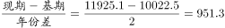
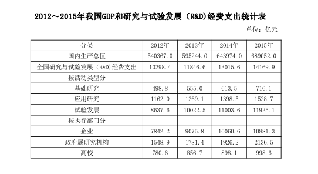

# 年均增长量计算（基期与增长期数判定）

考点：[[20-考点/资料分析/增长/年均增长量计算（基期与增长期数判定）|增长 / 年均增长量计算（基期与增长期数判定）]]
材料：[[15-材料/资料分析/195225 2012～2015年我国国内生产总值|195225 2012～2015年我国国内生产总值]]

**问法模型**：题干'2013～2015年……年平均增加'且选项为带'亿元'的金额区间 → 年均增长量模型：年均增量=（末年值−基年值）÷年份差（2015−2013=2），再对照金额区间选答案

## 推理链
1. 第1步：定位表格'按活动类型分—试验发展'行（不是全国R&D总量行）：2013年10022.5亿元、2014年11003.6亿元、2015年11925.1亿元
2. 第2步：'年平均增加'为年均增长量问题，公式为（末期值−基期值）÷增长期数；本题以题干首年2013年为基期、2015年为末期，增长期数=2015−2013=2
3. 第3步：代入计算：(11925.1−10022.5)÷2=1902.6÷2=951.3亿元
4. 第4步：951.3亿元落在900～1000亿元区间，对应C项'900多亿元'，与官方答案一致

**最快解法**：⚡ 首尾相减+截位直除：直接取2015年与2013年试验发展值11925.1−10022.5≈1900，÷2个增长期≈950亿元，秒选'900多亿元'（C），无需逐年做差再平均

## 易错点
- ⚠ 基期与期数陷阱：若误以2012年8637.6为基期、除以3个增长期，得约1095.8亿元会误选D；官方口径以题干首年2013年（10022.5）为基期、年份差2015−2013=2，须以官方答案C为准
- ⚠ 串行陷阱：题干问'试验发展'行，极易错拿'全国研究与试验发展经费支出'总量行（2013年11846.6、2015年14169.9），拿错行会算出约1161.7亿元而误判D
- ⚠ 增量与增速混淆：'年平均增加'是增量（亿元）而非增长率（%），也不能只算2014年单年增量981.1（11003.6−10022.5）以偏概全

## 母题抽象
> 🧩 当题干出现'A～B年，××年平均增加/年均增长'且选项为带单位金额区间时，用年均增长量模型：（B年值−A年值）÷（B−A）个增长期，再对照区间选项，同时核对所取行与题干对象（如'试验发展'≠全国总量）一致

**同类特征**：区间年份'2013～2015年'、'年平均增加'问法、'试验发展经费支出'特定行名、选项为带'亿元'的金额区间、年均增长量计算、基期与增长期数判定

## 相关题
（暂无）

---

### 题干
2013～2015年，试验发展经费支出年平均增加：

### 选项
- A. 不到800亿元
- B. 800多亿元
- C. 900多亿元　✅
- D. 1000亿元以上

### 官方解析

根据题干“2013～2015年······年平均增加”，结合选项带单位，可判定本题为年均增长量问题。定位表格材料可知，2013年的试验发展为10022.5亿元，2015年试验发展为11925.1亿元。故2013～2015年试验发展经费支出年平均增加量=亿元，C项符合。

故正确答案为C。

### 给定材料

> [!warning] 疑点（官方解析可能有误，待人工复核）
> 口径分歧提示：材料导读称'2013～2015年年均增量应以2012年为基期、除以3个增长期'，按该口径(11925.1−8637.6)÷3≈1095.8亿元应对应D项；但官方解析明确以2013年（10022.5）为基期、2015年（11925.1）为末期，增长期数为2，得951.3亿元对应C。年均增长类题目存在'年份差（末年−首年）'与'自然年计数（基期前移一年）'两种业界口径，本题官方答案为C，以官方口径为准，备考建议统一按'年份差=末年−首年'处理
