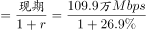
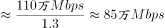

# 基期量计算（已知现期量与同比增长率反推基期）

考点：[[20-考点/资料分析/增长/基期量计算（已知现期量与同比增长率反推基期）|增长 / 基期量计算（已知现期量与同比增长率反推基期）]]
材料：[[15-材料/资料分析/195226 2010～2015年中国国际出口带宽|195226 2010～2015年中国国际出口带宽]]

**问法模型**：题干问2009年（早于材料起始年2010）的带宽'最接近哪个数字'→ 用基期量模型：基期量=现期量÷(1+同比增长率)

## 推理链
1. 第1步：题干求2009年数值，图1数据自2010年起，故2009年为基期；由图1读出2010年国际出口带宽109.9万Mbps、同比增速26.9%
2. 第2步：基期量公式：基期量=现期量÷(1+增长率)
3. 第3步：代入计算：109.9÷(1+26.9%)=109.9÷1.269≈86.6万Mbps（可用百化分26.9%≈1/3.7，即109.9×3.7/4.7≈86.6）
4. 第4步：与选项对照：86.6与B项87万Mbps最接近（A为71、C为97、D为128均偏离），故选B

**最快解法**：⚡ 百化分+截位直除：26.9%≈1/3.7，基期=109.9÷(1+1/3.7)=109.9×3.7/4.7≈110×0.787≈86.6万Mbps；或直接截位直除109.9/1.269≈110/1.27≈86.6，锁定B（87）

## 易错点
- ⚠ 基期现期方向混淆：2009年在2010年之前，应做除法109.9÷1.269；若误乘(1+26.9%)得约139.4万Mbps（恰近似2011年值139.0），方向即错
- ⚠ 双轴图混读：26.9%是右轴折线（增速），109.9是左轴柱值（带宽），勿把柱值当增速或线值当带宽
- ⚠ 单位量级陷阱：图1单位为万Mbps、表1为Mbps，本题全程用图1的万Mbps口径即可；若与表内Mbps数值混算会差1万倍

## 母题抽象
> 🧩 当题干所求年份早于材料给出的数据起始年份（出现'××年前一年/材料最早年份之前'），且材料给出相邻年份的现期量与同比增速时，用基期量=现期量÷(1+增速)，以百化分（增速≈1/n）或截位直除速算，验证结果与哪个选项最接近

**同类特征**：求2009年（早于材料起始年2010）、'最接近以下哪个数字'设问、基期量计算、现期量109.9万Mbps与增速26.9%均可从图1读取、选项带'万Mbps'单位

## 相关题
- [[10-真题/资料分析/增长/2255826 基期量计算（已知现期量与同比增长率反推基期）|2255826]]（江西 2016，相关度2）
- [[10-真题/资料分析/增长/11226618 基期量计算（已知现期量与同比增长率反推基期）|11226618]]（上海 2025，相关度2）
- [[10-真题/资料分析/增长/12019697 基期量计算（现期累计值−当期新增值）|12019697]]（广东 2026，相关度1）
- [[10-真题/资料分析/增长/2033794 基期量计算|2033794]]（江苏 2016，相关度1）
- [[10-真题/资料分析/增长/2166218 基期量计算（同比下降型）|2166218]]（深圳市考 2018，相关度1）

---

### 题干
2009年，中国国际出口带宽最接近以下哪个数字？

### 选项
- A. 71万Mbps
- B. 87万Mbps　✅
- C. 97万Mbps
- D. 128万Mbps

### 官方解析

根据题干“2009年，······最接近······”，结合材料所给时间是2010年，可判定本题为基期计算问题。定位柱状图可知，2010年中国国际出口带宽是109.9万Mbps，增速是。故2009年中国国际出口带宽，与B项最接近。

故正确答案为B。

### 给定材料

<b>根据以下资料，回答96～100题。</b>

> [!warning] 疑点（官方解析可能有误，待人工复核）
> 官方解析文字中'增速是。'处数字缺失（应为26.9%），且未展示完整算式，但不影响结论：109.9÷1.269≈86.6≈87，答案B正确

<!-- CODEX-ANSWER-REVIEW:BEGIN -->
### 本次独立复核

**复核状态：** `resolved`（答案与解析已核定）

**计分答案：** B（可计分）

**复核解析：**

图1读出2010年国际出口带宽109.9万Mbps、同比26.9%。2009年=109.9/1.269≈86.6万Mbps，最接近87万Mbps，选B。

**相关信息：**

双轴图中柱为带宽、折线为增速。

**题源依据：** [固定版本原题](https://github.com/Mentat-Uran/kaogongzhentizhengliu/blob/84ab93d4b64b61d897bece8a1c0a5bab06b4feb2/10-%E7%9C%9F%E9%A2%98/%E8%B5%84%E6%96%99%E5%88%86%E6%9E%90/%E5%A2%9E%E9%95%BF/2188588%20%E5%9F%BA%E6%9C%9F%E9%87%8F%E8%AE%A1%E7%AE%97%EF%BC%88%E5%B7%B2%E7%9F%A5%E7%8E%B0%E6%9C%9F%E9%87%8F%E4%B8%8E%E5%90%8C%E6%AF%94%E5%A2%9E%E9%95%BF%E7%8E%87%E5%8F%8D%E6%8E%A8%E5%9F%BA%E6%9C%9F%EF%BC%89.md)；固定内容 commit `84ab93d4b64b61d897bece8a1c0a5bab06b4feb2`，Markdown blob `17e7325149de76e063e14e15ee03bdd1be124371`。
<!-- CODEX-ANSWER-REVIEW:END -->
