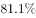
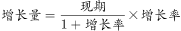
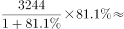
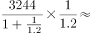
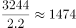
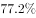

# 增长量计算（现期−基期，经增长率还原基期）

考点：[[20-考点/资料分析/增长/增长量计算（现期−基期，经增长率还原基期）|增长 / 增长量计算（现期−基期，经增长率还原基期）]]
材料：[[15-材料/资料分析/198622 新疆生产建设兵团十八大以来（以201|198622 新疆生产建设兵团十八大以来（以201]]

**问法模型**：'2016年比2012年多出多少家'→增长量模型：增长量=现期−基期=现期×r/(1+r)，先用增长率还原基期再作差

## 推理链
1. 第1步：定位材料第二段：2016年兵团批发零售企业3244家，'比2012年增长'后的百分数在转录材料中空缺（按官方答案B反推该增长率≈81.1%，对应2012年约1791家）
2. 第2步：增长量计算公式：增长量=现期−基期=现期−现期/(1+r)=现期×r/(1+r)
3. 第3步：代入计算：3244/(1+81.1%)≈3244/1.811≈1791家，增长量≈3244−1791=1453家（粗算r≈80%时3244×4/9≈1442，同样指向B）
4. 第4步：对照选项：1453与B项(1453家)一致，A(1391)、C(1518)、D(1604)偏差更大，故选B

**最快解法**：⚡ 百化分+截位直除：增长率≈81%≈4/5，增长量=3244×4/9≈1442，锁定最接近的B(1453)；或精确截位直除3244/1.811≈1791，3244−1791≈1453，直接命中B

## 易错点
- ⚠ 无源数据陷阱：材料中批发零售企业'比2012年增长'的百分数空缺（本组题唯一数据缺口），不能凭企业总数3357家或住宿餐饮113家拼凑基期，只能按官方口径代入增长率还原
- ⚠ 增长量误算为现期×r：若算成3244×81%≈2628会远超所有选项（量级干扰），正确应乘r/(1+r)，即先除以(1+r)还原基期
- ⚠ 主体口径与模型混淆：只取'批发零售企业3244家'，勿混入住宿餐饮113家或总数3357家；且'增长X倍'换算(÷(1+N))与'增加13家'绝对增量(−13)是两种不同模型（对应题3市场数），勿套混

## 母题抽象
> 🧩 当题干出现'现期比基期年多出/增长多少（带单位量）'且材料给出'现期值+比基期增长r%'时，用 增长量=现期×r/(1+r)（百化分速算），验证选项取最接近值

**同类特征**：比2012年多出、增长量计算、批发零售企业（分行业主体）、现期2016/基期2012、单位'家'

## 相关题
- [[10-真题/资料分析/增长/7159 增长量计算|7159]]（北京 2009，相关度1）
- [[10-真题/资料分析/增长/2571729 增长量计算——每增长1个百分点对应的增量（基期量×1%）|2571729]]（山东 2020，相关度1）
- [[10-真题/资料分析/增长/3018839 增长量计算（负增长情形：基期减少量）|3018839]]（广东 2021，相关度1）
- [[10-真题/资料分析/增长/10204654 增长量计算（已知现期与同比下降率求下降量）|10204654]]（安徽 2024，相关度1）
- [[10-真题/资料分析/增长/13319362 现期增长量计算（已知现期值与同比增速，用r-(1+r)公式）|13319362]]（江苏 2025，相关度1）

---

### 题干
2016年兵团批发零售企业的数量比2012年多出：

### 选项
- A. 1391家
- B. 1453家　✅
- C. 1518家
- D. 1604家

### 官方解析

由题干“2016年······的数量比2012年多出”，可判定本题为增长量计算问题。定位文字材料第二段，2016年，兵团拥有批发零售企业3244家，比2012年增长。代入增长量计算公式： 可得，批发零售企业增长了 家，与B项最接近。

故正确答案为B。

### 给定材料

        十八大以来，兵团各级紧紧抓住经济换挡升级的有利时机，有力地推动了商贸规模持续扩大。2016年，兵团实现商品销售总额3341.37亿元，比2012年增长2.2倍；社会消费品零售总额632.29亿元，比2012年增长1.1倍。

        2016年，兵团拥有商贸流通企业3357家，比2012年增长。分行业看，批发零售企业3244家，比2012年增长；住宿餐饮企业113家，比2012年增长。

        2016年，兵团拥有亿元以上商品交易市场23家，比2012年增加13家，总摊位数12621个，实现交易额1001.39亿元，比2012年增长25.6倍。分类型看，综合市场6家，其中，工业消费品综合市场1家，农产品综合市场2家，其他综合市场3家；专业市场17家，其中，生产资料市场2家，农产品市场6家，纺织服装鞋帽市场2家，电器、通讯器材、电子设备市场2家，家具、五金及装饰材料市场2家，汽车、摩托车及零配件市场3家。

        2016年，兵团拥有商业综合体3家，商户数共348家，从业人员1802人。其中，自营、联营商户64家，实现销售额1.65亿元；租赁商户284家，实现销售额5.83亿元。

> [!warning] 疑点（官方解析可能有误，待人工复核）
> 材料原文与官方解析中批发零售企业'比2012年增长'后的百分数在转录中均空缺，导致无法从给定文本直接复核官方计算过程；按官方答案B反推：基期=3244−1453=1791家、增长率≈1453/1791≈81.1%，与官方结论自洽，属转录缺口而非答案错误
