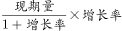
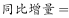
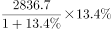
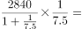
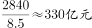
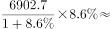
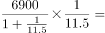
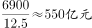
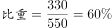

# 增长量计算及其占整体增量的比重（增量比重-'几成'型）

考点：[[20-考点/资料分析/增长/增长量计算及其占整体增量的比重（增量比重-'几成'型）|增长 / 增长量计算及其占整体增量的比重（增量比重/'几成'型）]]
材料：[[15-材料/资料分析/198623 2017年上半年Y市文化创意产业运行|198623 2017年上半年Y市文化创意产业运行]]

**问法模型**：'软件领域收入同比增量约占全市文创收入同比增量的（几成）'→增量比重模型：分别用 增量=现期×g/(1+g) 求部分与整体增量后作商，再映射到成数选项

## 推理链
1. 第1步：从材料第2段取部分量——软件和信息技术服务领域收入2836.7亿元，同比增速g₂（所给文本中数值缺失，以原卷为准）；从第1段取整体量——全市规模以上文创法人单位收入6902.7亿元，同比增速g₁（所给文本中数值缺失，以原卷为准）；两者同属'规模以上法人单位收入'口径，可跨段拼接。
2. 第2步：公式：同比增量=现期值×g/(1+g)。
3. 第3步：代入：软件领域增量=2836.7×g₂/(1+g₂)；全市增量=6902.7×g₁/(1+g₁)。
4. 第4步：增量比重=（2836.7÷6902.7）×[g₂/(1+g₂)]÷[g₁/(1+g₁)]，其中现期占比2836.7÷6902.7≈41.1%；官方代入原卷增速后商≈0.6，且由60%＞41.1%可反推增速因子＞1（软件领域增速高于全市增速）。
5. 第5步：0.6即'六成'，对照A四成/B五成/C六成/D七成，锁定C。

**最快解法**：⚡ 公式法+截位直除：增量比重=现期占比×增速因子。先截位直除得现期占比2836.7÷6902.7≈41%，再按 g/(1+g) 分别折算两处增速作相对比（软件领域因子大于全市因子），官方代入原卷增速后商约0.6，直接选C六成；切勿停在41%误选A四成。

## 易错点
- ⚠ 增量比重≠现期比重：2836.7÷6902.7≈41%只是现期占比，必须再乘增速因子[g₂/(1+g₂)]÷[g₁/(1+g₁)]，看到'四成'选项直接选A是本题最大陷阱。
- ⚠ 口径陷阱：分子分母必须同为'规模以上法人单位收入'（第2段软件2836.7亿÷第1段全市6902.7亿），不能误用增加值1734.7亿、功能区收入5087.5亿、利润349.8亿或投资141.6亿做分母。
- ⚠ 数值缺失与成数换算：所给文本中各处同比增速均为空白，增量必须依赖原卷增速计算，不得用现期量直接臆估增量；'六成'=60%，勿与'60个百分点'混淆。

## 母题抽象
> 🧩 当题干出现'（部分）的同比增量约占（整体）的同比增量的比重/几成'时，用增量比重模型：比值=（部分现期÷整体现期）×[g部分/(1+g部分)]÷[g整体/(1+g整体)]，先估现期占比定数量级与方向，再代入增速截位直除，验证商落在哪个'成数'区间。

**同类特征**：同比增量约占、几成（四成/五成/六成/七成）、部分增量÷整体增量（增量的比重）、软件和信息技术服务收入2836.7亿 vs 全市收入6902.7亿（跨段拼接）、现期（2017年上半年）同比数据、规模以上文创产业法人单位收入口径

## 相关题
（暂无）

---

### 题干
2017年上半年，Y市软件和信息技术服务领域规模以上法人单位收入同比增量约占全市规模以上文创产业法人单位同比增量的：

### 选项
- A. 四成
- B. 五成
- C. 六成　✅
- D. 七成

### 官方解析

由题干“2017年上半年······约占······的”，结合选项为几成，可判定本题为现期比重计算问题。定位材料第一、二段可得，“2017年上半年，规模以上文创产业法人单位实现收入6902.7亿元，同比增长，软件和信息技术服务领域实现收入2836.7亿元，增长”。根据可得，2017年上半年，Y市软件和信息技术服务领域规模以上法人单位收入。全市规模以上文创产业法人单位。故所求，即为六成。

故正确答案为C。

### 给定材料

        2017年上半年，Y市文化创意产业实现增加值1734.7亿元，同比增长，占地区生产总值的；规模以上文创产业法人单位实现收入6902.7亿元，同比增长，比上年4季度和今年1季度分别提高1.3个和0.2个百分点；实现利润总额349.8亿元，同比增长。

        分领域看，上半年，文化艺术服务领域规模以上法人单位实现收入182.7亿元，同比增长；软件和信息技术服务领域实现收入2836.7亿元，增长；设计服务领域实现收入167.1亿元，增长；新闻出版及发行服务领域实现收入340.6亿元，增长。

        分功能区看，上半年文创功能区规模以上法人单位实现收入5087.5亿元，同比增长。其中，文化科技融合示范区实现收入2616.1亿元，同比增长；时尚创意功能区、文化体育（会展）融合功能区、文化艺术品交易功能区分别实现收入187.9亿元、167.5亿元、52.2亿元，同比分别增长、和，均呈快速增长态势。

        上半年文化创意产业完成固定资产投资141.6亿元，同比增长。其中，旅游休闲娱乐领域完成投资81.3亿元，占文创产业投资总额的。

> [!warning] 疑点（官方解析可能有误，待人工复核）
> 所给材料文本与官方解析中的同比增速具体数值及中间计算结果均被截断（缺失），无法逐步复算增量商≈0.6；本题判定依赖原卷完整增速数据，但题型判定（增量比重）与答案C（六成）无矛盾，不构成解析错误。
