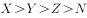
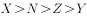
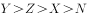
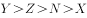

# 增长率大小比较（纯读数型）

考点：[[20-考点/资料分析/增长/增长率大小比较（纯读数型）|增长 / 增长率大小比较（纯读数型）]]
材料：[[15-材料/资料分析/198623 2017年上半年Y市文化创意产业运行|198623 2017年上半年Y市文化创意产业运行]]

**问法模型**：题干为四个功能区收入同比增速设代号X、Y、Z、N并给出不等式选项 → 定位材料对应段落直接读出四个增速数值，按'分别'的对应顺序逐一代入选项验证大小关系（读数比较模型，零计算）

## 推理链
1. 第1步：从题干提取代号与主体的对应关系：X=文化科技融合示范区（收入2616.1亿元，单独叙述），Y=时尚创意功能区（187.9亿元）、Z=文化体育（会展）融合功能区（167.5亿元）、N=文化艺术品交易功能区（52.2亿元）三者按'分别'顺序对应
2. 第2步：定位材料第3段'分功能区看'，X、Y、Z、N均为材料直接给出的同比增速（原卷数值，所给文本中此四处空白），属纯读数比较，无任何公式与计算
3. 第3步：利用材料定性信息'均呈快速增长态势'先缩小范围：四个增速均为正且较高，可排除含负增速或明显异常个位数的选项
4. 第4步：将原卷读出的X、Y、Z、N四个数值代入A、B、C、D四个不等式逐一验证大小关系
5. 第5步：比较可知仅D选项的不等式与四个实际增速的排序完全一致，与官方解析'比较可知（仅D成立）'吻合，故正确答案为D

**最快解法**：⚡ 直接读数比较法（定位+代入验证）：一步定位第3段，按'分别'顺序锁定X（文化科技融合示范区）、Y（时尚创意）、Z（文化体育会展）、N（艺术品交易）四个增速，先用'均呈快速增长态势'排掉异常选项，再逐项代入不等式验证，全程不需要计算增量或基期

## 易错点
- ⚠ 代号对应错位：X是单独叙述的文化科技融合示范区，Y、Z、N按'分别'的顺序对应后三个功能区，代入选项时顺序一旦错位则四个选项全错
- ⚠ 用收入体量猜增速：2616.1>187.9>167.5>52.2只是收入规模排序，与增速大小无必然联系，切勿把'收入最大'当'增速最快'（基期量与增速独立）
- ⚠ 定性描述当定量依据：'均呈快速增长态势'只能说明增速为正且较高，不能据此精确排序，最终必须回到原卷具体读数比较

## 母题抽象
> 🧩 当题干出现'设……同比增速分别为X、Y、Z、N，则以下正确的是'且选项为不等式时，用'定位—按序读数—代入验证'三步法：先按'分别/其中'的语序锁定各代号对应主体与数值，再逐项代入不等式，无需任何计算

**同类特征**：同比增长率分别设为X、Y、Z、N、选项为不等式（判断大小关系正确的是）、四个并列主体的增速比较、定位材料单一段落即可读数、纯读数型、零计算、材料附带定性描述'均呈快速增长态势'可作辅助

## 相关题
（暂无）

---

### 题干
设Y市文化科技融合示范区、时尚创意功能区、文化体育（会展）融合功能区和文化艺术品交易功能区规模以上法人单位2017年上半年收入同比增长率分别为X、Y、Z和N，则以下正确的是：

### 选项
- A. 

- B. 

- C. 

- D. 

　✅

### 官方解析

定位材料第三段可得，2017年上半年，文化科技融合示范区实现收入同比增长（X）；时尚创意功能区、文化体育（会展）融合功能区、文化艺术品交易功能区收入同比分别增长（Y），（Z）和（N）。比较可知，。

故正确答案为D。

### 给定材料

        2017年上半年，Y市文化创意产业实现增加值1734.7亿元，同比增长，占地区生产总值的；规模以上文创产业法人单位实现收入6902.7亿元，同比增长，比上年4季度和今年1季度分别提高1.3个和0.2个百分点；实现利润总额349.8亿元，同比增长。

        分领域看，上半年，文化艺术服务领域规模以上法人单位实现收入182.7亿元，同比增长；软件和信息技术服务领域实现收入2836.7亿元，增长；设计服务领域实现收入167.1亿元，增长；新闻出版及发行服务领域实现收入340.6亿元，增长。

        分功能区看，上半年文创功能区规模以上法人单位实现收入5087.5亿元，同比增长。其中，文化科技融合示范区实现收入2616.1亿元，同比增长；时尚创意功能区、文化体育（会展）融合功能区、文化艺术品交易功能区分别实现收入187.9亿元、167.5亿元、52.2亿元，同比分别增长、和，均呈快速增长态势。

        上半年文化创意产业完成固定资产投资141.6亿元，同比增长。其中，旅游休闲娱乐领域完成投资81.3亿元，占文创产业投资总额的。

> [!warning] 疑点（官方解析可能有误，待人工复核）
> 所提供材料文本中X、Y、Z、N四处同比增速数值均为空白缺失（官方解析中'比较可知'后的结论亦缺失），仅凭本文本无法直接复核四个不等式；答案D以原卷完整材料读数为准，此处仅记录数值缺口，不改变官方答案。
