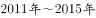
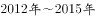
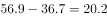
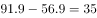
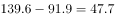
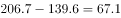

# 增长量比较（逐年作差）

考点：[[20-考点/资料分析/增长/增长量比较（逐年作差）|增长 / 增长量比较（逐年作差）]]
材料：[[15-材料/资料分析/198932 2011-2015年中国快递业务量（|198932 2011-2015年中国快递业务量（]]

**问法模型**：题干问'2012-2015年哪年相比上一年增长量最多'→对相邻两年快递业务量逐年作差（当年值−上年值），比较差值大小

## 推理链
1. 第1步：定位柱状图（左轴，亿件），读取2011-2015年快递业务量：36.7、56.9、91.9、139.6、206.7亿件
2. 第2步：明确增长量=当年值−上年值（亿件），与右轴折线'比上年增长%'无关
3. 第3步：代入计算：2012年=56.9−36.7=20.2亿件，2013年=91.9−56.9=35.0亿件，2014年=139.6−91.9=47.7亿件，2015年=206.7−139.6=67.1亿件
4. 第4步：比较四年增长量：67.1＞47.7＞35.0＞20.2，2015年增长量最多
5. 第5步：对照选项，2015年对应D项，故正确答案为D

**最快解法**：⚡ 柱差目测法（增长量比较）：相邻柱高度差即增长量，2015年柱206.7与前柱139.6的差约67亿件，明显为相邻柱差最大（其余约20.2、35.0、47.7），无需精算即可锁定D；若增速下降但基数逐年在涨，末年增量通常最大

## 易错点
- ⚠ 增长量与增长率口径混淆：折线2015年增速48.0%为五年最低、2013年61.6%为峰值，若误用增速比较会错选2013年（本题组第4小题'增幅最大'答案正是2013年，须严格区分作差与作商）
- ⚠ 双轴图串轴：柱对应左轴'亿件'、线对应右轴'%'，量纲刻度不同，读数勿串轴
- ⚠ 时间范围：2011年增长量需2010年数据（图中未给），但题干限定2012-2015年，无需反推2010年，切勿画蛇添足

## 母题抽象
> 🧩 当题干出现'哪年相比上一年增长量最多'且材料给出各年现期值时，用'相邻两年作差比较'模型；验证时警惕增速折线干扰——增速下降年份因基数扩大增量可能反而最大（增速降≠增长量降）

**同类特征**：哪年相比上一年、增长量最多、限定连续年份区间、柱状图相邻作差、增速折线为干扰项、增长量与增幅辨析

## 相关题
- [[10-真题/资料分析/增长/4651934 增长量比较|4651934]]（上海 2022，相关度1）

---

### 题干
2012-2015年，哪年相比上一年快递业务增长量最多？

### 选项
- A. 2013
- B. 2012
- C. 2014
- D. 2015　✅

### 官方解析

根据题干“2012-2015年，······增长量最多”，判定本题为增长量比较问题。定位柱状图，快递业务量分别为36.7亿件、56.9亿件、91.9亿件、139.6亿件、206.7亿件。根据公式可得，快递业务增长量分别为亿件、亿件、亿件、亿件，增长量最多的为2015年。

故正确答案为D。

### 给定材料

> [!warning] 疑点（官方解析可能有误，待人工复核）
> 官方解析公式处具体差值数字缺失（'分别为亿件、亿件'未代入数值），按图补算四年增长量为20.2、35.0、47.7、67.1亿件，结论2015年最大无误，不影响答案D

<!-- CODEX-ANSWER-REVIEW:BEGIN -->
### 本次独立复核

**复核状态：** `confirmed`（独立复算确认答案）

**计分答案：** D（可计分）

**复核解析：**

快递量同比增量分别为2012年20.2、2013年35.0、2014年47.7、2015年67.1亿件。最大为2015年，对应D。

**相关信息：**

用同一统计口径比较年度变化；增长量由现期与基期之差求得，给出现期量和增长率时使用现期×r/(1+r)。

**题源依据：** [固定版本原题](https://github.com/Mentat-Uran/kaogongzhentizhengliu/blob/84ab93d4b64b61d897bece8a1c0a5bab06b4feb2/10-%E7%9C%9F%E9%A2%98/%E8%B5%84%E6%96%99%E5%88%86%E6%9E%90/%E5%A2%9E%E9%95%BF/2255816%20%E5%A2%9E%E9%95%BF%E9%87%8F%E6%AF%94%E8%BE%83%EF%BC%88%E9%80%90%E5%B9%B4%E4%BD%9C%E5%B7%AE%EF%BC%89.md)；固定内容 commit `84ab93d4b64b61d897bece8a1c0a5bab06b4feb2`，Markdown blob `d69e47aa000d70b811daf773bfb46b2c7f2cfce5`。
<!-- CODEX-ANSWER-REVIEW:END -->
