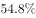
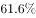
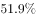
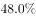
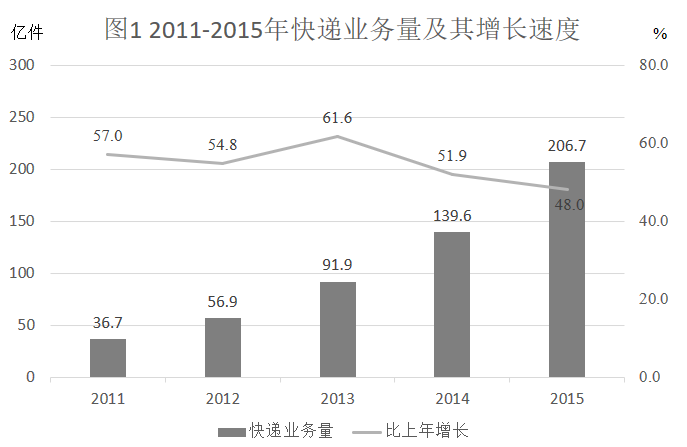

# 增长率（增长幅度）比较——折线读数型

考点：[[20-考点/资料分析/增长/增长率（增长幅度）比较——折线读数型|增长 / 增长率（增长幅度）比较——折线读数型]]
材料：[[15-材料/资料分析/198932 2011-2015年中国快递业务量（|198932 2011-2015年中国快递业务量（]]

**问法模型**：题干问'增长幅度最大'且选项为相邻年份区间 → '增长幅度'=同比增速，直接读折线找峰值，再把峰值年增速对应到'上一年至该年'的区间选项

## 推理链
1. 第1步：题干要求找'增长幅度最大'的年份区间，明确'增长幅度'即同比增长率，应读折线（右轴%）而非柱状图（左轴亿件）
2. 第2步：从折线提取2011-2015年增速：2011年57.0%、2012年54.8%、2013年61.6%、2014年51.9%、2015年48.0%
3. 第3步：选项区间与增速逐一对应——A'2011至2012年'=2012年增速54.8%；B'2012至2013年'=2013年增速61.6%；C'2013至2014年'=2014年增速51.9%；D'2014至2015年'=2015年增速48.0%（2011年的57.0%对应2010-2011年，不在选项中）
4. 第4步：四个对应增速比较：61.6%＞54.8%＞51.9%＞48.0%，峰值61.6%为2013年比2012年增长的幅度，即'2012年至2013年'
5. 第5步：对照选项，61.6%对应B项，故选B

**最快解法**：⚡ 直接读数比较法（零计算）：四个选项区间依次对应折线增速54.8%、61.6%、51.9%、48.0%，一眼锁定峰值61.6%（2013年）→即2012年至2013年，选B；关键是把'某年增速'翻译成'上一年至该年'的区间

## 易错点
- ⚠ 口径混淆：'增长幅度'=增速（作商读折线），若误当'增长量'（作差看柱），2015年增长量67.1亿件（206.7−139.6）最多，会误选D
- ⚠ 看柱不看线：柱最高是2015年（206.7亿件）但其增速48.0%反为五年最低；折线峰值61.6%在2013年，仅凭柱高会误判
- ⚠ 区间错位：61.6%是'2013年比2012年'的增速，对应'2012年至2013年'（B）；若把'2013年增速'误对应到'2013年至2014年'会错选C；另注意2011年增速57.0%对应2010-2011年，2010年不在图中

## 母题抽象
> 🧩 当题干出现'增长幅度/增速最大（快）'且选项为相邻年份区间时，直接读材料中的同比增速序列找峰值年，再将'峰值年增速'翻译为'上一年至该年'的区间表述作答，全程无需计算

**同类特征**：增长幅度最大、同比增速折线读数、相邻年份区间选项（201X年至201X年）、柱线组合双轴图、增长量与增长率口径辨析、零计算读数题

## 相关题
- [[10-真题/资料分析/增长/4678701 增长量比较（直接读数找最值）|4678701]]（选调 2020，相关度1）
- [[10-真题/资料分析/增长/2144614 增长率比较（多年环比增幅比较）|2144614]]（选调 2018，相关度1）

---

### 题干
快递业务量增长幅度最大的是：

### 选项
- A. 2011年至2012年
- B. 2012年至2013年　✅
- C. 2013年至2014年
- D. 2014年至2015年

### 官方解析

增长幅度即增长率，定位折线图可得，2012年～2015年快递业务增长速度分别为、、、，增长幅度最大的是2013年，即2012年至2013年。

故正确答案为B。

### 给定材料

> [!warning] 疑点（官方解析可能有误，待人工复核）
> 官方解析文字中增速数值缺失（'分别为、、、'处应为54.8%、61.6%、51.9%、48.0%），属解析排版遗漏，结论与答案B本身无误

<!-- CODEX-ANSWER-REVIEW:BEGIN -->
### 本次独立复核

**复核状态：** `confirmed`（独立复算确认答案）

**计分答案：** B（可计分）

**复核解析：**

四个选项对应的同比增长率依次为2012年54.8%、2013年61.6%、2014年51.9%、2015年48.0%。最大为2013年相较2012年，选B。

**相关信息：**

用同一统计口径比较年度变化；增长量由现期与基期之差求得，给出现期量和增长率时使用现期×r/(1+r)。

**题源依据：** [固定版本原题](https://github.com/Mentat-Uran/kaogongzhentizhengliu/blob/84ab93d4b64b61d897bece8a1c0a5bab06b4feb2/10-%E7%9C%9F%E9%A2%98/%E8%B5%84%E6%96%99%E5%88%86%E6%9E%90/%E5%A2%9E%E9%95%BF/2255828%20%E5%A2%9E%E9%95%BF%E7%8E%87%EF%BC%88%E5%A2%9E%E9%95%BF%E5%B9%85%E5%BA%A6%EF%BC%89%E6%AF%94%E8%BE%83%E2%80%94%E2%80%94%E6%8A%98%E7%BA%BF%E8%AF%BB%E6%95%B0%E5%9E%8B.md)；固定内容 commit `84ab93d4b64b61d897bece8a1c0a5bab06b4feb2`，Markdown blob `0877cc2bc59147f9719601eee42c73af9e755a8d`。
<!-- CODEX-ANSWER-REVIEW:END -->
