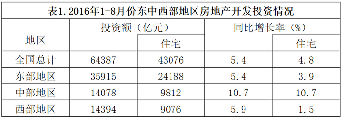
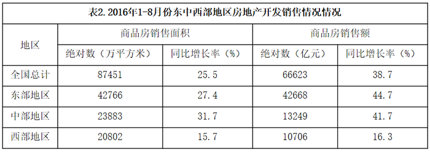

# 增长率（同比增速）直接比较

考点：[[20-考点/资料分析/增长/增长率（同比增速）直接比较|增长 / 增长率（同比增速）直接比较]]
材料：[[15-材料/资料分析/198935 2016年1-8月我国东、中、西部地|198935 2016年1-8月我国东、中、西部地]]

**问法模型**：题干问'房地产开发投资同比增长最快的地区'→定位表1总体（总计列）增速，直接比较三个地区增速数值，最大者即为答案

## 推理链
1. 第1步：题干指标为'房地产开发投资'，对应表1（投资情况表），且须用'总计'口径列而非'住宅'口径列，比较范围为东、中、西部三个地区
2. 第2步：从表1'同比增长率(%)'总计列读数：东部地区5.4%、中部地区10.7%、西部地区5.9%（全国5.4%仅作背景，不参与地区比较）
3. 第3步：直接比较数值大小：10.7% > 5.9% > 5.4%，中部地区增速最大
4. 第4步：'增长最快'即同比增速最大，比较的是增速列而非投资额绝对数列，故增速最快的地区为中部地区
5. 第5步：与选项对照，中部地区对应B，故选B

**最快解法**：⚡ 直接读数比较法（零计算）：锁定表1总体增速列，扫读东部5.4%、中部10.7%、西部5.9%，取最大10.7%对应中部即选B；全程无需动笔，关键只在选对列（总计列）和选对表（表1而非表2）

## 易错点
- ⚠ 双列口径串用：表1'同比增长率'分总计/住宅两列，本题问'房地产开发投资'须用总计列；本题恰好中部总体与住宅增速都是10.7%，误用住宅列也能碰对答案，但属于侥幸，其他题会踩坑
- ⚠ 跨表串用：若误看表2销售额增速（东部44.7%最快）或销售面积增速（中部31.7%最快），口径完全错误；销售额增速下会错选A东部，是命题人埋的强干扰
- ⚠ '增长最快'比较的是增速列而非投资额绝对数（东部35915亿元最大但增速仅5.4%），且中部总体与住宅增速均为10.7%属数据巧合，不要当作印刷错误

## 母题抽象
> 🧩 当题干出现'××指标同比增长最快（最慢）的地区/主体是'特征时，先锁定指标对应的表格与口径列（投资vs销售、总计vs住宅），直接比较该列增速数值取极值即为答案，无需计算；核心动作是'对表、对列、再比大小'

**同类特征**：同比增长最快、房地产开发投资（锁定表1总计列）、东中西部地区比较、读数比较型（无需计算）、同表双口径列需甄别

## 相关题
- [[10-真题/资料分析/增长/4817764 增长率（同比增速）直接比较|4817764]]（四川 2022，相关度2）
- [[10-真题/资料分析/增长/2187792 同比增长率比较（增速最快年份判断）|2187792]]（黑龙江 2018，相关度1）
- [[10-真题/资料分析/增长/18385420 同比增速比较（增长快慢）|18385420]]（浙江 2024，相关度1）
- [[10-真题/资料分析/增长/2725470 增长率比较（同比增速直接找数比大小）|2725470]]（四川 2020，相关度1）
- [[10-真题/资料分析/综合/2730994 综合判断题（趋势一致性比对+逐年增长率比较+平均票房合成+五年年均值计数）|2730994]]（深圳市考 2020，相关度1）

---

### 题干
2016年1-8月份，东中西部地区房地产开发投资同比增长最快的地区是：

### 选项
- A. 东部地区
- B. 中部地区　✅
- C. 西部地区
- D. 无法判断

### 官方解析

定位表1，2016年1-8月份，东部地区房地产开发投资额增长率为，中部地区房地产开发投资额增长率为，西部地区房地产开发投资额增长率为。则增长最快的地区是中部地区。

故正确答案为B。

### 给定材料

