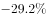

# 同比增长率直接比较（表内读数比较）

考点：[[20-考点/资料分析/增长/同比增长率直接比较（表内读数比较）|增长 / 同比增长率直接比较（表内读数比较）]]
材料：[[15-材料/资料分析/198982 全国一般公共预算收支执行情况：按'9|198982 全国一般公共预算收支执行情况：按'9]]

**问法模型**：题干问'1-9月主要收入项目中同比增长率最大的是'→ 直接在表1中读取四个选项对应税种的同比增速，作纯数值比较取最大

## 推理链
1. 第1步：题干限定'1-9月主要收入项目'，取数范围为表1（1-9月主要收入项目情况），同比增速列可直接读取
2. 第2步：提取四个选项的同比增速：耕地占用税-29.2%、个人所得税21.1%、国内增值税12%、资源税22%
3. 第3步：数值比较：22>21.1>12>-29.2，注意资源税22%与个人所得税21.1%仅差0.9个百分点，需精细比较；环境保护税增速为'–'（无可比增速）不参与，但其不在选项中，不影响结论
4. 第4步：增速最大者为资源税（+22%），对照选项选D

**最快解法**：⚡ 选项定位法+直接读数：四个选项即四个税种名称，逐一到表1定位增速列——耕地占用税-29.2、个税21.1、增值税12、资源税22，扫一眼即可锁定最大值22%对应资源税，无需任何计算

## 易错点
- ⚠ 资源税22%与个人所得税21.1%仅差0.9个百分点，扫读表格时极易把最大项看漏成个税而误选B
- ⚠ 耕地占用税-29.2%是增速最小（负增长最大幅度）项，勿被'29.2'这个大数字吸引而误选A
- ⚠ 题干限'1-9月累计口径'的表1数据，勿与正文9月当月口径或正文空白增速混淆；环境保护税增速为'–'不可作为比较对象

## 母题抽象
> 🧩 当题干出现'主要项目中同比增长率最大/最小的是（选项为项目名）'特征时，用选项定位法直接读取明细表增速列作纯数值比较，验证时先剔除增速为'–'的项目，再警惕两个接近数值（差<1个百分点）间的取舍

**同类特征**：同比增长率最大、主要收入项目、选项即税种名称、表1增速列直接取数、累计口径、纯读数比较

## 相关题
- [[10-真题/资料分析/增长/10204452 增长率大小比较（四选项现期-基期比值比较）|10204452]]（广东 2024，相关度1）
- [[10-真题/资料分析/其他/5514921 数列扫描定位（首次突破某值）|5514921]]（广东 2023，相关度1）
- [[10-真题/资料分析/增长/2187809 增长率比较（多主体增速排序）|2187809]]（天津 2018，相关度1）
- [[10-真题/资料分析/平均数/16593083 平均数增长率比较（逐月均价增长率）|16593083]]（甘肃 2024，相关度1）
- [[10-真题/资料分析/增长/2166228 增长率比较（季度累计值同比增幅比较）|2166228]]（深圳市考 2018，相关度1）

---

### 题干
1-9月主要收入项目中，同比增长率最大的是（    ）。

### 选项
- A. 耕地占用税
- B. 个人所得税
- C. 国内增值税
- D. 资源税　✅

### 官方解析

定位材料表格一可得：耕地占用税增长率为，个人所得税增长率为，国内增值税增长率为，资源税增长率为，故增长率最大的为资源税。

故正确答案为D。

### 给定材料

一、根据以下资料，回答106-110题。

        9月份，全国一般公共预算收入12963亿元，同比增长。其中，中央一般公共预算收入5919亿元，同比增长；地方一般公共预算本级收入7044亿元，同比增长。全国一般公共预算收入中的税收收入10269亿元，同比增长；非税收入2694亿元，同比下降。

        1-9月累计，全国一般公共预算收入145831亿元，同比增长。其中，中央一般公共预算收入69582亿元，同比增长；地方一般公共预算本级收入76249亿元，同比增长。全国一般公共预算收入中的税收收入127486亿元，同比增长；非税收入18345亿元，同比下降。

        9月份，全国一般公共预算支出22616亿元，同比增长，其中，中央一般公共预算本级支出2533亿元，同比增长；地方一般公共预算支出20083亿元，同比增长。

        1-9月累计，全国一般公共预算支出163289亿元，同比增长，为年初预算的，比序时进度快2.8个百分点。其中，中央一般公共预算本级支出22959亿元，同比增长；地方一般公共预算支出140330亿元，同比增长。

