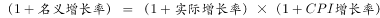
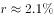
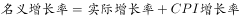
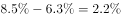

# CPI增长率推算（名义增长率与实际增长率换算）

考点：[[20-考点/资料分析/增长/CPI增长率推算（名义增长率与实际增长率换算）|增长 / CPI增长率推算（名义增长率与实际增长率换算）]]
材料：[[15-材料/资料分析/198983 2018年前三季度全国居民（含城镇、|198983 2018年前三季度全国居民（含城镇、]]

**问法模型**：题干问'消费价格指数（CPI）增长（率）'而材料同时给出名义增速与'扣除价格因素'实际增速 → 用'1+名义=(1+实际)(1+CPI)'（增速较小时近似为名义≈实际+CPI）反推CPI增长率=名义−实际

## 推理链
1. 第1步：题干求2018年前三季度CPI增长率，定位文字材料'全国居民人均消费支出14281元，比上年同期名义增长＿，扣除价格因素实际增长＿'，名义增速与实际增速是同一基期（2017年前三季度）下的两套同比口径，14281元等金额本身不参与计算
2. 第2步：三个增长率满足 1+名义增长率=(1+实际增长率)×(1+CPI增长率)；因三个增速数值都较小，可近似为 名义增长率≈实际增长率+CPI增长率
3. 第3步：故 CPI增长率=名义增长率−实际增长率（或用精确式 (1+名义)/(1+实际)−1）
4. 第4步：代入材料中的名义增速与实际增速（原文该两处数值被隐去留空），官方解析按上述公式计算，所得结果与D项最接近
5. 第5步：与选项对照，正确答案为D

**最快解法**：⚡ 公式法：见到'扣除价格因素，实际增长'即条件反射 CPI=名义增速−实际增速（选项差距极小时升级用 (1+名义)/(1+实际)−1），两个增速直接作差对照选项，不碰14281元等任何金额数据

## 易错点
- ⚠ 名义/实际双口径混淆：必须用'名义−实际'推CPI，若误拿实际增速当名义增速或反减（实际−名义）会得到负值/错值
- ⚠ 近似式'名义≈实际+CPI'仅在增速较小时成立，当选项数值非常接近时须换用精确式(1+名义)=(1+实际)(1+CPI)，官方解析注中已说明两式结果略有差异
- ⚠ 口径陷阱：'比上年同期'指前三季度累计同比（1—9月对1—9月），不是单季或全年；计算只依赖增速，勿误用人均支出金额或饼图8项数据凑算

## 母题抽象
> 🧩 当题干出现'扣除价格因素/实际增长/CPI增长'且材料同时给出名义增速与实际增速时，用'名义=(1+实际)(1+CPI)'的关系（小增速下 名义≈实际+CPI），取 CPI=名义−实际 直接对照选项验证

**同类特征**：消费价格指数（CPI）增长、扣除价格因素实际增长、名义增长与实际增长并存、两套增速之差反推、比上年同期（累计同比）

## 相关题
- [[10-真题/资料分析/增长/2376996 名义与实际增速区分及不变价（扣除价格因素）换算|2376996]]（选调 2019，相关度1）

---

### 题干
2018年前三季度，消费价格指数（CPI）增长了（  ）

### 选项
- A. 

- B. 

- C. 

- D. 

　✅

### 官方解析

根据题干“2018年前三季度，消费价格指数（CPI）增长了”，结合选项为百分数，可知本题为一般增长率计算问题。定位文字材料可得“2018年前三季度，全国居民人均消费支出14281元，比上年同期名义增长，扣除价格因素，实际增长”，根据公式，可知：，可知，与D项最接近。

故正确答案为D。

注：名义增长率、实际增长率和CPI增长率三者之间的实际计算公式为：，但也可以用“”进行表述，由于三个增长率数值都比较小，用两个公式计算出来的结果很接近，因此在本题中也可以用“”，则CPI增长率为。

### 给定材料

        2018年前三季度，全国居民人均消费支出14281元，比上年同期名义增长，扣除价格因素，实际增长。其中，城镇居民人均消费支出19014元，增长，扣除价格因素，实际增长；农村居民人均消费支出8538元，增长，扣除价格因素，实际增长。

> [!warning] 疑点（官方解析可能有误，待人工复核）
> 本材料文字段中'名义增长'与'实际增长'的具体数值均被隐去留空，导致无法代入数字复核D项的具体结果；笔记仅能确认公式关系与官方答案D，未改动官方结论

<!-- CODEX-ANSWER-REVIEW:BEGIN -->
### 本次独立复核

**复核状态：** `resolved`（答案与解析已核定）

**计分答案：** D（可计分）

**复核解析：**

材料图公式显示前三季度名义增速8.5%、实际增速6.3%。同一时期同一基期的名义、实际与价格指数关系为1+名义=(1+实际)(1+CPI)，因此CPI=1.085/1.063−1≈2.07%。选项2.2%最接近，D。原解析公式图片有丢失，但收入金额无需参与计算。

**相关信息：**

按题意“前三季度”均指1—9月累计同比。名义和实际增速相近时，差值约等于价格指数增速，但本题用精确乘法关系。

**题源依据：** [固定版本原题](https://github.com/Mentat-Uran/kaogongzhentizhengliu/blob/84ab93d4b64b61d897bece8a1c0a5bab06b4feb2/10-%E7%9C%9F%E9%A2%98/%E8%B5%84%E6%96%99%E5%88%86%E6%9E%90/%E5%A2%9E%E9%95%BF/2256398%20CPI%E5%A2%9E%E9%95%BF%E7%8E%87%E6%8E%A8%E7%AE%97%EF%BC%88%E5%90%8D%E4%B9%89%E5%A2%9E%E9%95%BF%E7%8E%87%E4%B8%8E%E5%AE%9E%E9%99%85%E5%A2%9E%E9%95%BF%E7%8E%87%E6%8D%A2%E7%AE%97%EF%BC%89.md)；固定内容 commit `84ab93d4b64b61d897bece8a1c0a5bab06b4feb2`，Markdown blob `38d396260f4f43a12f814702c6d997f172eb9c39`。
<!-- CODEX-ANSWER-REVIEW:END -->
