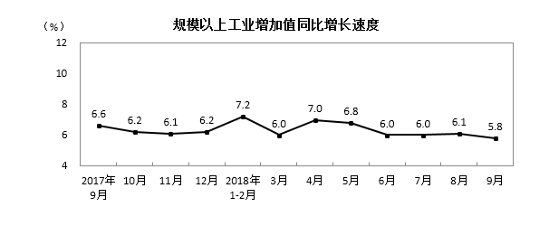
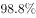
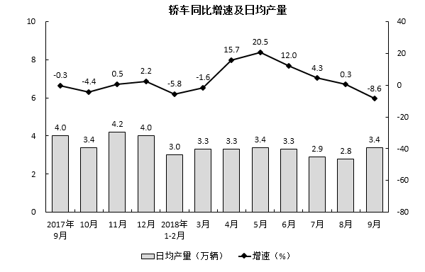
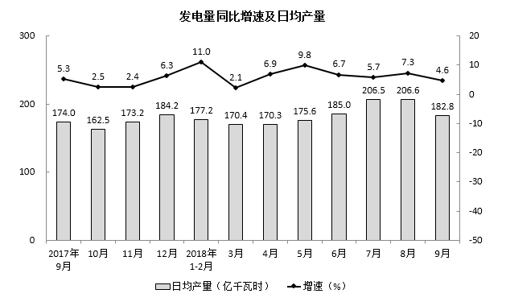

# 增长量计算（现期×g-(1+g)，百化分）

考点：[[20-考点/资料分析/增长/增长量计算（现期×g-(1+g)，百化分）|增长 / 增长量计算（现期×g/(1+g)，百化分）]]
材料：[[15-材料/资料分析/198984 国家统计局月度工业数据：2018年9|198984 国家统计局月度工业数据：2018年9]]

**问法模型**：题干'比2017年同期增加约+选项带万吨单位'→增长量计算模型：增长量=现期×g/(1+g)，配合百化分速算。

## 推理链
1. 第1步：从正文分产品段提取条件：2018年9月水泥产量20781万吨（现期量），同比增速在正文中空缺，须以补全的5.0%为前提（据官方答案A反推自洽：20781×5%/105%≈990万吨）。
2. 第2步：识别题型：问'增加约……万吨'且选项带单位，判定为增长量计算，公式：增长量=现期×g/(1+g)。
3. 第3步：百化分：5%=1/20，即n=20，则增长量=20781×(1/20)/(1+1/20)=20781/(20+1)=20781/21。
4. 第4步：截位直除：20781/21≈989.6万吨，约等于990万吨。
5. 第5步：与选项对照：A项990万吨吻合当选；B项1039万吨恰为20781×5%=1039，是漏除(1+g)的干扰项；C、D对应其他增速口径，排除。

**最快解法**：⚡ 百化分+直除：5%≈1/20（n=20），增长量=现期/(n+1)=20781/21≈989.6≈990万吨，一步直除锁定A，无需精算。

## 易错点
- ⚠ 把增长量误算成增长率对应量：直接用20781×5%≈1039万吨会错选B，正确须除以(1+g)，即20781/21。
- ⚠ 现期基期方向混淆：20781万吨是2018年9月现期值，增长量用现期×g/(1+g)；且同段汽车、轿车为'下降'，勿把负增长方向串用到水泥。
- ⚠ 正文水泥增速数值空缺，必须以补全的5.0%为前提求解，勿串用同段钢材、发电量等其他产品增速；单位万吨与选项一致，无需换算。

## 母题抽象
> 🧩 当题干出现'现期比去年同期增加/减少约+数值+单位'且材料给出现期总量与同比增速时，将增速百化分为1/n，用增长量=现期/(n+1)（减少时为n-1）直除对照选项。

**同类特征**：比2017年同期增加约、选项带实物单位（万吨）、已知现期总量20781万吨、同比增速为百分数（补全5.0%）、增长量计算、'约'字暗示估算/速算

## 相关题
- [[10-真题/资料分析/增长/7159 增长量计算|7159]]（北京 2009，相关度1）
- [[10-真题/资料分析/增长/2571729 增长量计算——每增长1个百分点对应的增量（基期量×1%）|2571729]]（山东 2020，相关度1）
- [[10-真题/资料分析/增长/3018839 增长量计算（负增长情形：基期减少量）|3018839]]（广东 2021，相关度1）
- [[10-真题/资料分析/增长/10204654 增长量计算（已知现期与同比下降率求下降量）|10204654]]（安徽 2024，相关度1）
- [[10-真题/资料分析/增长/13319362 现期增长量计算（已知现期值与同比增速，用r-(1+r)公式）|13319362]]（江苏 2025，相关度1）

---

### 题干
2018年9月水泥产量比2017年同期增加约（    ）。

### 选项
- A. 990万吨　✅
- B. 1039万吨
- C. 864万吨
- D. 948万吨

### 官方解析
根据题干“2018年9月水泥产量比2017年同期增加······”，结合选项带单位，可判断此题为增长量计算问题。定位文字材料第六段，“9月份······水泥20781万吨，增长”，可得，A项当选。
故正确答案为A。

### 给定材料

        2018年9月份，规模以上工业增加值同比实际增长（以下增加值增速均为扣除价格因素的实际增长率），比8月份回落0.3个百分点。从环比看，9月份，规模以上工业增加值比上月增长。1-9月份，规模以上工业增加值同比增长，增速较1-8月份回落0.1个百分点。

        分三大门类看，9月份，采矿业增加值同比增长，增速较8月份加快0.2个百分点；制造业增长，回落0.4个百分点；电力、热力、燃气及水生产和供应业增长，加快1.1个百分点。

        分经济类型看，9月份，国有控股企业增加值同比增长；集体企业增长，股份制企业增长，外商及港澳台商投资企业增长3.2%。

        分行业看，9月份，41个大类行业中有38个行业增加值保持同比增长。其中，农副食品加工业增长，纺织业增长，化学原料和化学制品制造业增长，非金属矿物制品业增长，黑色金属冶炼和压延加工业增长，有色金属冶炼和压延加工业增长，通用设备制造业增长，专用设备制造业增长，汽车制造业增长，铁路、船舶、航空航天和其他运输设备制造业增长，电气机械和器材制造业增长，计算机、通信和其他电子设备制造业增长，电力、热力生产和供应业增长。

        分地区看，9月份，东部地区增加值同比增长，中部地区增长，西部地区增长，东北地区增长。

        分产品看，9月份，596种产品中有324种产品同比增长。其中，钢材9675万吨，同比增长；水泥20781万吨，增长；十种有色金属456万吨，增长；乙烯161万吨，增长；汽车242.6万辆，下降；轿车102.8万辆，下降；发电量5483亿千瓦时，增长；原油加工量5134万吨，增长。

        9月份，工业企业产品销售率为，比上年同月下降0.4个百分点。工业企业实现出口交货值11839亿元，同比增长。

> [!warning] 疑点（官方解析可能有误，待人工复核）
> 官方解析未列明所补全的水泥同比增速具体数值（正文该处空缺）；按答案A反推应为5.0%（20781×5%/1.05≈989.6≈990万吨），与解析结论一致、口径自洽，非实质矛盾。
