# 隔年（间隔）增长率

考点：[[20-考点/资料分析/增长/隔年（间隔）增长率|增长 / 隔年（间隔）增长率]]
材料：[[15-材料/资料分析/199266 2014年全国农村义务教育经费保障资|199266 2014年全国农村义务教育经费保障资]]

**问法模型**：题干'与2012年相比，2014年……增长'→材料只给现期值878.97亿元与2013、2014两个逐年增速，应用间隔增长率公式 r间=r1+r2+r1×r2 求两年复合增速

## 推理链
1. 第1步：定位材料第1段，现期2014年国家下拨农村义务教育经费保障资金为878.97亿元，2013年、2014年依次增长r2013、r2014（本版本该两处数值空缺，须以原卷数值代入）
2. 第2步：题干比较的是2014年对2012年，中间隔着2013、2014两个增长年，判断为间隔增长率问题，公式为 r间=r2013+r2014+r2013×r2014
3. 第3步：先加两项增速得和值，再补乘积项 r2013×r2014（两个百分数相乘，量级约为千分之几，方向为正，使结果略大于两增速之和），代入原卷增速计算得8.66%
4. 第4步：题干设问为'增长'且选项均为无量纲数值，即求增长率而非增长量；8.66%对应D选项8.66，其余选项均偏离，故选D

**最快解法**：⚡ 公式法（间隔增长率）：r=r1+r2+r1×r2。先心算两个逐年增速之和，再补乘积项；识别选项陷阱——若同时出现'两增速之和'与略大的'和+乘积'两个近似值，必选含乘积项修正的那个；本题结果为8.66%，直选D

## 易错点
- ⚠ 隔年对象混淆：见到'2014年'就近只用2014年单年增速（或只用2013年增速）计算，未做两年连乘还原，2012年是间隔基期不是材料直接给出的年份
- ⚠ 漏掉乘积项：只算 r1+r2，忽略 r1×r2 的正修正项，误选偏小的干扰项
- ⚠ 问法口径错位：题干问增长率（选项为百分数数值），不是用878.97亿元乘增速求增长量（亿元）；另注意本版本材料两个增速数值空缺且声明无图表，不得凭空补数，须以原卷数值为准

## 母题抽象
> 🧩 当题干出现'与隔一年的年份（如2012年）相比，现期（2014年）某指标增长…'且材料只给现期值和相邻两个逐年增速时，用间隔增长率公式 r=r1+r2+r1×r2 直接求复合增速，验证结果应略大于两增速之和

**同类特征**：与2012年相比，2014年、间隔两年/隔年增长、国家下拨……保障资金、增长率设问、选项为无量纲百分数、现期值878.97亿元＋两个逐年增速、材料第一段单一指标

## 相关题
- [[10-真题/资料分析/增长/12536395 隔年（间隔）增长率|12536395]]（四川 2024，相关度2）
- [[10-真题/资料分析/增长/2028352 隔年（间隔）增长率|2028352]]（国考 2017，相关度2）
- [[10-真题/资料分析/增长/4743036 隔年（间隔）增长率|4743036]]（安徽 2019，相关度2）
- [[10-真题/资料分析/增长/14993564 隔年增长率（间隔增长率）|14993564]]（选调 2024，相关度1）

---

### 题干

与2012年相比，2014年国家下拨农村义务教育经费保障资金增长（  ）。

### 选项
- A. 6.45
- B. 7.38
- C. 8.53
- D. 8.66　✅

### 官方解析

根据题干“与2012年相比，2014年······增长······”，判断本题为间隔增长率问题。定位材料第一段可知，2013年国家下拨农村义务教育经费保障资金增长率为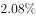，2014年增长率为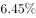，代入间隔增长率公式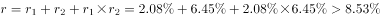。

故正确答案为D。

### 给定材料

        2014年，国家下拨农村义务教育经费保障资金为878.97亿元，2013、2014年依次增长、。

        2014年，农村、城市小学生均预算内事业性经费分别比2010年增长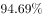、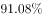，农村小学增幅超过城市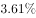；农村、城市初中生均预算内事业性经费分别比2010年增长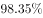、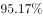，农村增长幅度高出城市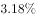。2014年，农村、城市小学生均预算内公用教育经费支出分别比2010年增长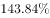、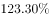，农村小学增幅超过城市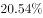；2014年，农村、城市初中生均预算内公用教育经费支出分别比2010年增长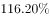、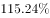，农村增长幅度高出城市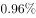。

        2014年，全国小学生均校舍建筑面积为6.85平方米，比2010年增长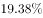；全国初中生均校舍建筑面积为11.99平方米，比2010年增长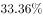。其中全国小学生均教学与辅助用房面积增长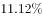，初中增长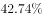；全国小学生均生活用房面积增长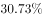，初中增长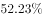；全国小学生均体育馆面积增长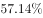，初中增长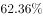。

        据对全国14省（区、市）10万余名中小学生的抽样调查显示（以小学四年级、初中二年级为代表，以下同），2010—2014年，每周课时数超过30节的小学比例由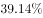下降到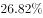，每学期统一考试次数超过1次的小学比例由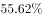下降到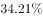，每天在校时间超过6小时的小学比例由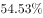下降到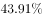，每天家庭作业时间超过1小时的学生比例由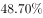下降到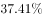，每天体育锻炼时间超过1小时的学生比例由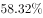上升到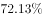。

