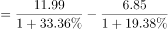
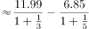
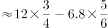
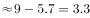

# 基期量计算（两基期量作差）

考点：[[20-考点/资料分析/增长/基期量计算（两基期量作差）|增长 / 基期量计算（两基期量作差）]]
材料：[[15-材料/资料分析/199266 2014年全国农村义务教育经费保障资|199266 2014年全国农村义务教育经费保障资]]

**问法模型**：题干问‘2010年全国初中生均校舍建筑面积比2010年全国小学生均校舍建筑面积大多少平方米’→同一基期年两主体对比，用基期量=现期量/(1+各自增长率)分别还原2010年值后再作差

## 推理链
1. 第1步：题干两处年份均为2010年，属同基期年对比；材料第三段只给2014年现期值——全国初中生均校舍建筑面积11.99平方米、小学生均6.85平方米，及各自比2010年的增速，判定为基期计算问题
2. 第2步：所用公式为基期量=现期量/(1+增长率)，所求=11.99/(1+g初中)−6.85/(1+g小学)
3. 第3步：代入材料第三段给出的初中、小学各自2010—2014年增速（本版本数值空缺，按原卷数值代入）分别还原2010年初中、小学生均校舍建筑面积
4. 第4步：两项基期量作差约为3.25平方米，与A项最接近；若漏去除以(1+增速)而直接用现期差11.99−6.85=5.14，则落入D项陷阱，故正确答案为A

**最快解法**：⚡ 基期差值公式＋截位直除：先警惕现期差11.99−6.85=5.14正是D项干扰；分别对11.99/(1+g初中)、6.85/(1+g小学)截位直除还原2010年值后作差，与A项3.25对照锁定答案

## 易错点
- ⚠ 现期/基期混淆：直接用11.99−6.85=5.14作答恰好命中D项，必须先各自除以(1+增速)还原2010年再作差
- ⚠ 小学与初中的2010—2014增速不同，不能用同一个增长率去算两基期量
- ⚠ 题干‘2010年……比2010年……’年份重复、官方解析称‘材料所给时间为2011年’与本材料现期2014年口径不一致，均不影响基期量作差模型；本版本增速数值全部空缺，须以原卷数值代入，不可凭空补数

## 母题抽象
> 🧩 当题干出现‘基期年A比基期年B大/多多少’（两主体同一基期年对比）时，用基期量=现期量/(1+增长率)分别还原后作差，并用‘基期差应偏离现期差’的方向核对选项

**同类特征**：同一基期年两主体对比（2010年比2010年）、求差值并给出单位（平方米）、生均校舍建筑面积、材料现期2014年、增速为2010—2014年增幅、选项含现期直接作差的干扰值（5.14）

## 相关题
（暂无）

---

### 题干
2010年全国初中生均校舍建筑面积比2010年全国小学生均校舍建筑面积大（  ）平方米。

### 选项
- A. 3.25　✅
- B. 3.86
- C. 4.12
- D. 5.14

### 官方解析

根据题干“2010年全国初中生……比2010年全国小学生……大……平方米”，结合材料所给时间为2011年，可判定本题为基期计算问题。定位材料第三段可得：2014年，全国小学生均校舍建筑面积为6.85平方米，比2010年增长；全国初中生均校舍建筑面积为11.99平方米，比2010年增长。则题干所求  ，与A项最接近。

故正确答案为A。

### 给定材料

        2014年，国家下拨农村义务教育经费保障资金为878.97亿元，2013、2014年依次增长、。

        2014年，农村、城市小学生均预算内事业性经费分别比2010年增长、，农村小学增幅超过城市；农村、城市初中生均预算内事业性经费分别比2010年增长、，农村增长幅度高出城市。2014年，农村、城市小学生均预算内公用教育经费支出分别比2010年增长、，农村小学增幅超过城市；2014年，农村、城市初中生均预算内公用教育经费支出分别比2010年增长、，农村增长幅度高出城市。

        2014年，全国小学生均校舍建筑面积为6.85平方米，比2010年增长；全国初中生均校舍建筑面积为11.99平方米，比2010年增长。其中全国小学生均教学与辅助用房面积增长，初中增长；全国小学生均生活用房面积增长，初中增长；全国小学生均体育馆面积增长，初中增长。

        据对全国14省（区、市）10万余名中小学生的抽样调查显示（以小学四年级、初中二年级为代表，以下同），2010—2014年，每周课时数超过30节的小学比例由下降到，每学期统一考试次数超过1次的小学比例由下降到，每天在校时间超过6小时的小学比例由下降到，每天家庭作业时间超过1小时的学生比例由下降到，每天体育锻炼时间超过1小时的学生比例由上升到。

> [!warning] 疑点（官方解析可能有误，待人工复核）
> 官方解析称‘结合材料所给时间为2011年’，与本材料现期2014年的口径不符，疑为解析排印笔误；题干‘2010年……比2010年……’两处年份相同亦疑为排印问题；两者均不改变基期量还原后作差的模型，不改变正确答案A
