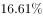
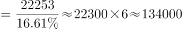
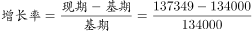
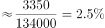

# 增长率计算（由部分量绝对数与占比反推基期总量）

考点：[[20-考点/资料分析/增长/增长率计算（由部分量绝对数与占比反推基期总量）|增长 / 增长率计算（由部分量绝对数与占比反推基期总量）]]
材料：[[15-材料/资料分析/199267 2010年部分省（区、市）人口年龄构|199267 2010年部分省（区、市）人口年龄构]]

**问法模型**：题干给出'2010年某部分人口绝对数+表中该部分占比+2015年总量'并问'比2010年增加'→先用部分量÷占比反推基期总量，再按现期÷基期−1求增长率，与选项（数值即百分比口径）对照

## 推理链
1. 第1步：从表格'占总人口比重'栏定位2010年全国0-14岁占比16.61%；题干给出2010年0-14岁人口22253万人、2015年全国总人口137349万人
2. 第2步：规则——部分量=总量×比重，故基期总量=部分量÷比重：2010年全国总人口=22253÷16.61%
3. 第3步：截位估算：0.1661×134000≈22257略大，回调得2010年总人口≈133973万人≈13.40亿（回验13.40亿×16.61%≈2.23亿吻合）
4. 第4步：官方判定为增长率问题：增长率=137349÷133973−1≈3376÷133973≈2.52%（等价写法：137349×16.61%÷22253−1≈22814÷22253−1≈2.52%）
5. 第5步：对照选项0.86/1.91/2.52/3.14，仅2.52与计算结果吻合，故选C

**最快解法**：⚡ 截位直除+亿级估算：22253÷0.1661≈13.40亿，137349万≈13.73亿，(13.73−13.40)÷13.40≈0.33÷13.40≈2.5%，直选最接近的C(2.52)；更快的单步法：现期×比重÷部分量−1=13.73亿×16.61%÷2.2253亿−1≈2.52%

## 易错点
- ⚠ 口径陷阱：题干写'增加'且选项未带%，若按'增长量'算得3376万人≈0.34亿人，与四个选项全不符；官方解析明确判定'增长率问题'，须先看选项数值量级与单位确定是求量还是求率
- ⚠ 分母口径：22253万人只能除以16.61%（占总人口比重），不能误用15-59岁占比70.07%，更不能误用少儿抚养比23.70%（抚养比的分母是15-59岁人口而非总人口）
- ⚠ 基期现期方向：2010为基期、2015为现期，须先反推基期总量再作商，勿把增量3376万直接当答案、或求率时漏除以基期

## 母题抽象
> 🧩 当题干出现'某期部分量绝对数+表中对应占比+另一期总量，问两期总量增加多少'时，用'部分量÷占比'反推基期总量，再按现期÷基期−1求增长率，并先看选项单位确定最终口径

**同类特征**：2010年0～14岁人口22253万人、表中占比16.61%需自行定位、2015年总人口137349万人、'比2010年增加'表述、选项为不带%的数值（实为增长率口径）、部分量反推基期总量

## 相关题
（暂无）

---

### 题干

已知2010年全国0～14岁人口为22253万人，到2015年全国总人口达到137349万人，那么，2015年全国总人口比2010年增加（    ）。

### 选项
- A. 0.86
- B. 1.91
- C. 2.52　✅
- D. 3.14

### 官方解析

根据题干“······2015年全国总人口比2010增加······”，可判定本题为增长率问题。定位表格可得：2010年全国0-14岁占总人口的比重为，根据题干，2010年全国0～14岁人口为22253万人，到2015年全国总人口达到137349万人。那么2010年全国总人口，则。 

故正确答案为C。

### 给定材料

        其中“少儿抚养比”为0～14岁人口数和15～59岁人口数的比值；“老年抚养比”为60岁及以上人口数和15～59岁人口数的比值；“总抚养比”为“少儿抚养比”和“老年抚养比”之和。

> [!warning] 疑点（官方解析可能有误，待人工复核）
> 题干问'增加'且选项未标注'%'，按字面'增长量'理解应为约3376万人（≈0.34亿人），四个选项均不匹配；官方解析明确判定为'增长率问题'，C的2.52实为增长率2.52%，疑为原题选项漏印'%'所致，不影响官方答案C。

<!-- CODEX-ANSWER-REVIEW:BEGIN -->
### 本次独立复核

**复核状态：** `confirmed`（独立复算确认答案）

**计分答案：** C（可计分）

**复核解析：**

2010年0—14岁人口占比为16.61%，该年龄人口为22253万人，故2010年总人口=22253÷0.1661≈133973.5万人。至2015年为137349万人，增长率=(137349−133973.5)÷133973.5≈2.519%，对应C的2.52%。

**相关信息：**

题干公式图给出百分号，分母是反推的2010年总人口。

**题源依据：** [固定版本原题](https://github.com/Mentat-Uran/kaogongzhentizhengliu/blob/84ab93d4b64b61d897bece8a1c0a5bab06b4feb2/10-%E7%9C%9F%E9%A2%98/%E8%B5%84%E6%96%99%E5%88%86%E6%9E%90/%E5%A2%9E%E9%95%BF/2261602%20%E5%A2%9E%E9%95%BF%E7%8E%87%E8%AE%A1%E7%AE%97%EF%BC%88%E7%94%B1%E9%83%A8%E5%88%86%E9%87%8F%E7%BB%9D%E5%AF%B9%E6%95%B0%E4%B8%8E%E5%8D%A0%E6%AF%94%E5%8F%8D%E6%8E%A8%E5%9F%BA%E6%9C%9F%E6%80%BB%E9%87%8F%EF%BC%89.md)；固定内容 commit `84ab93d4b64b61d897bece8a1c0a5bab06b4feb2`，Markdown blob `ce49617e23ad8ce3592cd47d66caeef99ce6e562`。
<!-- CODEX-ANSWER-REVIEW:END -->
