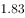
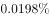
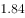
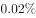
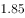
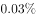
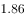
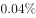
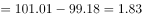
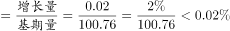

# 环比增长率计算（兼考图表极差读数）

考点：[[20-考点/资料分析/增长/环比增长率计算（兼考图表极差读数）|增长 / 环比增长率计算（兼考图表极差读数）]]
材料：[[15-材料/资料分析/199270 2017年1-2月全国房地产开发投资|199270 2017年1-2月全国房地产开发投资]]

**问法模型**：'一段时间内指数的极差'→最大值−最小值；'环比增加了'且选项第二空带百分号→（本月值−上月值）÷上月值×100%

## 推理链
1. 第1步：从图4读取2016年2月至2017年2月共13个月度点值：99.18、100.29、100.59、100.57、100.94、100.37、100.40、100.55、100.86、100.75、101.01、100.76、100.78
2. 第2步：极差=最大值−最小值，最高为2016年12月的101.01，最低为2016年2月的99.18，极差=101.01−99.18=1.83点
3. 第3步：选项第二空带百分号，判定求环比增长率而非增量；图4读得2017年2月为100.78、2017年1月为100.76，环比增量=100.78−100.76=0.02点（与正文'比1月份提高0.02点'互证）
4. 第4步：环比增长率=0.02÷100.76×100%≈0.02%
5. 第5步：对照选项，极差1.83点、环比增长率约0.02%只有A项符合

**最快解法**：⚡ 图表直读+截位直除：极差直接相减101.01−99.18=1.83；环比用百化分思想——分子0.02点、分母约100点（100.76截位），商直接约0.02%，两空联查锁定A，无需精算

## 易错点
- ⚠ 把第二空当成增量0.02点而漏算增长率：选项带百分号提示求的是环比增长率0.02%，只算差值会误选
- ⚠ 极差漏取端点：最高值101.01在2016年12月、最低值99.18在序列起点2016年2月，漏看起点或把100.76/100.78当最值都会算错
- ⚠ 环比基期用错或单位混淆：环比应除以上月100.76，勿用2016年2月的99.18或极差做分母；指数单位是'点'，0.02点对应约0.02%，勿把0.02点当0.02%以外的量级

## 母题抽象
> 🧩 当题干出现'某时段内指数/量的极差'时，用图表最大值−最小值；当'环比增加了'且选项带百分号时，用（本月值−上月值）÷上月值，警惕'点'与'%'的单位区分

**同类特征**：极差、自2016年2月至2017年2月、环比增加、选项带百分号、国房景气指数点值、折线图两空联合设问

## 相关题
- [[10-真题/资料分析/其他/2661084 极差（最大值-最小值）计算与跨指标比较|2661084]]（选调 2018，相关度1）
- [[10-真题/资料分析/其他/2262880 极差计算（涨跌幅时间序列：最大值−最小值）|2262880]]（选调 2016，相关度1）
- [[10-真题/资料分析/其他/2661076 极差（最大值−最小值）计算及跨图两极差之比|2661076]]（选调 2018，相关度1）
- [[10-真题/资料分析/增长/5919124 增长量计算（已知现期量与环比增速求环比增长量）|5919124]]（江苏 2024，相关度1）

---

### 题干
自2016年2月至2017年2月，国房景气指数的极差是（  ），2017年2月国房景气指数环比增加了：

### 选项
- A. 
  
　✅
- B. 
  

- C. 
  

- D. 
  

### 官方解析

根据题干“2017年2月……环比增加了”，结合选项第二个空带百分号，可判定本题为一般增长率问题。定位材料最后一个表格可知：2016年2月至2017年2月，国房景气指数最高值为2016年12月（101.01），最低值为2016年2月（99.18），故自2016年2月至2017年2月，国房景气指数的极差。定位材料文字最后一段和最后一个表格可知：2017年2月房地产开发景气指数比1月分提高0.02点，1月份国房景气指数为100.76。故2017年2月国房景气指数环比增长率，只有A项符合。

故正确答案为A。

### 给定材料

（1）房地产开发投资完成情况

        2017年1-2月份，全国房地产开发投资9854亿元，同比名义增长，增速比去年全年提高2个百分点。其中，住宅投资6571亿元，增长，增速提高2.6个百分点。住宅投资占房地产开发投资的比重为。

        1-2月份，东部地区房地产开发投资5966亿元，同比增长，增速比去年全年提高2.2个百分点；中部地区投资1907亿元，增长，增速提高3个百分点；西部地区投资1982亿元，增长，增速提高1.6个百分点。

        1-2月份，房地产开发企业房屋施工面积622950万平方米，同比增长，增速与去年全年持平。其中，住宅施工面积423185万平方米，增长。房屋新开工面积17238万平方米，增长，增速提高2.3个百分点。其中，住宅新开工面积12410万平方米，增长。房屋竣工面积16141万平方米，增长，增速提高9.7个百分点。其中，住宅竣工面积11674万平方米，增长。

        1-2月份，房地产开发企业土地购置面积2374万平方米，同比增长，去年全年为下降；土地成交价款794亿元，增长，增速回落7.1个百分点。

（2）商品房销售和待售情况

        1-2月，商品房销售面积14054万平方米，同比增长，增速比去年全年提高2.6个百分点。其中，住宅销售面积增长，办公楼销售面积增长，商业营业用房销售面积增长。商品房销售额10806亿元，增长，增速回落8.8个百分点。其中，住宅销售额增长，办公楼销售额增长，商业营业用房销售额增长。

        1-2月份，东部地区商品房销售面积6595万平方米，同比增长，增速比去年全年回落6.8个百分点；销售额6645亿元，增长，增速回落23个百分点。中部地区商品房销售面积3680万平方米，增长，增速提高4.6个百分点；销售额2073亿元，增长44.1%，增速提高5.4个百分点。西部地区商品房销售面积3779万平方米，增长，增速提高20.6个百分点；销售额2088亿元，增长，增速提高31.2个百分点。

        2月末，商品房待售面积70555万平方米，比去年末增加1015万平方米。其中，住宅待售面积增加468万平方米，办公楼待售面积增加155万平方米，商业营业用房待售面积增加260万平方米。

（3）房地产开发企业到位资金情况

        1-2月份，房地产开发企业到位资金22880亿元，同比增长，增速比去年全年回落8.2个百分点。其中，国内贷款4985亿元，增长;利用外资48亿元，增长；自筹资金6897亿元，下降；其他资金10950亿元，增长。在其他资金中，定金及预收款6108亿元，增长；个人按揭贷款3391亿元，增长。

（4）房地产开发景气指数

        2月份，房地产开发景气指数（简称“国房景气指数”，今年起发布的是基期修定后的值）为100.78，比1月份提高0.02点。

