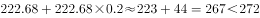
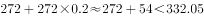
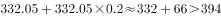
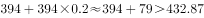
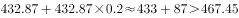
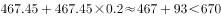
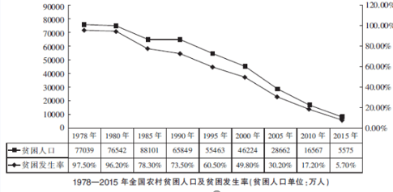

# 同比增长率计算与超阈值年份计数

考点：[[20-考点/资料分析/增长/同比增长率计算与超阈值年份计数|增长 / 同比增长率计算与超阈值年份计数]]
材料：[[15-材料/资料分析/199271 以我国农村扶贫为主题，围绕1978—|199271 以我国农村扶贫为主题，围绕1978—]]

**问法模型**：题干'2011—2016年，资金投入增速超过[x%]的有几年'→逐年用增长率公式r=(当年−上年)/上年计算6个同比增速，与阈值逐一比较后计数

## 推理链
1. 第1步：由图2提取2010—2016年中央财政专项扶贫资金（亿元）：222.68、272、332.05、394、432.87、467.45、670，2011—2016年共6个同比增速
2. 第2步：增长率公式 r=(当年−上年)/上年，逐年代入相邻两年数据
3. 第3步：2011年=(272−222.68)/222.68=49.32/222.68≈22.2%，超过阈值20%
4. 第4步：2012年=(332.05−272)/272=60.05/272≈22.1%，超过；2013年=(394−332.05)/332.05=61.95/332.05≈18.7%，未超
5. 第5步：2014年=38.87/394≈9.9%、2015年=34.58/432.87≈8.0%，均未超；2016年=(670−467.45)/467.45=202.55/467.45≈43.3%，超过
6. 第6步：满足条件的为2011、2012、2016共3年，对照选项选B

**最快解法**：⚡ 增量-基期比较法（判定r>20%等价于'当年增量>上年/5'，避免逐个除出百分比）：2011年增量49.32>222.68/5≈44.5✓；2012年增量60.05>272/5=54.4✓；2013年增量61.95<332.05/5≈66.4✗；2014、2015年增量38.87、34.58远小于上年/5（78.8、86.6）✗✗；2016年增量202.55>467.45/5≈93.5✓；共3年，选B

## 易错点
- ⚠ 2013年增速18.7%最接近阈值20%，粗算或截位不当时极易误判为'超过'，从而错选C（4年）；须精确比较61.95与332.05/5≈66.4
- ⚠ 增速是当年对上年的同比口径：2011年须以2010年222.68为基期、2016年须以2015年467.45为基期，漏算2016年（增速最高43.3%）或把2010年误计入增速年份都会数错
- ⚠ 图2同一年份并列'贫困人口（万人）'与'扶贫资金（亿元）'两个数值，须认准亿元一列作分子分母，误用万人数据则全盘皆错；另题干阈值数值被截断，须按官方解析口径（20%）判定

## 母题抽象
> 🧩 当题干出现'某连续年份内，指标增速超过x%的有几年'特征时，用'当年增量>上年×x%'逐年代入判定（不必算出每个百分比），再对满足的年份计数

**同类特征**：2011—2016年（连续年份区间）、增速超过（含比较阈值）、有几年（计数型问法）、中央财政专项扶贫资金投入、同比增长率、定位图2条形图

## 相关题
- [[10-真题/资料分析/增长/23299 增长率计算之百分点换算（跨期增速倒推）|23299]]（安徽 2012，相关度1）
- [[10-真题/资料分析/增长/2015318 同比增长率计算|2015318]]（重庆 2016，相关度1）
- [[10-真题/资料分析/增长/2456363 基期量计算|2456363]]（浙江 2020，相关度1）
- [[10-真题/资料分析/增长/4695874 同比增长率计算（分量增速，一般增长率）|4695874]]（选调 2018，相关度1）
- [[10-真题/资料分析/增长/10204440 一般增长率计算与趋势图匹配（同比增长率逐年比较）|10204440]]（广东 2024，相关度1）

---

### 题干

2011-2016年，中央财政专项扶贫资金投入增速超过的有：

### 选项
- A. 2年
- B. 3年　✅
- C. 4年
- D. 5年

### 官方解析

根据问题“增速超过”可判定题型为增长率问题，由增长率，所求问题可转化为：，即增速超过。

定位第二个图形材料可得：

2011年：，满足；

2012年：，满足；

2013年：，不满足；

2014年：，不满足；

2015年：，不满足；

2016年：，满足。

因此2011年、2012年、2016年，共3年满足。

故正确答案为B。

### 给定材料

        2016年我国扶贫力度进一步加大，中央和省级财政专项扶贫资金投入超过了1000亿元，其中中央财政安排专项扶贫资金670亿元。全国农村超额完成了政府工作报告提出的减贫1000万人的目标任务。2000-2014年，中央财政累计投入专项扶贫资金2966亿元，年均增长。

> [!warning] 疑点（官方解析可能有误，待人工复核）
> 题干'增速超过'后的阈值数值缺失（材料导读亦注明被截断）；按官方答案B（3年）反推阈值应为20%：逐年增速22.2%、22.1%、18.7%、9.9%、8.0%、43.3%中恰有2011、2012、2016三年超过，与官方解析完全一致，答案本身无误，仅题干文字不完整

<!-- CODEX-ANSWER-REVIEW:BEGIN -->
### 本次独立复核

**复核状态：** `resolved`（答案与解析已核定）

**计分答案：** B（可计分）

**复核解析：**

阈值图为20%。扶贫资金图（亿元）2010—2016依次222.68、272、332.05、394、432.87、467.45、670。对2011—2016逐年计算：22.15%、22.08%、18.66%、9.87%、7.99%、43.33%。大于20%的为2011、2012、2016三年，选B。

**相关信息：**

图中资金系列为长条横向数据的浅色条，另一个深色条为贫困人口；不得拿人口数作资金基数。

**题源依据：** [固定版本原题](https://github.com/Mentat-Uran/kaogongzhentizhengliu/blob/84ab93d4b64b61d897bece8a1c0a5bab06b4feb2/10-%E7%9C%9F%E9%A2%98/%E8%B5%84%E6%96%99%E5%88%86%E6%9E%90/%E5%A2%9E%E9%95%BF/2261884%20%E5%90%8C%E6%AF%94%E5%A2%9E%E9%95%BF%E7%8E%87%E8%AE%A1%E7%AE%97%E4%B8%8E%E8%B6%85%E9%98%88%E5%80%BC%E5%B9%B4%E4%BB%BD%E8%AE%A1%E6%95%B0.md)；固定内容 commit `84ab93d4b64b61d897bece8a1c0a5bab06b4feb2`，Markdown blob `f46961914f2d97fd2525f492767cba6640f373d5`。
<!-- CODEX-ANSWER-REVIEW:END -->
