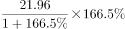
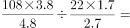
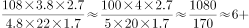

# 同比增量计算与增量之比（增量=现期×g-(1+g)）

考点：[[20-考点/资料分析/增长/同比增量计算与增量之比（增量=现期×g-(1+g)）|增长 / 同比增量计算与增量之比（增量=现期×g/(1+g)）]]
材料：[[15-材料/资料分析/199272 中国移动支付市场：2015年银行与非|199272 中国移动支付市场：2015年银行与非]]

**问法模型**：题干出现'两主体……同比增量之比约为'→对两主体分别用'增量=现期×g/(1+g)'求增量，再作比对照选项。

## 推理链
1. 第1步：定位文字段：2015年国内银行移动支付金额108.22万亿元、非银行支付机构金额21.96万亿元，两处同比增速数值在给定材料中均为空缺；本题取'金额'指标且为全年同比，与图1第三方市场的季度环比数据无关
2. 第2步：规则：同比增量=现期×g/(1+g)（由基期=现期/(1+g)推得），不能误用'现期×g'代替
3. 第3步：设银行、非银行金额同比增速为g₁、g₂，则增量之比=(108.22/21.96)×[g₁/(1+g₁)]÷[g₂/(1+g₂)]，其中现期之比108.22/21.96截位直除≈4.93
4. 第4步：官方解析按原卷完整增速代入上述公式分别求出两主体增量，比值≈6:1（增速因子使比值自现期比4.9上修）
5. 第5步：与选项对照：A.7:2=3.5、B.6:1、C.5:2=2.5、D.4:1，6:1与计算结果最接近，故选B

**最快解法**：⚡ 公式法+截位直除：增量之比=(108.22/21.96)×[g₁/(1+g₁)]÷[g₂/(1+g₂)]；先截位得现期比≈4.93作锚，再按增速因子g/(1+g)方向上修，官方结果≈6:1，直接锁定B。

## 易错点
- ⚠ 同比vs环比混淆：图中折线全是环比增速（如25.8%是2016Q2环比），本题是全年'同比增量'，只能用文字段数据，切勿读图取数
- ⚠ 只比现期得108.22/21.96≈4.9:1就去找最近选项，会误选D(4:1)，必须再乘增速因子g/(1+g)之比修正到≈6:1
- ⚠ 增量公式漏除(1+g)：误写成现期×g；另注意108.22万亿元与21.96万亿元是'移动支付金额'下两个并列口径，量级差约5倍，勿把银行数值配非银行增速或反之，也不可用图中5个季度加总替代全年21.96万亿元

## 母题抽象
> 🧩 当题干出现'A与B……同比增量之比'特征时，用'增量之比=现期之比×[g_A/(1+g_A)]÷[g_B/(1+g_B)]'：先截位求现期比作锚，再按两主体增速因子方向修正，选最接近的比值选项。

**同类特征**：同比增量之比、国内银行与非银行机构两主体并列、移动支付金额（万亿元）、现期值明确、同比增速需取自卷面、'约为'+形如7:2/6:1的比值选项、取数自文字段而非图表

## 相关题
（暂无）

---

### 题干
2015年国内银行和非银行机构移动支付金额同比增量之比约为：

### 选项
- A. 7:2
- B. 6:1　✅
- C. 5:2
- D. 4:1

### 官方解析

根据问题“······同比增量之比约为”可判定题型为比值计算问题。定位文字材料可得：2015年国内银行移动支付金额108.22万亿元，同比增长，非银行机构移动支付金额21.96万亿元，同比增长。由可得：2015年国内银行移动支付金额同比增长了万亿元，2015年非银行机构移动支付金额同比增长了万亿元，故比值，与B项最接近。

故正确答案为B。

### 给定材料

        中国支付清算协会发布的《中国支付清算行业运作报告（2016）》显示，2015年国内银行共处理移动支付业务138.37亿笔，金额108.22万亿元，同比分别增长和；非银行支付机构共同处理移动支付业务398.61亿笔，金额21.96万亿元，同比分别增长和。

> [!warning] 疑点（官方解析可能有误，待人工复核）
> 给定材料中两处'同比分别增长__和__'的增速数值被空缺，官方解析公式与中间结果处也留白、仅给出比值≈6:1，故依据现有材料无法独立复算该比值，本题定量结论需依托原卷完整增速数据（本笔记以官方答案B为准，不作改动）。
