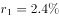
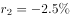
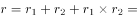
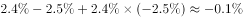
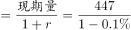
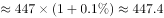

# 间隔（隔年）基期值计算

考点：[[20-考点/资料分析/增长/间隔（隔年）基期值计算|增长 / 间隔（隔年）基期值计算]]
材料：[[15-材料/资料分析/199274 2018年上半年全国规模以上文化及相|199274 2018年上半年全国规模以上文化及相]]

**问法模型**：题干所求时间（2016年上半年）比材料现期（2018年上半年）早两期，且中间年份增速为负 → 用隔年基期模型：所求=现期值÷[(1+本期同比增速)×(1+上期同比增速)]，负增长增速必须带负号代入。

## 推理链
1. 第1步：题干问“2016年上半年”而材料现期为2018年上半年，中间隔着2017年上半年，判定为间隔（隔年）基期计算；从材料第3段提取东北地区现期营业收入447亿元。
2. 第2步：确定两个增速的符号：东北地区2018年上半年“实现了正增长”故本期增速r₁>0；“与上年同期下降相比”说明2017年上半年增速r₂为负（本版材料增速数值空白，需按官方解析补齐两增速后代入）。
3. 第3步：列隔年基期公式：2016年上半年值=447÷[(1+r₁)×(1+r₂)]=447÷[(1+r₁)×(1−|r₂|)]，即先倒推2017年上半年、再倒推2016年上半年，连续除两次。
4. 第4步：方向定性校验：官方答案对应的2016年值（约447.7）略大于现期447，说明补齐后(1+r₁)(1−|r₂|)略小于1（2017年降幅略大于2018年增幅），两年复合增速略为负，基期值应略高于现期；四个选项中仅D项447.7大于447，方向自洽。
5. 第5步：按官方解析代入两增速精算：2016年上半年东北地区营业收入≈447.7亿元（即约447亿元），与第4步定性结论一致。
6. 第6步：对照选项，约447.7亿元与D项（447.7）最接近，故选D。

**最快解法**：⚡ 隔年基期公式法＋选项方向锁定：先确认2018年增速为正、2017年（上年同期）增速为负，带负号写出447÷[(1+r₁)×(1−|r₂|)]；由降幅略大于增幅知两年复合增速略为负，基期值应略大于现期447，扫一眼选项只有D（447.7）大于447，可直接锁定，无需精算。

## 易错点
- ⚠ 符号处理陷阱：“与上年同期下降x%相比”中x%是2017年（隔年）的负增速，若把(1−降幅)误当(1+降幅)代入，基期值会被算小而误选低数值选项，这是隔年基期最高频失分点。
- ⚠ 只倒推一期：447÷(1+r₁)得到的只是2017年上半年的值而非2016年，量级恰与C项（437.7）接近，构成一步除法的陷阱；必须连续除两次才能回到2016年。
- ⚠ “基期一定比现期小”的思维定势：因2017年降幅略大于2018年增幅，两年复合增速为负，2016年基期值（447.7）反而略大于现期447，若直接排除大于447的选项就会漏掉正确答案D。

## 母题抽象
> 🧩 当题干所求时间比材料现期早两期（如材料是2018年上半年、问2016年上半年）时，用隔年基期公式：所求=现期值÷[(1+r₁)(1+r₂)]；先按符号（负增长保留负号）代入，并定性判断两年复合增速正负——复合增速略为负则基期值略大于现期值，可直接锁定比现期略大的选项。

**同类特征**：问“2016年上半年”而材料现期为2018年上半年（早两期）、隔年基期/间隔基期、只给现期值与两个相邻同比增速（本期正增长、上年同期下降）、文字型材料中的区域类数据（东北地区447亿元）、选项中仅一项略大于现期值、口径为“上半年累计”的同比

## 相关题
- [[10-真题/资料分析/增长/13504439 隔年（间隔）基期量计算|13504439]]（河北 2025，相关度1）
- [[10-真题/资料分析/增长/2050706 间隔基期量计算（隔年基期+降幅收窄百分点换算）|2050706]]（河南 2017，相关度1）

---

### 题干
2016年上半年，东北地区规模以上文化及相关产业企业实现营业收入约（  ）亿元。

### 选项
- A. 425.9
- B. 435.9
- C. 437.7
- D. 447.7　✅

### 官方解析

根据题干“2016上半年，东北地区······实现营业收入”，结合材料时间为2018年，可判定本题为间隔基期计算问题。定位文字材料第三段可知，2018年东北地区实现营业收入为447亿元，增长，与上年同期下降相比，实现正增长，则2018年增长率，2017年增长率，所以2018年较2016年的增长率，则2016年东北地区实现营业收入，与D项最接近。

故正确答案为D。

### 给定材料

        对全国规模以上文化及相关产业5.9万家企业的调查显示，2018年上半年，上述企业实现营业收入42227亿元，比上年同期增长，继续保持较快增长。

        文化及相关产业9个行业的营业收入均实现增长。其中，新闻信息服务营业收入3744亿元，比上年同期增长；创意设计服务5143亿元，增长；内容创作生产8820亿元，增长；文化传播渠道4501亿元，增长；文化辅助生产和中介服务7783亿元，增长；文化消费终端生产7911亿元，增长；文化投资运营349亿元，增长；文化装备生产3313亿元，增长；文化休闲娱乐服务663亿元，增长。

        分区域看，东部地区规模以上文化及相关产业企业实现营业收入32443亿元；中部、西部和东北地区分别为5828亿元、3509亿元和447亿元。从增长速度看，西部地区比上年同期增长；东部地区增长；中部地区增长；东北地区增长，与上年同期下降相比，实现了正增长。

