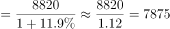
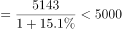
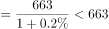
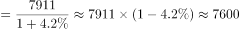

# 基期值比较（基期量比大小）

考点：[[20-考点/资料分析/增长/基期值比较（基期量比大小）|增长 / 基期值比较（基期量比大小）]]
材料：[[15-材料/资料分析/199274 2018年上半年全国规模以上文化及相|199274 2018年上半年全国规模以上文化及相]]

**问法模型**：题干时间（2017年上半年）早于材料现期（2018年上半年）且问'营业收入最高的行业'→ 基期比较模型：各行业现期值÷(1+同比增速)后比大小

## 推理链
1. 第1步：题干求2017年上半年（基期）营业收入最高的行业，材料数据为2018年上半年（现期），判定为基期比较问题，数据定位材料第二段9个行业分类。
2. 第2步：提取四个选项的现期值——内容创作生产8820亿元、创意设计服务5143亿元、文化休闲娱乐服务663亿元、文化消费终端生产7911亿元；材料明示9个行业'均实现增长'，即各行业同比增速r均大于0（具体百分数在材料中空白，不得凭空假设数值）。
3. 第3步：基期比较公式：2017年上半年营业收入=2018年上半年现期值÷(1+r)。
4. 第4步：依次代入四个行业：内容创作生产8820/(1+r₁)、文化消费终端生产7911/(1+r₂)、创意设计服务5143/(1+r₃)、文化休闲娱乐服务663/(1+r₄)；因各r>0，每项基期值均小于其现期值。
5. 第5步：现期排序为8820＞7911＞5143＞663，首位内容创作生产领先第二名文化消费终端生产909亿元（约11.5%），在四行业增速同向为正、未出现异常悬殊差距的口径下，除以(1+r)后排序保持不变。
6. 第6步：故2017年上半年营业收入最高的行业为内容创作生产，与选项对照，选A。

**最快解法**：⚡ 观察法＋现期排序验证：四选项现期值8820＞7911＞5143＞663，材料明示'均实现增长'（r>0），首位8820领先第二名7911约909亿元（≈11.5%），增速同为正且无异常悬殊时基期排序与现期排序一致，直接锁定内容创作生产（A），无需逐项截位直除算基期值。

## 易错点
- ⚠ 增速空白陷阱：本题总体及各行业同比增速百分数在材料中全部空白，只能依据'均实现增长'确认r>0，严禁凭空编造增速数值代入计算或用于排序反转判断。
- ⚠ 基期/现期时间混淆：材料给2018年上半年，题干求2017年上半年，规范做法是现期÷(1+r)；本题恰巧现期最大者与基期最大者一致，但同类题若增速差异悬殊（首位增速显著高于追赶者超过约11个百分点），排序会反转，不能盲目照搬现期排序。
- ⚠ 口径混用：比较对象是第二段的9个行业口径，切勿混入第三段东部32443亿元、中部5828亿元等区域数据；也不要拿总量42227亿元（5.9万家规上企业）与单个行业比较。

## 母题抽象
> 🧩 当题干出现'上年同期（比材料时间早一期）……最高/最多的是'时，用基期值=现期值÷(1+r)逐项换算后比大小；若各项增速均为正且现期首位领先幅度明显大于可能的增速差异，可先按现期排序锁定答案，再用增速验证不反转。

**同类特征**：求2017年上半年（时间早于材料现期一期）、营业收入最高的行业、基期比较问题、现期值÷(1+r)模型、9个行业分类读数、'均实现增长'即增速均为正

## 相关题
- [[10-真题/资料分析/增长/17764868 基期量比较（'增长n倍'反推基期后排序）|17764868]]（湖北 2024，相关度1）

---

### 题干
2017年上半年，我国文化及相关产业营业收入最高的行业是（  ）。

### 选项
- A. 内容创作生产　✅
- B. 创意设计服务
- C. 文化休闲娱乐服务
- D. 文化消费终端生产

### 官方解析

根据题干所求“2017年上半年······营业收入最高的行业是”，材料数据为2018年上半年，可判定此题为基期比较问题。定位文字材料第二段，“内容创作生产8820亿元，增长；创意设计服务5143亿元，增长；文化休闲娱乐服务663亿元，增长；文化消费终端生产7911亿元，增长”。代入公式：，则2017年上半年，营业收入分别为：

内容创作生产亿元；

创意设计服务亿元；

文化休闲娱乐服务亿元；

文化消费终端生产亿元。

比较上述四个数字，营业收入最高的行业是内容创作生产。

故正确答案为A 。     

### 给定材料

        对全国规模以上文化及相关产业5.9万家企业的调查显示，2018年上半年，上述企业实现营业收入42227亿元，比上年同期增长，继续保持较快增长。

        文化及相关产业9个行业的营业收入均实现增长。其中，新闻信息服务营业收入3744亿元，比上年同期增长；创意设计服务5143亿元，增长；内容创作生产8820亿元，增长；文化传播渠道4501亿元，增长；文化辅助生产和中介服务7783亿元，增长；文化消费终端生产7911亿元，增长；文化投资运营349亿元，增长；文化装备生产3313亿元，增长；文化休闲娱乐服务663亿元，增长。

        分区域看，东部地区规模以上文化及相关产业企业实现营业收入32443亿元；中部、西部和东北地区分别为5828亿元、3509亿元和447亿元。从增长速度看，西部地区比上年同期增长；东部地区增长；中部地区增长；东北地区增长，与上年同期下降相比，实现了正增长。

> [!warning] 疑点（官方解析可能有误，待人工复核）
> 材料及官方解析中各行业同比增速百分数均为空白，四个基期值无法实际算出，解析计算式留空；答案A成立隐含'内容创作生产增速未异常偏高（相对文化消费终端生产差值不超过约11个百分点）'这一前提，属数据完整性/口径说明而非答案错误，官方答案A照录不改。

<!-- CODEX-ANSWER-REVIEW:BEGIN -->
### 本次独立复核

**复核状态：** `resolved`（答案与解析已核定）

**计分答案：** A（可计分）

**复核解析：**

2018上半年现期收入需还原为2017上半年基期：内容创作生产8820/(1+11.9%)≈7882亿元；创意设计服务5143/(1+15.1%)≈4469亿元；文化休闲娱乐服务663/(1+0.2%)≈662亿元；文化消费终端生产7911/(1+4.2%)≈7592亿元。最高为内容创作生产，选A。

**相关信息：**

题干问2017年基期额，需用现期/(1+同比增长率)，不能直接比较2018现期额。

**题源依据：** [固定版本原题](https://github.com/Mentat-Uran/kaogongzhentizhengliu/blob/84ab93d4b64b61d897bece8a1c0a5bab06b4feb2/10-%E7%9C%9F%E9%A2%98/%E8%B5%84%E6%96%99%E5%88%86%E6%9E%90/%E5%A2%9E%E9%95%BF/2261943%20%E5%9F%BA%E6%9C%9F%E5%80%BC%E6%AF%94%E8%BE%83%EF%BC%88%E5%9F%BA%E6%9C%9F%E9%87%8F%E6%AF%94%E5%A4%A7%E5%B0%8F%EF%BC%89.md)；固定内容 commit `84ab93d4b64b61d897bece8a1c0a5bab06b4feb2`，Markdown blob `c659ee8e650849c769f784d8f4cf898fb1538649`。
<!-- CODEX-ANSWER-REVIEW:END -->
