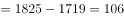
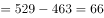
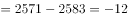
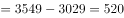

# 增长量比较（同比增量作差）

考点：[[20-考点/资料分析/增长/增长量比较（同比增量作差）|增长 / 增长量比较（同比增量作差）]]
材料：[[15-材料/资料分析/199275 2011—2015年我国部分社会服务|199275 2011—2015年我国部分社会服务]]

**问法模型**：题干出现'与2012年相比，2013年下列…增加最多的是'→ 对四个选项各自定位对应指标行，用'同比增量=2013年值−2012年值'逐项作差后比较大小

## 推理链
1. 第1步：题干限'与2012年相比，2013年增加最多'，只需比较A福利院、B儿童福利机构、C老龄机构、D基金会四行在表1中2013年与2012年两列数据（福利院1825/1719，儿童529/463，老龄2571/2593，基金会3549/3029）
2. 第2步：增长量比较模型：增量=现期值−基期值，此处即2013年值−2012年值，无需涉及增长率
3. 第3步：代入作差：社会福利院1825−1719=106个；儿童福利机构529−463=66个；老龄机构2571−2593=−22个（负增长，实为减少）；基金会3549−3029=520个
4. 第4步：比较增量：520＞106＞66＞−22，基金会增量最大，对照选项选D

**最快解法**：⚡ 口算作差+量级排除法：四组两位数相减直接心算，基金会3549−3029=520一眼即超其余三项（106、66、−22），可先算基金会锁定答案再带过其余选项验证

## 易错点
- ⚠ 把'单位数大'误当'增加最多'：老龄机构2013年(2571)数值虽大，但较2012年(2593)实际减少22个，增量为负直接排除
- ⚠ '增加最多'比的是同比增量而非增长率，本题增量与增长率方向一致但模型是相邻两年作差
- ⚠ 定位陷阱：表1'社会工作'行2013年较2012年增加144016个为全表最大，但它不在选项中，勿误扫到该行；且社会福利院2014/2015年数据缺失（'–'），本题恰好只用2012/2013年数据不受影响

## 母题抽象
> 🧩 当题干出现'与某年相比，某年下列……增加最多的是'且选项为具体类别时，逐项锁定对应行的两列相邻年份数据，用'现期−上期'作差比较，增量为负者直接排除，注意增量最大≠数值最大

**同类特征**：与2012年相比，2013年、增加最多的是、四个具体机构类别选项、同比增量比较（非增长率）、数据在表1分类指标行、相邻两年截面值作差

## 相关题
（暂无）

---

### 题干
与2012年相比，2013年下列社会服务机构中单位数增加最多的是（  ）。

### 选项
- A. 社会福利院
- B. 儿童福利机构
- C. 老龄机构
- D. 基金会　✅

### 官方解析

根据题干“······增加最多的是”，可判定本题为增长量比较问题。定位第一个表格第4列和第5列，。故社会福利院单位数的增长量，儿童福利机构单位数的增长量，老龄机构单位数的增长量，基金会单位数的增长量，故与2012年相比，2013年增加最多的为基金会。

故正确答案为D。

### 给定材料

