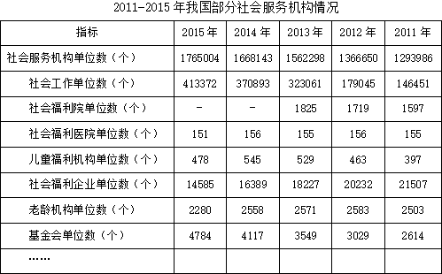

# 增长量计算（跨期增量+单位换算）

考点：[[20-考点/资料分析/增长/增长量计算（跨期增量+单位换算）|增长 / 增长量计算（跨期增量+单位换算）]]
材料：[[15-材料/资料分析/199275 2011—2015年我国部分社会服务|199275 2011—2015年我国部分社会服务]]

**问法模型**：题干'2015年比2011年增加约多少万个'→ 增长量=现期值−基期值，再把'个'换算成'万个'对照选项

## 推理链
1. 第1步：由题干'……比……增加……万个'判定为增长量计算，定位表1总量行'社会服务机构单位数'：2015年为1765004个，2011年为1293986个（两表均为期末时点数，直接相减即可，无需增速公式）
2. 第2步：套用规则 增长量=现期值−基期值=2015年数值−2011年数值
3. 第3步：代入计算 1765004−1293986=471018个
4. 第4步：单位换算 471018个÷10000≈47.1万个
5. 第5步：与选项对照，47.1万个最接近47万，选B

**最快解法**：⚡ 高位截位口算：把两数截成'176.5万−129.4万'，百万位、十万位直接相减≈47.1万，锁定47，选B；全程不需动笔精确减完整8位数

## 易错点
- ⚠ 单位陷阱（本题最大坑）：表中单位为'个'，选项单位为'万个'，471018个必须÷10000换算成约47万个；若忘换算会去选471018或错选数量级
- ⚠ 基期现期方向混淆：2015年是现期、2011年是基期，须用1765004−1293986，倒减得负值即错
- ⚠ 定位错行错表：必须用表1全口径总量行'社会服务机构单位数'，不能误用表2'社区服务机构数'（360956−160352≈20万个，对应错误选项）；也不能误用表1某分类行（如社会工作行）

## 母题抽象
> 🧩 当题干出现'现期年份比基期年份增加约多少××（选项单位与材料单位不一致）'时，先用'现期−基期'求差，再做量级换算（个→万除以10⁴），最后对照选项量级验证

**同类特征**：跨两个年度截点（2015年比2011年）、'增加约……万个'问增量不问增速、给出具体单位'万个'与表中'个'不一致、取用总量行（社会服务机构单位数）、选项为连续整数、仅需量级判断

## 相关题
（暂无）

---

### 题干
2015年，社会服务机构单位数比2011年增加约（  ）万个。

### 选项
- A. 46
- B. 47　✅
- C. 48
- D. 49

### 官方解析
根据题干“······比······增加······万个”，可判定本题为增长量计算问题。定位第一个表格可得：2015年社会服务机构单位数1765004，2011年社会服务机构单位数1293986，故社会服务机构单位数万。
故正确答案为B。

### 给定材料

