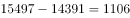
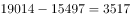
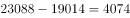
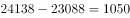

# 增长量比较

考点：[[20-考点/资料分析/增长/增长量比较|增长 / 增长量比较]]
材料：[[15-材料/资料分析/199275 2011—2015年我国部分社会服务|199275 2011—2015年我国部分社会服务]]

**问法模型**：'××数量同比增加最多的年份是'→相邻两年期末存量相减求各年同比增量，四个年份横向比大小取最大

## 推理链
1. 第1步：题干关键词'社区服务中心'锁定表2'社区服务中心数（个）'行，读取2011—2015年数据依次为14391、15497、19014、23088、24138个
2. 第2步：增长量比较模型：某年同比增量=该年期末数−上一年期末数
3. 第3步：逐年作差：2012年=15497−14391=1106个；2013年=19014−15497=3517个；2014年=23088−19014=4074个；2015年=24138−23088=1050个
4. 第4步：比较四个增量，4074个（2014年）最大，对应选项C，故选C

**最快解法**：⚡ 逐年相减+首位估算法：先粗算量级——2012年约1100、2013年约3500、2014年约4100、2015年约1000，只比千位/百位首位即可锁定2014年（4074个）最大，无需精算，直接选C；切勿误把2015年数值最大（24138个）当成增量最大

## 易错点
- ⚠ 定位错行：表2指标名称相近（社区服务机构数/社区服务中心数/社区服务站数），必须锁定'社区服务中心数'行，误用首行'社区服务机构数'（其2014年还较2013年不增反降）或表1数据即错
- ⚠ '增加最多'比的是同比增量（相邻两年相减），不是增长率、更不是现期值大小：2015年现期值24138最大但其增量仅1050个，属四个年份中较小者
- ⚠ 时间范围：仅比较2012—2015四个年份的增量，2011年作基期不参比；表2'社区服务机构覆盖率(%)'行量纲不同且2011年(23.6%)高于2012—2014年，勿混看、勿想当然套趋势

## 母题抽象
> 🧩 当题干出现'某指标同比增加最多的年份是'且材料为逐年期末存量表时，用相邻两年相减求各年增量后直接横向比大小，警惕'现期值最大≠增量最大'且增量可能为负

**同类特征**：同比增加最多、增长量比较、相邻年份相减、年份比较型设问、社区服务中心、表2定位

## 相关题
- [[10-真题/资料分析/增长/2604294 增长量比较|2604294]]（广东 2020，相关度4）
- [[10-真题/资料分析/增长/2144598 增长量比较|2144598]]（选调 2018，相关度3）
- [[10-真题/资料分析/增长/465283 增长量比较|465283]]（江苏 2014，相关度3）
- [[10-真题/资料分析/增长/15121335 增长量比较|15121335]]（江苏 2024，相关度3）
- [[10-真题/资料分析/增长/18643862 增长量比较|18643862]]（四川 2026，相关度3）

---

### 题干
2012—2015年，社区服务中心数量同比增加最多的年份是（  ）。

### 选项
- A. 2012年
- B. 2013年
- C. 2014年　✅
- D. 2015年

### 官方解析

根据题干“······同比增长最多的年份”，可判定本题为增长量比较问题，定位材料第二个表格中：社区服务中心数同比增量分别为2012年: 个、2013年：个、2014年：个、2015年：个。因此增加最多的年份为2014年。

故正确答案为C。

### 给定材料

