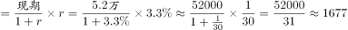

# 增长量计算（已知现期与同比增速，现期×r-(1+r)模型）

考点：[[20-考点/资料分析/增长/增长量计算（已知现期与同比增速，现期×r-(1+r)模型）|增长 / 增长量计算（已知现期与同比增速，现期×r/(1+r)模型）]]
材料：[[15-材料/资料分析/199276 以2017年末为现期、辅以2013—|199276 以2017年末为现期、辅以2013—]]

**问法模型**：题干'2017年……比2016年增加约（ ）公里'→判定为增长量计算，用增长量=现期×r/(1+r)，并注意'万公里→公里'的单位换算。

## 推理链
1. 第1步：从文字材料提取条件：2017年末西部地区铁路营业里程5.2万公里，比上年增长3.3%（该增速在显示材料中空缺，官方解析按此口径计算，与答案A自洽）
2. 第2步：确定公式：增长量=现期×r/(1+r)=52000×3.3%/(1+3.3%)
3. 第3步：单位换算：题干问'公里'而材料为'万公里'，5.2万公里=52000公里
4. 第4步：代入计算：3.3%≈1/30.3，增长量≈52000/31.3≈1661公里（直接算52000×0.033/1.033≈1661.2）
5. 第5步：与选项对照：1661对应A，正确答案为A

**最快解法**：⚡ 百化分+截位直除：先把5.2万公里换算成52000公里，再把3.3%百化分为1/30.3，增长量=现期/(30.3+1)=52000/31.3≈1661公里，首位直锁A（若粗算52000/31≈1677，距1661最近仍选A）。

## 易错点
- ⚠ 单位量级陷阱：材料单位是'万公里'、题干问'公里'，5.2万公里必须×10000写成52000公里，否则结果差一万倍
- ⚠ 公式误用：误算现期×r=52000×3.3%≈1716（混淆为基期口径），正确须除以(1+r)得1661
- ⚠ 取数陷阱：西部地区增速仅在文字段（显示空缺），图中只有全国营业/复线/电气化三系列，切勿用全国营业里程增速(12.7/12.4-1≈2.4%)替代西部增速代入计算

## 母题抽象
> 🧩 当题干出现'现期比基期增加约××（带具体单位）'且给出现期值与同比增速r时，用增长量=现期×r/(1+r)（百化分r≈1/N则增长量≈现期/(N+1)），并先核对该单位与材料单位是否需要换算。

**同类特征**：比2016年增加约、增长量计算、作答单位'公里'与材料'万公里'不同、西部地区铁路营业里程、现期5.2万公里、选项为百位级精确数值、需一定精度

## 相关题
- [[10-真题/资料分析/增长/7159 增长量计算|7159]]（北京 2009，相关度1）
- [[10-真题/资料分析/增长/2571729 增长量计算——每增长1个百分点对应的增量（基期量×1%）|2571729]]（山东 2020，相关度1）
- [[10-真题/资料分析/增长/3018839 增长量计算（负增长情形：基期减少量）|3018839]]（广东 2021，相关度1）
- [[10-真题/资料分析/增长/10204654 增长量计算（已知现期与同比下降率求下降量）|10204654]]（安徽 2024，相关度1）
- [[10-真题/资料分析/增长/13319362 现期增长量计算（已知现期值与同比增速，用r-(1+r)公式）|13319362]]（江苏 2025，相关度1）

---

### 题干
2017年，西部地区铁路营业里程比2016年增加约（  ）公里。

### 选项
- A. 1661　✅
- B. 1761
- C. 1861
- D. 1961

### 官方解析

根据题干“2017年······比2016年增加······公里”，可判定本题为增长量计算问题。定位文字材料“2017年末，西部地区铁路营业里程5.2万公里，比上年增长”，故2017年西部地区铁路营业里程同比增长量公里。

故正确答案为A。

### 给定材料

        2017年末，全国铁路营业里程达到12.7万公里，比上年增长，其中高铁营业里程2.5万公里。全国铁路路网密度132.2公里/万平方公里，比上年增加3.0公里/万平方公里。其中复线里程7.2万公里，复线率（铁路复线里程占铁路营业里程的比重），电气化里程8.7万公里，电化率（铁路电气化里程占铁路营业里程的比重）。西部地区铁路营业里程5.2万公里，比上年增长。

> [!warning] 疑点（官方解析可能有误，待人工复核）
> 材料文字及官方解析中西增速数值均被截断（显示为空），按官方答案A=1661反推增速应为3.3%，代入52000×3.3%/1.033≈1661完全自洽，不构成对答案的矛盾，仅提示本题取数依赖题干/原始公报补全该增速。

<!-- CODEX-ANSWER-REVIEW:BEGIN -->
### 本次独立复核

**复核状态：** `confirmed`（独立复算确认答案）

**计分答案：** A（可计分）

**复核解析：**

固定题源公式图给出2017年西部铁路营业里程同比增长率3.3%。已知现期5.2万公里=52000公里，则同比增长量=52000×3.3%/(1+3.3%)≈1661.18公里，最接近A项1661公里。原文和旧解析中的百分比图片不显示为文字，但该公式图在固定题源中完整存在，故可复算。

**相关信息：**

增长量=现期量×增长率/(1+增长率)。若文字转录缺少百分比，应先核查题源公式图，不从答案倒推数据。

**题源依据：** [固定版本原题](https://github.com/Mentat-Uran/kaogongzhentizhengliu/blob/84ab93d4b64b61d897bece8a1c0a5bab06b4feb2/10-%E7%9C%9F%E9%A2%98/%E8%B5%84%E6%96%99%E5%88%86%E6%9E%90/%E5%A2%9E%E9%95%BF/2261968%20%E5%A2%9E%E9%95%BF%E9%87%8F%E8%AE%A1%E7%AE%97%EF%BC%88%E5%B7%B2%E7%9F%A5%E7%8E%B0%E6%9C%9F%E4%B8%8E%E5%90%8C%E6%AF%94%E5%A2%9E%E9%80%9F%EF%BC%8C%E7%8E%B0%E6%9C%9F%C3%97r-(1%2Br)%E6%A8%A1%E5%9E%8B%EF%BC%89.md)；固定内容 commit `84ab93d4b64b61d897bece8a1c0a5bab06b4feb2`，Markdown blob `541f7ac20ffda5469a2d6de6770f37e86cef4afd`。
<!-- CODEX-ANSWER-REVIEW:END -->
