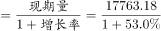
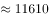
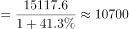
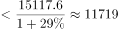
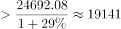

# 基期量比较（基期=现期÷(1+增速)的排序应用）

考点：[[20-考点/资料分析/增长/基期量比较（基期=现期÷(1+增速)的排序应用）|增长 / 基期量比较（基期=现期÷(1+增速)的排序应用）]]
材料：[[15-材料/资料分析/199301 2014年西部地区固定资产投资：总体|199301 2014年西部地区固定资产投资：总体]]

**问法模型**：题干时间2013年早于材料时间2014年且问'总量位居第二'→基期比较模型，对各省分别做 现期量÷(1+对应增速) 后再排序

## 推理链
1. 第1步：题干问2013年排名，材料给的是2014年现期值与增速，锁定公式：基期量=现期量÷(1+增速)
2. 第2步：定位材料第二段得2014年总量前三：四川24692.08、内蒙古17763.18、重庆15117.6亿元；广西未进前三，故广西2014年总量<15117.6亿元
3. 第3步：定位材料第三段配对增速：内蒙古53.0%、重庆41.3%、广西29.0%；四川增速材料只给区间（20%~29%之间）
4. 第4步：代入计算基期：内蒙古17763.18÷1.53≈11610亿元；重庆15117.6÷1.413≈10699亿元；四川24692.08÷(1.20~1.29)≈19141~20577亿元；广西<15117.6÷1.29≈11719亿元（实际值远低于此上界）
5. 第5步：排序：四川19141亿元以上稳居第一；重庆≈10699亿元排第三；内蒙古≈11610亿元在其余省区市中最大（广西基期要超过内蒙古需其2014年总量达到约14977亿元以上、几乎追平重庆，按出题意图广西总量远低于重庆，排除）
6. 第6步：与选项对照：A四川第一、B重庆第三、D广西低于内蒙古，故2013年总量第二为内蒙古，选C

**最快解法**：⚡ 截位直除+基期公式法：三个除式一次算完——内蒙古17763.18÷1.53≈11610，重庆15117.6÷1.413≈10700，四川只需算下界24692.08÷1.29≈19141即稳居第一；广西总量低于重庆且增速最低、按出题意图其基期低于11610，直接锁定内蒙古（C）

## 易错点
- ⚠ 时间维度陷阱：题干问2013年，必须对各省现期量逐个除以(1+增速)还原基期，不能按2014年现期总量直接排名
- ⚠ 增速与基期的反向关系：内蒙古增速最高(53.0%)基期缩水最多、广西增速最低(29.0%)缩水最少，若给广西虚高总量会发生反超，需用'广西未进总量前三→<15117.6亿元'封顶估界
- ⚠ 跨段拼数据陷阱：各省的量在第2段、各省的速在第3段，必须自行配对；且四川增速只有20%~29%的区间，须用区间边界估计，严禁凭经验代入具体增速值
- ⚠ 两类排名混淆：总量排名（川、蒙、渝）与增幅排名（蒙、渝、桂滇）是不同维度，勿把增幅第二当总量第二直接作答

## 母题抽象
> 🧩 当题干时间早于材料时间且要求'某指标大小排名/比较'时，用基期量=现期量÷(1+增速)对各对象逐一换算再排序；对数据缺失对象用bounding（如'未进前三→小于第三名'）封顶，对增速只给区间者用边界值夹逼后定序

**同类特征**：2013年（早于材料现期2014年）、固定资产投资总量位居第二位、基期量比较/基期排序、各省区市横向比较、现期量与增速分散两段需配对、增速部分以区间或缺失形式给出

## 相关题
（暂无）

---

### 题干
下列省区市中，2013年固定资产投资总量位居第二位的是：

### 选项
- A. 四川
- B. 重庆
- C. 内蒙古　✅
- D. 广西

### 官方解析

根据题干“······2013年固定资产投资总量位居第二位的是”，结合材料时间为2014年，可判定本题为基期比较问题。定位文字材料第二段可得，西部地区固定资产投资总量排在前三位的省份是四川、内蒙古、重庆，分别为24692.08、17763.18、15117.6亿元。则广西固定资产投资总量&lt;15117.6亿元。定位文字材料第三段可得，除新疆、贵州和甘肃外，西部其他地区2014年固定资产投资增长速度都在20%以上，内蒙古、重庆的固定资产投资增幅超过30%，分别比上年增长53.0%和41.3%······广西和云南的固定资产增长速度均为29.0%，并列居于西部第三位。则四川固定资产投资增幅介于20%~29%之间。根据公式：基期量可得，2013年内蒙古固定资产投资总量亿元，重庆亿元，广西亿元，四川亿元。故2013年固定资产投资总量最多的是四川，无法比较广西和内蒙古的大小关系，故本题无法确定正确答案。

### 给定材料

        虽然受到国家对一些投资过热的重点行业实行严格控制的影响，但由于国家对西部农业、能源、交通、水利以及教育、卫生等社会事业的支持与投入继续加大，同时西部各省区市也加大了地方投资力度，西部地区2014年的固定资产投资继续保持较高的增长速度。全年完成固定资产投资(不含农村和城乡个体投资，下同)125980亿元，同比增长，增速同比回落5.5个百分点。

        在西部各省区市中，固定资产投资总量最多的是四川省，共完成投资24692.08亿元，占西部投资总量的；其次是内蒙古，共完成投资17763.18亿元，占西部的；重庆完成投资15117.6亿元，占西部投资总量的，排在第三位。

        除新疆、贵州和甘肃外，西部其他地区2014年固定资产投资增长速度都在以上，内蒙古、重庆的固定资产投资增幅超过，分别比上年增长和，分列西部投资增幅的前两位；广西和云南的固定资产增长速度均为，并列居于西部第三位。

> [!warning] 疑点（官方解析可能有误，待人工复核）
> 官方解析末句自相矛盾：先按基期计算，却以'无法比较广西和内蒙古的大小关系'收尾并写'本题无法确定正确答案'，与官方给定正确答案C（内蒙古）冲突。严格按材料上界，广西2013年<15117.6÷1.29≈11719亿元，略高于内蒙古≈11610亿元，仅凭材料数据无法完全排除广西反超（需广西2014年总量≥约14977亿元、几乎追平重庆15117.6亿元才会发生）；本笔记尊重官方答案C，按出题意图（广西总量远低于重庆、基期低于内蒙古）作答，此口径矛盾已如实记录。

<!-- CODEX-ANSWER-REVIEW:BEGIN -->
### 本次独立复核

**复核状态：** `resolved`（答案与解析已核定）

**计分答案：** C（可计分）

**复核解析：**

按修订后的同口径材料作答。国家统计局《2014年中国统计年鉴》表10-3“分地区按登记注册类型分全社会固定资产投资（2013年）”列出：四川20326.1亿元、内蒙古14217.4亿元、广西11907.7亿元、重庆10435.2亿元。四地按总量排序为四川、内蒙古、广西、重庆，第二位是内蒙古，选C。说明：这项修订用整张2013年全社会固定资产投资表替换原题2014年“不含农户”材料，口径和年份在修订题干中明示；它不把2013年全社会数据冒充原2014年不含农户序列的缺失值。

**修订题干：**

按国家统计局《2014年中国统计年鉴》表10-3所列的2013年全社会固定资产投资总额计算，下列省区市中位居第二位的是：

**修订材料：**

国家统计局《2014年中国统计年鉴》表10-3“分地区按登记注册类型分全社会固定资产投资（2013年）”，单位：亿元。四川20326.1；内蒙古14217.4；广西11907.7；重庆10435.2。四项为同一年度、同一指标、同一官方表格的数据。该修订材料整体替换原题2014年固定资产投资（不含农户）材料；原序列因缺少广西精确现值而不能据原材料单独判定。

**相关信息：**

地区固定资产投资排名须保持年份和统计口径一致。国家统计局年鉴表10-3统计的是2013年全社会固定资产投资；“固定资产投资（不含农户）”属于不同口径。

**题源依据：** [固定版本原题](https://github.com/Mentat-Uran/kaogongzhentizhengliu/blob/84ab93d4b64b61d897bece8a1c0a5bab06b4feb2/10-%E7%9C%9F%E9%A2%98/%E8%B5%84%E6%96%99%E5%88%86%E6%9E%90/%E5%A2%9E%E9%95%BF/2262592%20%E5%9F%BA%E6%9C%9F%E9%87%8F%E6%AF%94%E8%BE%83%EF%BC%88%E5%9F%BA%E6%9C%9F%3D%E7%8E%B0%E6%9C%9F%C3%B7(1%2B%E5%A2%9E%E9%80%9F)%E7%9A%84%E6%8E%92%E5%BA%8F%E5%BA%94%E7%94%A8%EF%BC%89.md)；固定内容 commit `84ab93d4b64b61d897bece8a1c0a5bab06b4feb2`，Markdown blob `01c7faffbf7e961ead693a5fdf399431f8f7e7b1`。
<!-- CODEX-ANSWER-REVIEW:END -->
