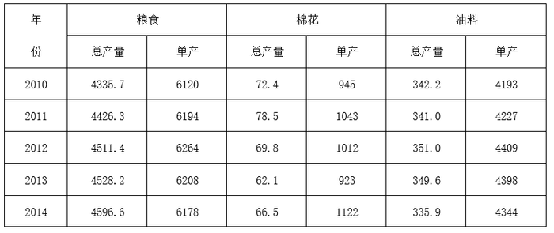

# 增长率比较（单产环比增速最快年份判定·选非题）

考点：[[20-考点/资料分析/增长/增长率比较（单产环比增速最快年份判定·选非题）|增长 / 增长率比较（单产环比增速最快年份判定·选非题）]]
材料：[[15-材料/资料分析/199304 山东省2010—2014年粮食、棉花|199304 山东省2010—2014年粮食、棉花]]

**问法模型**：题干为'下列说法不准确的是'→选非题，对四个选项逐一验证'某作物单产增速最快的一年'，模型为环比增长率＝(当年单产−上年单产)/上年单产，比较各年增速找最大者后核对陈述正误

## 推理链
1. 第1步：从表中提取粮食单产6120→6194→6264→6208→6178千克/公顷，粮食总产量4335.7→4426.3→4511.4→4528.2→4596.6万吨；棉花单产945→1043→1012→923→1122；油料单产4193→4227→4409→4398→4344
2. 第2步：A项验证总产量：粮食总产量五年逐年递增、无任何下降年份，A说法准确
3. 第3步：B项验证粮食单产增速：2010年无环比；2011年(6194−6120)/6120=74/6120≈1.21%，2012年(6264−6194)/6194=70/6194≈1.13%，2013、2014年单产下降为负增长；74/6120分子更大、分母更小，故2011年增速＞2012年，增速最快是2011年而非2012年，B说法不准确
4. 第4步：C项验证棉花单产增速：2012、2013年为负增长直接排除；2011年98/945≈10.4%，2014年(1122−923)/923=199/923≈21.6%，2014年最大，C说法准确
5. 第5步：D项验证油料单产增速：2013、2014年为负增长直接排除；2011年34/4193≈0.8%，2012年(4409−4227)/4227=182/4227≈4.3%，分母相近而182远大于34，2012年最大，D说法准确
6. 第6步：本题为选非题，只有B不准确，故正确答案为B

**最快解法**：⚡ 分数比较法（分子大分母小则分数大）＋负增长排除：每列单产先标出下降年份（粮食2013/2014、棉花2012/2013、油料2013/2014）直接划掉，只对正增长年份比较；粮食单产74/6120与70/6194分子大者分母反而小，一步定性判定2011＞2012，无需算出具体百分比；同理锁定棉花2014（199/923）、油料2012（182/4227），全程口算即可

## 易错点
- ⚠ 选非题思维反转：四个选项中三个为真、一个为假，惯性选'正确说法'会错选A/C/D，须紧扣'不准确'设问
- ⚠ 总产量趋势想当然迁移到单产：粮食总产量2013、2014仍逐年上升，但单产6264→6208→6178连续两年下降，由总产量推单产方向必错；本题B项正是利用该背离设陷
- ⚠ 2011与2012年粮食单产增量十分接近（74对70千克/公顷）且基期也接近（6120对6194），粗看几乎无法区分，必须用'分子大分母小'严格比较才能判定2011更快；另注意2010年无环比增速，比较范围仅2011—2014四年

## 母题抽象
> 🧩 当题干出现'XX（单产/产量）增速最快的一年是某年'且给定逐年数据时，先划掉所有同比下降年份，只对正增长年份列(现期−基期)/基期的分数，用'分子大分母小'定性比较找最大年份，再按选非/选是题要求核对选项

**同类特征**：选非题·选不准确项、增速最快的一年、单产环比增速比较、逐年数据核对、粮食/棉花/油料三类作物、总产量与单产趋势背离

## 相关题
（暂无）

---

### 题干
下列说法不准确的是（  ）。

### 选项
- A. 自2010年至2014年山东省粮食总产量逐年增加
- B. 粮食单产增速最快的一年是2012年　✅
- C. 棉花单产增速最快的一年是2014年
- D. 油料单产增速最快的一年是2012年

### 官方解析
A项：2010-2014年，粮食总产量依次是4335.7万吨、4426.3万吨、4511.4万吨、4528.2万吨、4596.6万吨，逐年增加，正确；
B项：2011年粮食单产增速：；2012年粮食单产增速：；2013年与2014年粮食单产均下降，与相比，分子大分母小，则，因此增速最快的是2011年。错误；
C项：2011年棉花单产增速：，2012年与2013年棉花单产均为下降，2014年：，与相比，分子大分母小，则，因此增速最快的是2014年。正确；
D项：2011年油料单产增速：，2012年油料单产增速：，2013年与2014年油料单产均下降，与相比，分母差不多，分子明显前者大，则，因此增速最快的是2012年。正确。
本题为选非题，故正确答案为B。

### 给定材料

        山东省2010年至2014年的粮食、棉花、油料总产量（单位：万吨）和单产（单位：千克／公顷）如下表： 

