# 基期和差问题（进出口差值绝对量的同比缩小比较）

考点：[[20-考点/资料分析/增长/基期和差问题（进出口差值绝对量的同比缩小比较）|增长 / 基期和差问题（进出口差值绝对量的同比缩小比较）]]
材料：[[15-材料/资料分析/199307 2013年全国林产品进出口概况（出口|199307 2013年全国林产品进出口概况（出口]]

**问法模型**：“2013年进出口差值的绝对量比上年有所缩小”→基期和差比较模型：基期值=现期值÷(1+同比增速)，逐项比较|现期出口−现期进口|与|基期出口−基期进口|的大小。

## 推理链
1. 第1步：从表格提取2013年数据——原木出口1.31万立方米(+263.89%)、进口4515.94万立方米(+19.18%)；锯材出口45.82(−4.50%)、进口2404.30(+16.32%)；刨花板出口27.13(+25.20%)、进口58.68(+8.52%)；纸和纸制品出口782.23万吨(+18.29%)、进口297.12万吨(−8.70%)。
2. 第2步：明确判定规则——“差值绝对量缩小”即|现期出口−现期进口|＜|基期出口−基期进口|，基期值=现期值÷(1+增速)，增速为负时分母小于1。
3. 第3步：A原木：现期差=4515.94−1.31=4514.63，基期差≈4515.94/1.1918−1.31/3.6389≈3789−0.4≈3788.7，现期差＞基期差，差值扩大，排除。
4. 第4步：B锯材：现期差=2404.30−45.82=2358.48，基期差≈2404.30/1.1632−45.82/0.955≈2066.9−48.0≈2018.9，现期差＞基期差，差值扩大，排除。
5. 第5步：C刨花板：现期差=58.68−27.13=31.55，基期差≈58.68/1.0852−27.13/1.252≈54.1−21.7≈32.4，现期差31.55＜基期差32.4，差值缩小，符合题意。
6. 第6步：D纸和纸制品：现期差=782.23−297.12=485.11，基期差≈782.23/1.1829−297.12/0.913≈661.3−325.4≈335.9，现期差＞基期差，差值扩大，排除。
7. 第7步：四个选项中仅刨花板的进出口差值绝对量比上年缩小，对照选项确定答案为C。

**最快解法**：⚡ 基期和差公式法＋方向速判先排除：D为净出口且出口增(+18.29%)、进口降(−8.70%)，差值必扩大；A、B为净进口且进口增量（约+727、+337万立方米）远超出口变动（+0.95、−2.2万立方米），差值必扩大；仅剩C需精算——基期差=58.68/1.0852−27.13/1.252≈54.1−21.7≈32.4＞现期差31.55，缩小，选C（截位直除两位即可）。

## 易错点
- ⚠ “增速大”不等于“差值缩小”：原木出口增速高达263.89%但基数仅1.31万立方米，凭增速判断易误选A，必须比较绝对差值。
- ⚠ 增速为负时基期回推方向易错：锯材出口−4.50%、纸和纸制品进口−8.70%，分母(1+增速)＜1，基期值反而大于现期值，方向算反即出错。
- ⚠ 口径与方向陷阱：差值指|出口−进口|，A/B/C为净进口方向、D为净出口方向，不能只看单个增速；表格各行单位不一（万立方米/万吨），只能在同一产品内部比较，不可跨行加总或比较。

## 母题抽象
> 🧩 当题干出现“差值/差额/顺（逆）差比上年缩小（扩大）”特征时，用基期和差模型：先算现期|A−B|，再以A/(1+a)、B/(1+b)回推基期算|差|，比较大小即锁定答案。

**同类特征**：进出口差值的绝对量、比上年有所缩小、基期和差比较、现期值÷(1+增速)回推、净进口/净出口方向、木质林产品逐项排查

## 相关题
- [[10-真题/资料分析/增长/3522370 基期量计算与基期和差比较（两次基期化后作差定符号）|3522370]]（青海 2021，相关度1）

---

### 题干
下列木质林产品中，2013年进出口差值的绝对量比上年有所缩小的是：

### 选项
- A. 原木
- B. 锯材
- C. 刨花板　✅
- D. 纸和纸制品

### 官方解析

根据题干“···进出口差值的绝对量比上年有所缩小”，可判定本题为基期和差问题。

A项：定位表格可得，2013年原木出口量1.31万立方米，同比增长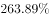，进口量4515.94万立方米，同比增长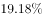。现期差绝对值为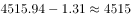，基期差为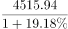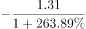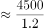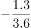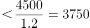，现期差大于基期差，即差值比上年扩大，排除；

B项：定位表格可得，2013年锯材出口量45.82万立方米，同比增长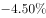，进口量2404.30万立方米，同比增长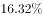。现期差绝对值为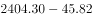，基期差为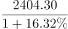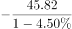，其中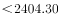，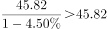，则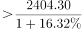，现期差大于基期差，即差值比上年扩大，排除；

C项：定位表格可得，2013年刨花板出口量27.13万立方米，同比增长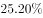。进口量58.68万立方米，同比增长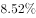。现期差绝对值为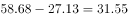，基期差为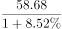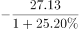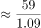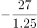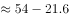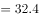。现期差小于基期差，即差值比上年缩小，正确；

D项：定位表格可得，2013年纸和纸制品出口量762.23万吨，同比增长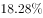，进口量297.12万吨，同比增长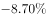。现期差绝对值为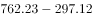，基期差为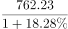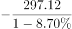，其中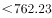，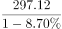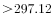，则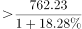，现期差大于基期差，即差值比上年扩大，排除。

故正确答案为C。

### 给定材料

        2013年，全国林产品出口644.55亿美元，同比增长，增幅比上年增加3.18个百分点，占全国商品出口额的。林产品进口640.88亿美元，同比增加，增幅比上年增加8.58个百分点，占全国商品进口额的。其中，非木质林产品出口162.3亿美元，同比增加，进口288.80亿美元，同比下降。

> [!warning] 疑点（官方解析可能有误，待人工复核）
> 官方解析D项将纸和纸制品出口量误写为762.23万吨（表格实为782.23万吨）；按任一读数计算，现期差（485.11或465.11）均大于基期差（约336），结论“差值扩大”不变，不影响正确答案C。

<!-- CODEX-ANSWER-REVIEW:BEGIN -->
### 本次独立复核

**复核状态：** `resolved`（答案与解析已核定）

**计分答案：** C（可计分）

**复核解析：**

比较2013年进出口差额与2012年。刨花板2013进口58.68、出口27.13，差31.55；2012进口约54.07、出口约21.67，差32.40，绝对差缩小，选C。

**相关信息：**

基期量=现期量/(1+增长率)；若同比下降则除以(1−降幅)。注意百分点与百分比口径。

**题源依据：** [固定版本原题](https://github.com/Mentat-Uran/kaogongzhentizhengliu/blob/84ab93d4b64b61d897bece8a1c0a5bab06b4feb2/10-%E7%9C%9F%E9%A2%98/%E8%B5%84%E6%96%99%E5%88%86%E6%9E%90/%E5%A2%9E%E9%95%BF/2263119%20%E5%9F%BA%E6%9C%9F%E5%92%8C%E5%B7%AE%E9%97%AE%E9%A2%98%EF%BC%88%E8%BF%9B%E5%87%BA%E5%8F%A3%E5%B7%AE%E5%80%BC%E7%BB%9D%E5%AF%B9%E9%87%8F%E7%9A%84%E5%90%8C%E6%AF%94%E7%BC%A9%E5%B0%8F%E6%AF%94%E8%BE%83%EF%BC%89.md)；固定内容 commit `84ab93d4b64b61d897bece8a1c0a5bab06b4feb2`，Markdown blob `a8b24a75f3d9d0c6e0a4777fab38103bde1cc588`。
<!-- CODEX-ANSWER-REVIEW:END -->
