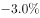

# 同比增速逐月比较（直接找数比较）

考点：[[20-考点/资料分析/增长/同比增速逐月比较（直接找数比较）|增长 / 同比增速逐月比较（直接找数比较）]]
材料：[[15-材料/资料分析/199339 2017年3月至2018年2月全国进|199339 2017年3月至2018年2月全国进]]

**问法模型**：题干问'下半年同比增速低于上月水平的月份有几个'→锁定图1折线（数量同比增速），将7—12月各月增速逐月与上月增速直接比大小后计数

## 推理链
1. 第1步：由题干定位'2017年下半年'即7—12月，比较对象是图1折线所示的数量同比增速，而非柱值数量
2. 第2步：比较规则为'本月增速<上月增速'即计入，7月的'上月'为6月（图内可得），需从图1读取2017年6—12月增速
3. 第3步：读图1折线：6月5.6%、7月1.0%、8月13.3%、9月8.2%、10月7.0%、11月21.5%、12月-3.0%
4. 第4步：逐月比较：7月1.0%<5.6%✓；8月13.3%>1.0%✗；9月8.2%<13.3%✓；10月7.0%<8.2%✓；11月21.5%>7.0%✗；12月-3.0%<21.5%✓
5. 第5步：符合条件的月份为7月、9月、10月、12月，共4个，与选项C（4）对照一致，故选C

**最快解法**：⚡ 直接找数法（折线走势比较）：只看图1折线在7—12月的升降——凡折线相对上月'下降'即符合；走势为降、升、降、降、升、降，对应7、9、10、12月共4个，全程无需计算

## 易错点
- ⚠ 把'同比增速低于上月'误读为柱值数量低于上月，错误地去比较柱高（1.1、1.2等当期值）
- ⚠ 时间范围与比较链错位：下半年是7—12月，7月的'上月'是6月（图内可读），若把上半年月份计入统计或将比较链延伸到2018年1月（26.0%）都会多算/错算
- ⚠ 把折线同比增速当成环比增速使用，或对负值（12月-3.0%）处理不当——此处只需比大小，-3.0%<21.5%即符合

## 母题抽象
> 🧩 当题干出现'某时段内同比增速低于上月水平的月份有几个'时，直接读对应折线，逐月与前一月增速比大小（只看折线升降、不看柱值），数出下降月份数即为答案，属零计算找数题

**同类特征**：下半年、同比增速低于上月水平、月份有几个、直接找数、折线读数比较、数量指标（图1）

## 相关题
- [[10-真题/资料分析/增长/5445931 增长量计算与比较（相邻月末时点做差计数）|5445931]]（国考 2023，相关度2）
- [[10-真题/资料分析/增长/3523536 环比比较（逐月与上月比较、正增长月份计数）|3523536]]（甘肃 2021，相关度2）
- [[10-真题/资料分析/增长/4770006 环比升降判断（双指标同时增长计数）|4770006]]（四川 2017，相关度2）
- [[10-真题/资料分析/增长/17764858 环比增长逐月判断与计数（双列同时增长）|17764858]]（湖北 2024，相关度1）
- [[10-真题/资料分析/其他/2377364 直接找数比较（读图找最值）|2377364]]（西藏 2019，相关度1）

---

### 题干
2017年下半年，全国进口药品数量同比增速低于上月水平的月份有几个？

### 选项
- A. 2
- B. 3
- C. 4　✅
- D. 5

### 官方解析

根据题干“2017年下半年······同比增速低于上月水平······”结合材料给出了每个月的增长率，可判定本题为直接找数问题。2017年下半年为7—12月，定位图形材料1可得：2017年6—12月增长率分别为、、、、、、。比较可知：7月、9月、10月、12月增速低于上月水平，即有4个月。

故正确答案为C。

### 给定材料

 

