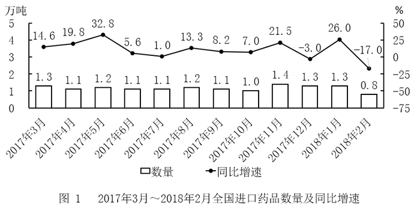

# 环比增长率计算与折线图匹配

考点：[[20-考点/资料分析/增长/环比增长率计算与折线图匹配|增长 / 环比增长率计算与折线图匹配]]
材料：[[15-材料/资料分析/199339 2017年3月至2018年2月全国进|199339 2017年3月至2018年2月全国进]]

**问法模型**：题干要求'某季度各月环比增长率'的图形匹配→用相邻月份当期柱值求环比=(当月−上月)/上月，只需估算正负与相对高低，再与选项折线走势比对

## 推理链
1. 第1步：题干锁定2017年第四季度（10、11、12月）的金额环比增长率，环比的基期是上月，故需从图2读出9—12月金额：21.9、18.4、24.0、27.8亿美元
2. 第2步：环比增长率公式=（当月值−上月值）/上月值×100%
3. 第3步：10月环比=(18.4−21.9)/21.9=−3.5/21.9≈−16%；11月环比=(24.0−18.4)/18.4=5.6/18.4≈+30%；12月环比=(27.8−24.0)/24.0=3.8/24.0≈+16%
4. 第4步：三点走势特征为：10月最低且为负值（约−16%），11月冲至最高（约+30%），12月回落但仍为正（约+16%，约为11月的一半）
5. 第5步：将'负低—正最高—正居中'的走势与四个选项折线比对，仅D图符合，故正确答案为D

**最快解法**：⚡ 截位直除+定性趋势：先定符号——10月18.4<21.9必为负，排除10月非负的选项；再比高低——11月增量5.6/基期18.4≈30%最大，12月增量3.8/基期24.0≈16%，约是11月的一半；'最低负—最高—居中'直接锁定D，无需精算百分数

## 易错点
- ⚠ 把图2折线（同比增速）误当环比增长率直接读图：折线是同比，环比必须用相邻月柱值自行相减计算
- ⚠ 漏取9月数据：10月环比的基期是9月（21.9亿美元），若只取10—12月三个月柱值则10月环比无法计算或误用同比增速替代
- ⚠ 只算数值不核正负与量级：11月约+30%与12月约+16%同号但高低差近一倍，若忽略11月为最高点易错选形态相近的其他折线

## 母题抽象
> 🧩 当题干出现'各月/各季环比增长率的折线图匹配'特征时，用相邻期当期值求环比=(现−基)/基，只估算正负号与相对高低（截位直除），再与图形走势比对验证，切勿把图中同比折线当环比

**同类特征**：第四季度各月、环比增长率、折线图、图形匹配、金额（图2取数）、需用到季度前一个月作基期

## 相关题
- [[10-真题/资料分析/增长/2377290 环比增长率计算与趋势图识别|2377290]]（选调 2019，相关度2）
- [[10-真题/资料分析/增长/5509651 环比增长率计算与趋势（折线图匹配）|5509651]]（吉林 2023，相关度2）
- [[10-真题/资料分析/增长/15833698 环比增速计算与折线趋势图匹配|15833698]]（黑龙江 2026，相关度1）
- [[10-真题/资料分析/增长/2051184 增长量比较（同比增长量趋势折线图判断）|2051184]]（黑龙江 2017，相关度1）
- [[10-真题/资料分析/增长/5893795 同比增量计算与折线趋势比对（增长量比较）|5893795]]（国考 2024，相关度1）

---

### 题干
以下折线图中，能准确反映2017年第四季度各月全国进口药品金额环比增长率的是：

### 选项
- A. A
- B. B
- C. C
- D. D　✅

### 官方解析
根据题干“2017年第四季度各月······环比增长率”，可判定本题为一般增长率问题。定位图形材料2可得：2017年9月-12月全国进口药品金额分别为21.9亿美元、18.4亿美元、24.0亿美元、27.8亿美元。根据公式：，2017年第四季度各月的环比增长率分别为：10月：；11月：；12月：。
即10月最小，11月最大。结合图像，D选项符合。
故正确答案为D。

### 给定材料

 

