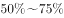

# 混合增长率（整体增速区间判定，线段法）

考点：[[20-考点/资料分析/增长/混合增长率（整体增速区间判定，线段法）|增长 / 混合增长率（整体增速区间判定，线段法）]]
材料：[[15-材料/资料分析/199338 2017年A省邮电业务（电信-邮政-|199338 2017年A省邮电业务（电信-邮政-]]

**问法模型**：题干问'整体量（邮电业务总量=电信+邮政）的同比增速落在哪个范围' → 用混合增长率'居中但不中、偏向基期量大的分量'模型锁定区间选项

## 推理链
1. 第1步：由材料第一段提取：2017年邮电业务总量6065.71亿元，其中电信业务总量3575.86亿元（增速记为a）、邮政业务总量2489.85亿元（增速记为b）；核对加总：3575.86+2489.85=6065.71，总量确为两部分之和（注：原文a、b的具体百分比因图片/公式缺失未显示，须回原卷核对，不得臆造）
2. 第2步：混合增长率规则：整体增速g必介于两分量增速a与b之间（'混合居中'），且偏向基期量大的那一方（基期量=现期量/(1+增速)）
3. 第3步：看权重：电信现期占比3575.86/6065.71≈59.0%，邮政占比2489.85/6065.71≈41.0%，现期量比约1.44:1；因a、b相差不大，基期量大小序与现期一致，故电信基期量大于邮政基期量
4. 第4步：取两分量增速的中间值m=(a+b)/2；因电信一侧基期量偏大，整体增速g应落在m偏向电信增速一侧，即g略大于中间值m（'居中但不中'）
5. 第5步：结论定位：g介于a、b之间且略高于中间值，故'低于下限'的A项被排除，'略大于中间值'的落点恰对应C区间，选C

**最快解法**：⚡ 混合居中口诀+线段法：整体增速必在电信增速a与邮政增速b之间→先排除落在两增速区间之外的A；再取中间值(a+b)/2，比较基期量3575.86/(1+a)＞2489.85/(1+b)，故整体增速在中点略偏电信一侧、略大于中点，秒锁定C

## 易错点
- ⚠ 偏向判断必须用基期量而非现期量：严格应比较3575.86/(1+a)与2489.85/(1+b)；本题两增速差距不大，用现期量1.44:1近似判断方向结论相同，但两增速悬殊时现期近似会判错偏向
- ⚠ '居中但不中'陷阱：误把整体增速当成两增速的算术中点；实际因电信基期略大，整体增速略高于中点，若中点恰压在区间边界上就会误选相邻区间
- ⚠ 口径与数据完整性：6065.71−3575.86=2489.85与邮政量吻合（注意导读中2489.86为约数）；原文两处增速百分比因图片丢失未显示，切勿凭印象补数代入，须回原卷核对

## 母题抽象
> 🧩 当题干问'整体（可拆为两部分之和）的增速落在哪个范围'时，用混合增长率：整体增速介于两分量增速之间、偏向基期量大的分量；先取两增速中间值，再按基期量大小向大的一侧微调，即可锁定区间选项

**同类特征**：整体量=两分量之和（邮电=电信+邮政）、问整体同比增速所在区间、选项为'低于/之间/超过'型区间、两分项增速均已在材料给出、混合增长率

## 相关题
- [[10-真题/资料分析/增长/12536411 混合增长率（整体=限上+限下，线段法-口诀定区间）|12536411]]（四川 2024，相关度1）
- [[10-真题/资料分析/增长/2049536 混合增长率（多主体合计-平均增速，居中偏向基期量大）|2049536]]（新疆 2017，相关度1）
- [[10-真题/资料分析/增长/2049720 混合增长率（居中偏向）|2049720]]（山东 2017，相关度1）
- [[10-真题/资料分析/增长/2050992 混合增长率（居中原则-线段法）|2050992]]（江西 2017，相关度1）
- [[10-真题/资料分析/增长/2274485 混合增速（全年-上半年-下半年增速大小关系推断与计数）|2274485]]（北京 2019，相关度1）

---

### 题干
2017年A省邮电业务总量同比增速在以下哪个范围之内？

### 选项
- A. 
低于

- B. 
之间

- C. 
之间
　✅
- D. 
超过

### 官方解析

根据“2017年A省邮电业务总量同比增速在以下哪个范围”，且材料已知电信业务和邮政业务的增长率，可判断此题为混合增长率问题。定位文字材料第一段，“2017年，A省完成邮电业务总量6065.71亿元。其中，电信业务总量3575.86亿元，同比增长；邮政业务总量2489.85亿元，增长”，根据混合增长率的口诀：混合居中但不中，偏向基期大的部分。由此可得A省邮电业务总量的增长率应介于和之间，结合选项可排除A。和的中间值为，又电信业务总量基期为亿元，邮政业务总量基期为亿元，电信业务总量略大于邮政业务总量，所以混合增长率略大于中间值，对应C项。

故正确答案为C。

### 给定材料

        2017年，A省完成邮电业务总量6065.71亿元。其中，电信业务总量3575.86亿元，同比增长；邮政业务总量2489.85亿元，增长。

        2017年，A省移动电话期末用户1.48亿户，比上年末增长。其中，4G期末用户达1.18亿户，比上年末增长。互联网宽带接入期末用户3128万户，比上年末增长。移动互联网期末用户1.31亿户，比上年末增长，移动互联网接入流量同比增长。

        2017年，全省全年完成快递业务量100.51亿件，同比增长。其中，同城快递业务量增长，异地快递业务量增长，国际和港澳台地区快递业务量增长。

        2017年，A省完成客运总量148339万人次，同比增长，增幅比前三季度提高0.2个百分点，比上年提高0.5个百分点；完成旅客周转总量4143.84亿人公里，增长，增幅比前三季度提高0.7个百分点，比上年提高1.8个百分点。

        2017年，A省完成高铁客运量17872万人次，旅客周转量474.64亿人公里，同比分别增长和。高铁客运量和旅客周转量分别占铁路旅客运输总量的和，比重比上年分别提高4.3个和3.9个百分点。

> [!warning] 疑点（官方解析可能有误，待人工复核）
> 材料原文中电信、邮政业务总量增速的具体百分比数值缺失（疑为原卷公式/图片丢失），官方解析亦未给出可读数值，故无法从给定文本复核C区间端点的具体数字；混合增长率方法与答案C的判定逻辑成立，但区间端点数值须回原卷核对补齐

<!-- CODEX-ANSWER-REVIEW:BEGIN -->
### 本次独立复核

**复核状态：** `confirmed`（独立复算确认答案）

**计分答案：** C（可计分）

**复核解析：**

原图中电信、邮政当前量分别为3575.86和2489.85，增速75.8%与32.0%；按各自基期量加权后总增速约54.7%，位于C项区间。

**相关信息：**

整体增速介于分项增速之间并偏向基期量大的分项。

**题源依据：** [固定版本原题](https://github.com/Mentat-Uran/kaogongzhentizhengliu/blob/84ab93d4b64b61d897bece8a1c0a5bab06b4feb2/10-%E7%9C%9F%E9%A2%98/%E8%B5%84%E6%96%99%E5%88%86%E6%9E%90/%E5%A2%9E%E9%95%BF/2264427%20%E6%B7%B7%E5%90%88%E5%A2%9E%E9%95%BF%E7%8E%87%EF%BC%88%E6%95%B4%E4%BD%93%E5%A2%9E%E9%80%9F%E5%8C%BA%E9%97%B4%E5%88%A4%E5%AE%9A%EF%BC%8C%E7%BA%BF%E6%AE%B5%E6%B3%95%EF%BC%89.md)；固定内容 commit `84ab93d4b64b61d897bece8a1c0a5bab06b4feb2`，Markdown blob `074ef53765bb2bb1283201208895f0eb8ac98497`。
<!-- CODEX-ANSWER-REVIEW:END -->
