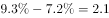

# 两个同比增速之差比较（百分点作差）

考点：[[20-考点/资料分析/增长/两个同比增速之差比较（百分点作差）|增长 / 两个同比增速之差比较（百分点作差）]]
材料：[[15-材料/资料分析/200303 2017年上半年B市第三产业总体及信|200303 2017年上半年B市第三产业总体及信]]

**问法模型**：题干问'A的同比增速比B的同比增速高/低多少个百分点'→ 同一年份两个增速直接相减（部分增速−总体增速），差为正选'高'、为负选'低'，单位为个百分点

## 推理链
1. 第1步：题干要求比较2017年上半年信息传输、软件和信息技术服务业增加值（现期1319.5亿元）的同比增速与第三产业增加值（现期10198.2亿元）的同比增速
2. 第2步：规则：两个同期增速比较无需涉及增加值绝对量，直接作差，差值单位是'个百分点'，正值为'高'、负值为'低'
3. 第3步：定位材料第二段'信息传输、软件和信息技术服务业增加值同比增长'与第一段'第三产业增加值同比增长'两处增速（所给文本数值空缺，按官方解析还原），信息服务业增速−第三产业增速=+2.1个百分点
4. 第4步：差值为正2.1个百分点，即信息服务业增速比第三产业高2.1个百分点，对照选项选B

**最快解法**：⚡ 定位作差法：分别圈出材料第二段信息服务业增速与第一段第三产业增速，直接相减得2.1，差为正→直接锁定'高2.1个百分点'（B）；增加值1319.5亿元、10198.2亿元两个绝对量完全用不上，不要误入除法计算

## 易错点
- ⚠ 材料所给文本两处增速数值均空缺，必须回查原完整材料取数，切勿凭空补数，或误用其他段落增速（如电信业务量增速、科研服务业'扩大1.4个百分点'）代入作差
- ⚠ 作差顺序易反：须用'部分（信息服务业）增速−总体（第三产业）增速'，差为正才是'高'；搞反相减顺序会误选A（低2.1个百分点）
- ⚠ '个百分点'与'%'不能混用：增速之差只能表述为'高2.1个百分点'；干扰项C/D的31.6个百分点为数据错配陷阱，别把不同行业/指标的增速拿来相减

## 母题抽象
> 🧩 当题干出现'某部分（行业）同比增速比总体同比增速高/低多少个百分点'的特征时，直接定位两个增速作差（部分−总体），差为正选'高'、为负选'低'，单位是'个百分点'而非'%'，完全不涉及现期值绝对量计算

**同类特征**：增速比…高/低、个百分点、信息传输、软件和信息技术服务业、第三产业增加值、同比增速作差、同一报告期（2017年上半年）

## 相关题
- [[10-真题/资料分析/增长/10718183 名义增速与实际增速之差（百分点计算）|10718183]]（深圳市考 2024，相关度1）
- [[10-真题/资料分析/比重/16070258 现期比重差值（两个部分占比相减）|16070258]]（重庆 2026，相关度1）
- [[10-真题/资料分析/比重/1752600 两期比重变化（比重差，百分点表述）|1752600]]（北京 2016，相关度1）
- [[10-真题/资料分析/比重/1789664 比重差值计算（百分点搭桥）|1789664]]（江苏 2016，相关度1）
- [[10-真题/资料分析/比重/2042846 两期比重差（比重差值计算）|2042846]]（江苏 2017，相关度1）

---

### 题干
2017年上半年，B市信息传输、软件和信息技术服务业实现增加值同比增速比第三产业实现增加值同比增速

### 选项
- A. 低2.1个百分点
- B. 高2.1个百分点　✅
- C. 低31.6个百分点
- D. 高31.6个百分点

### 官方解析

定位文字材料第二段可得“2017年上半年，信息传输、软件和信息技术服务业实现增加值同比增长”；定位材料第一段可得“2017年上半年，B市第三产业实现增加值同比增长”。则个百分点，即高2.1个百分点。

故正确答案为B。

### 给定材料

<b>根据下列统计资料回答问题</b>

        2017年上半年，B市全市第三产业实现增加值10198.2亿元，按可比价计算，同比增长。

上半年，信息传输、软件和信息技术服务业实现增加值1319.5亿元，同比增长；累计完成电信业务量361.1亿元，同比增长；科学研究和技术服务业实现增加值1211.8亿元，同比增长，比一季度增幅扩大1.4个百分点。

        上半年，旅客周转量同比增长；货物周转量由上年的下降转为增长，其中铁路同比增长，民航同比增长。上半年，快递业务量累计达到9.9亿件，同比增长；交通运输、仓储和邮政业实现增加值554.2亿元，同比增长，增幅比上年同期扩大7.8个百分点。

        上半年，批发和零售业实现增加值1190.6亿元，同比增长，增幅比上年同期扩大7.1个百分点。第二季度，全市实现电子商务交易额8324.5亿元，同比增长。

        上半年，B市规模以上文化创意产业法人单位、战略性新兴产业法人单位、高技术服务业法人单位分别实现收入6902.7亿元、3870.0亿元和6924.9亿元，同比分别增长、和。

        上半年，服务业扩大开放六大重点领域的规模以上非公有制经济单位实现收入7864.6亿元，同比增长，快于六大重点领域整体增速8.0个百分点，占六大重点领域整体收入的比重为，比上年同期提高1.1个百分点。

> [!warning] 疑点（官方解析可能有误，待人工复核）
> 所给材料文本及官方解析中两处同比增速的具体数值均空缺（解析公式处亦为空），本题计算依赖原完整材料补数；按官方答案口径，两增速之差为+2.1个百分点、方向为'高'，与选项B一致，仅数据展示不完整，不构成答案错误

<!-- CODEX-ANSWER-REVIEW:BEGIN -->
### 本次独立复核

**复核状态：** `resolved`（答案与解析已核定）

**计分答案：** B（可计分）

**复核解析：**

2017上半年信息传输、软件和信息技术服务业增加值同比增速9.3%，第三产业同比增速7.2%；差为+2.1个百分点，信息传输等行业较高，选B。原材料/解析文字有空白，公式图恢复了两个数值。

**相关信息：**

百分点差是两个增长率相减；“高”对应正差。

**题源依据：** [固定版本原题](https://github.com/Mentat-Uran/kaogongzhentizhengliu/blob/84ab93d4b64b61d897bece8a1c0a5bab06b4feb2/10-%E7%9C%9F%E9%A2%98/%E8%B5%84%E6%96%99%E5%88%86%E6%9E%90/%E5%A2%9E%E9%95%BF/2274495%20%E4%B8%A4%E4%B8%AA%E5%90%8C%E6%AF%94%E5%A2%9E%E9%80%9F%E4%B9%8B%E5%B7%AE%E6%AF%94%E8%BE%83%EF%BC%88%E7%99%BE%E5%88%86%E7%82%B9%E4%BD%9C%E5%B7%AE%EF%BC%89.md)；固定内容 commit `84ab93d4b64b61d897bece8a1c0a5bab06b4feb2`，Markdown blob `04c833743357093e5a5ab060ee88fddcd767635e`。
<!-- CODEX-ANSWER-REVIEW:END -->
