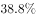

# 混合增长率（混合增速大小居中定区间）

考点：[[20-考点/资料分析/增长/混合增长率（混合增速大小居中定区间）|增长 / 混合增长率（混合增速大小居中定区间）]]
材料：[[15-材料/资料分析/200303 2017年上半年B市第三产业总体及信|200303 2017年上半年B市第三产业总体及信]]

**问法模型**：题干给出上半年累计增速'比一季度增幅扩大1.4个百分点'，求第二季度单季同比增速的范围 → 识别为混合增长率问题，用'大小居中'原则：上半年增速介于一季度与二季度增速之间，再结合扩大方向定界

## 推理链
1. 第1步：定位材料第二段：2017年上半年科学研究和技术服务业实现增加值1211.8亿元，上半年同比增速为a%（原完整材料数值），且'比一季度增幅扩大1.4个百分点'，故2017年一季度增速为(a−1.4)%
2. 第2步：上半年累计增速是一季度增速与第二季度增速按对应基期量加权的混合增长率，依据'混合增长率，大小居中'，上半年增速a%必严格介于(a−1.4)%与第二季度增速之间
3. 第3步：比较方向：a%>（a−1.4）%，即上半年增速高于一季度增速，居中关系只能是 二季度增速＞a%＞（a−1.4）%
4. 第4步：对照选项临界值：一季度增速（a−1.4）%对应选项中ER93所代表的数值，上半年增速a%对应选项中8lHC所代表的数值；第二季度增速＞上半年增速a%，即大于8lHC所代表的临界值
5. 第5步：故第二季度同比增速的范围是大于上半年增速（大于8lHC临界值），选D，与官方解析结论一致

**最快解法**：⚡ 结论秒杀法（混合增速居中，零计算）：上半年增速=一季度增速+1.4个百分点＞一季度增速 ⇒ 上半年增速居中 ⇒ 第二季度单季增速必＞上半年增速，直接锁定'大于上半年增速'的D项，无需代入1211.8亿元或任何具体增速数值

## 易错点
- ⚠ '增幅扩大1.4个百分点'是百分点的差值，误当作增速数值本身，或与%混算（百分点差只能用于增速之间作差比较）
- ⚠ 方向搞反：误以为第二季度增速介于'一季度增速与上半年增速之间'或小于上半年增速；居中原则下应为第二季度增速＞上半年累计增速
- ⚠ 时间口径：上半年为1—6月累计值，需拆为一、二季度两期做混合，误把二季度增速当成与上半年增速相等（错选'等于'类选项）或直接与一季度增速比较

## 母题抽象
> 🧩 当题干出现'累计期（如上半年）增速比前期（如一季度）增幅扩大/收窄X个百分点，求后期单季增速范围'时，用混合增长率'大小居中'：扩大⇒后期单季增速＞累计增速，收窄⇒后期单季增速＜累计增速，只看方向即可秒选区间，无需具体数值

**同类特征**：求第二季度单季同比增速的范围、比一季度增幅扩大1.4个百分点、混合增长率大小居中、累计值拆分单季、区间型选项（小于/等于/介于/大于）、无需具体数值即可定界

## 相关题
（暂无）

---

### 题干
2017年第二季度，B市科学研究和技术服务业实现增加值的同比增速的范围是

### 选项
- A. 
小于

- B. 
等于

- C. 
大于且小于等于

- D. 
大于
　✅

### 官方解析
由题干“2017年第二季度，B市······同比增速的范围是”，定位文字材料第二段可得“2017年上半年，科学研究和技术服务业实现增加值······同比增长，比一季度增幅扩大1.4个百分点”，即2017年一季度增速为。由于“”，故上半年增速为第一季度和第二季度增速的混合增速，判定本题为混合增长率问题。根据结论“混合增长率，大小居中”，可得。即2017年第二季度同比增速的范围是大于。
故正确答案为D。

### 给定材料

<b>根据下列统计资料回答问题</b>

        2017年上半年，B市全市第三产业实现增加值10198.2亿元，按可比价计算，同比增长。

上半年，信息传输、软件和信息技术服务业实现增加值1319.5亿元，同比增长；累计完成电信业务量361.1亿元，同比增长；科学研究和技术服务业实现增加值1211.8亿元，同比增长，比一季度增幅扩大1.4个百分点。

        上半年，旅客周转量同比增长；货物周转量由上年的下降转为增长，其中铁路同比增长，民航同比增长。上半年，快递业务量累计达到9.9亿件，同比增长；交通运输、仓储和邮政业实现增加值554.2亿元，同比增长，增幅比上年同期扩大7.8个百分点。

        上半年，批发和零售业实现增加值1190.6亿元，同比增长，增幅比上年同期扩大7.1个百分点。第二季度，全市实现电子商务交易额8324.5亿元，同比增长。

        上半年，B市规模以上文化创意产业法人单位、战略性新兴产业法人单位、高技术服务业法人单位分别实现收入6902.7亿元、3870.0亿元和6924.9亿元，同比分别增长、和。

        上半年，服务业扩大开放六大重点领域的规模以上非公有制经济单位实现收入7864.6亿元，同比增长，快于六大重点领域整体增速8.0个百分点，占六大重点领域整体收入的比重为，比上年同期提高1.1个百分点。

> [!warning] 疑点（官方解析可能有误，待人工复核）
> 所给材料文本中上半年增速、一季度增速数值均空缺，选项LaTeX临界值未能读取；按混合居中逻辑，D项临界值应为上半年同比增速原值，ER93临界值应为其减1.4个百分点（即一季度增速），具体数值需回查完整原题材料核对；官方解析逻辑无误，答案D维持不变
