# 同比增速比较+增长率计算（增速最快年份锁定与该年增速求解）

考点：[[20-考点/资料分析/增长/同比增速比较+增长率计算（增速最快年份锁定与该年增速求解）|增长 / 同比增速比较+增长率计算（增速最快年份锁定与该年增速求解）]]
材料：[[15-材料/资料分析/200304 2009～2015年我国会展业发展状|200304 2009～2015年我国会展业发展状]]

**问法模型**：题干为'2010～2015年间同比增速最快的一年，展出面积较上年约增加了（多少）'→先逐年比较同比增速锁定年份，再对该年份套用'（现期−基期）/基期'求解

## 推理链
1. 第1步：从表格'展览会展出面积'行（万平方米）提取2009～2015年数据：4990、7440、8120、8990、9391、10276、11798
2. 第2步：规则：同比增速=（现期−基期）/基期；'2010～2015年'区间内2010年的基期是2009年，必须用表格首列数据
3. 第3步：快速锁定：2010年分子（增量7440−4990=2450）为6个年份中最大，分母（基期4990）为最小，故其同比增速必然最大，无需逐项精算
4. 第4步：验证次大者：2015年增速=1522/10276≈15%，远低于2010年，确认2010年为增速最快年份
5. 第5步：代入计算：2010年展出面积较上年增加2450万平方米，同比增速=2450/4990≈49%
6. 第6步：与选项对照：约49%（对应增加2450万平方米）即为D选项

**最快解法**：⚡ 分子最大分母最小法：比较各年增量与基期，2010年增量2450万平方米最大且基期4990最小，直接锁定增速最快年份；再截位直除2450/4990≈2450/5000≈49%，命中D。由官方解析，看出D已是四选项中最大值后，其余年份增速可不算。

## 易错点
- ⚠ 基期口径：问'2010～2015年'增速时，2010年增速必须用2009年（表格首列）数据作基期，漏用首列易误判2015年（≈15%）为增速最快年份
- ⚠ 增量与增速混淆：先比增速锁定2010年，再求该年表现；2450万平方米是增量、约49%是增速，对应选项时勿张冠李戴
- ⚠ 同名指标口径：'展览会展出面积'（千位级万平方米，2010年为7440）与'出境参展净面积'（十位级万平方米）主体和量级完全不同，勿串行取数

## 母题抽象
> 🧩 当题干出现'某区间内同比增速最快的年份，该指标较上年增加/增长…'时，用'分子（同比增量）最大且分母（基期）最小'一步锁定年份，再对该年份做一次截位直除验证增速值，无需逐年精算全部增速

**同类特征**：同比增速最快的一年、较上年约增加了、展览会展出面积、2010～2015年区间、两步问法：先比较后计算

## 相关题
- [[10-真题/资料分析/倍数/2742293 同比增量倍数（需先做同比增速比较定位年份）|2742293]]（北京 2021，相关度1）
- [[10-真题/资料分析/增长/2144733 增长量计算（增长量=现期×r-(1+r)）|2144733]]（新疆 2017，相关度1）
- [[10-真题/资料分析/增长/2571789 增长量计算（现期量与同比增速已知）|2571789]]（山东 2020，相关度1）

---

### 题干
2010～2015年间，我国展览会展出面积同比增速最快的一年，展览会展出面积较上年约增加了

### 选项
- A. 
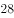

- B. 
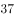

- C. 
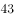

- D. 
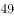
　✅

### 官方解析

由题干“2010-2015年间，……展览会展出面积较上年约增加了”，结合材料已知时间为2009-2015，结合选项为百分数，可判定本题为一般增长率问题。定位材料可得：

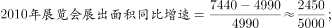

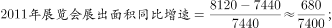

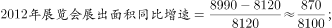

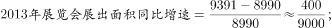

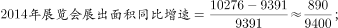

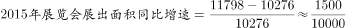，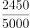分子最大，分母最小，可得2010-2015年间，我国展览会展出面积同比增速最快的为2010年，故2010-2015年间，我国展览会展出面积同比增速最快的一年，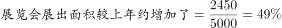，即为D选项。

实际上如果大家看出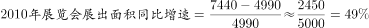，已经是四个选项中最大的D选项，后面几年的同比增速就不需要列出了。

故正确答案为D。

### 给定材料

<b>根据下列统计资料回答问题</b>

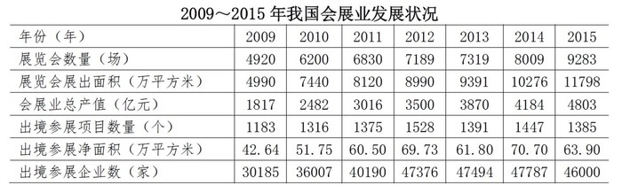

> [!warning] 疑点（官方解析可能有误，待人工复核）
> 官方解析称'结合选项为百分数，可判定本题为一般增长率问题'，而题干文字'较上年约增加了'字面上似问增长量（2450万平方米）；按官方口径答案D对应2010年增速2450/4990≈49%（即增加2450万平方米那一项），口径以选项为准，不影响正确答案D
