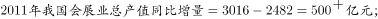
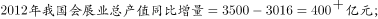
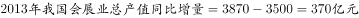
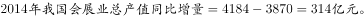

# 同比增长量计算+折线图趋势匹配

考点：[[20-考点/资料分析/增长/同比增长量计算+折线图趋势匹配|增长 / 同比增长量计算+折线图趋势匹配]]
材料：[[15-材料/资料分析/200304 2009～2015年我国会展业发展状|200304 2009～2015年我国会展业发展状]]

**问法模型**：题干问'2011～2014年总产值同比增量的变化情况（折线图）'→ 采用逐差法模型：逐年'现期产值-上年产值'求增量，再按增量序列的升降形态与选项折线比对。

## 推理链
1. 第1步：从表格'会展业总产值（亿元）'行沿行横读提取数据：2010年2482、2011年3016、2012年3500、2013年3870、2014年4184（2011年增量需以2010年为基期）
2. 第2步：同比增量=现期值-上年值（基期值为上年当期值，非固定基期）
3. 第3步：代入逐年计算：2011年=3016-2482=534；2012年=3500-3016=484；2013年=3870-3500=370；2014年=4184-3870=314（亿元）
4. 第4步：增量序列534→484→370→314，逐年减小、单调递减
5. 第5步：对照四个折线图选项，只有A项呈逐年下降趋势，故正确答案为A

**最快解法**：⚡ 逐差法+趋势定性判断：口算各年增量534、484、370、314（百位级减法，尾数辅助校验），发现单调递减后直接锁定唯一递减折线A，无需精算各选项折线的具体数值刻度。

## 易错点
- ⚠ '增量'与'增速'/'总量'混淆：总产值本身逐年上升（2482→4184），但同比增量逐年下降（534→314），若误按总产值走势或增速走势选图会选错
- ⚠ 基期取错：2011年的增量必须用2010年产值2482作基期（需用到表格前部列数据），不能漏掉2010年或错用2009年1817
- ⚠ 区间口径：折线图为2011～2014年共4个数据点，不要把2015年增量（4803-4184=619）或2010年增量（2482-1817=665）画入图中；同时注意纵轴量级为几百亿元，非数千亿元

## 母题抽象
> 🧩 当题干出现'某指标XX～XX年同比增量的变化情况（折线图）'特征时，用逐差法逐年求'现期-上年'增量，验证首年基期为区间前一年数据，再按增量序列升降形态与折线选项匹配。

**同类特征**：同比增量的变化情况、折线图匹配、2011～2014年区间、会展业总产值、单位：亿元、增长量计算而非增长率

## 相关题
- [[10-真题/资料分析/增长/12882030 累计转当期+环比增长率计算与趋势匹配|12882030]]（内蒙古 2025，相关度1）
- [[10-真题/资料分析/增长/19526226 同比增量计算与图形匹配（增长量比较-排除法）|19526226]]（国考 2026，相关度1）
- [[10-真题/资料分析/增长/2028362 增长量比较（逐年同比增量计算＋折线趋势图匹配）|2028362]]（国考 2017，相关度1）
- [[10-真题/资料分析/增长/2434297 一般增长率计算与折线图匹配（增长率走势比较）|2434297]]（新疆 2019，相关度1）
- [[10-真题/资料分析/增长/2448416 增长量比较（逐年同比增量序列与折线图趋势匹配）|2448416]]（国考 2020，相关度1）

---

### 题干

以下哪项的折线图可以准确表现2011～2014年间，我国会展业总产值同比增量的变化情况（单位：亿元）？

### 选项
- A. A　✅
- B. B
- C. C
- D. D

### 官方解析

由题干“……我国会展业总产值同比增量的变化情况”，可判定本题为增长量计算问题。定位材料可得，

；

即2011-2014年间，我国会展业总产值同比增量逐年下降，只有A项的折线图可以准确表现。

故正确答案为A。

### 给定材料

<b>根据下列统计资料回答问题</b>

